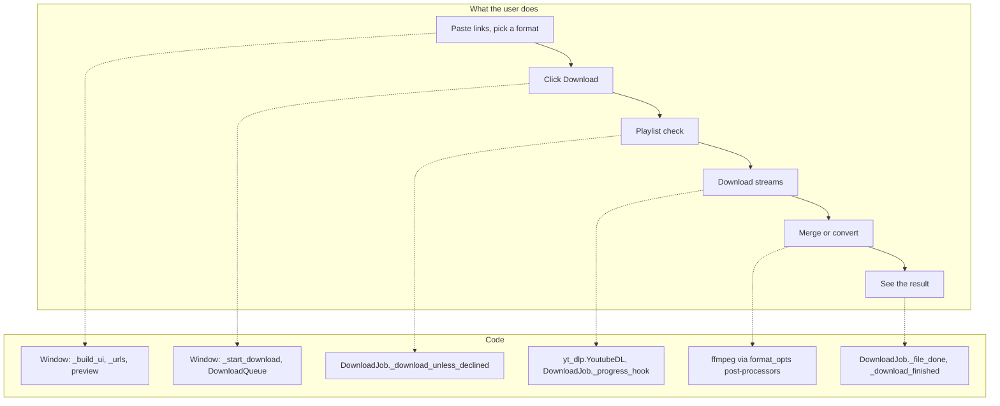

# 1 Overview

Relevant source files

- [README.md](https://github.com/lifeupnorth/YouTubeDownloader/blob/b369bd269cac691e2563e27391dbd3702c986e50/README.md)
- [LICENSE](https://github.com/lifeupnorth/YouTubeDownloader/blob/b369bd269cac691e2563e27391dbd3702c986e50/LICENSE)
- [youtube_downloader.py](https://github.com/lifeupnorth/YouTubeDownloader/blob/b369bd269cac691e2563e27391dbd3702c986e50/youtube_downloader.py)
- [download_engine.py](https://github.com/lifeupnorth/YouTubeDownloader/blob/b369bd269cac691e2563e27391dbd3702c986e50/download_engine.py)
- [requirements.txt](https://github.com/lifeupnorth/YouTubeDownloader/blob/b369bd269cac691e2563e27391dbd3702c986e50/requirements.txt)
- [packaging/build_exe.py](https://github.com/lifeupnorth/YouTubeDownloader/blob/b369bd269cac691e2563e27391dbd3702c986e50/packaging/build_exe.py)
- [.github/workflows/build-exe.yml](https://github.com/lifeupnorth/YouTubeDownloader/blob/b369bd269cac691e2563e27391dbd3702c986e50/.github/workflows/build-exe.yml)
- [.github/dependabot.yml](https://github.com/lifeupnorth/YouTubeDownloader/blob/b369bd269cac691e2563e27391dbd3702c986e50/.github/dependabot.yml)

**YouTubeDownloader** is a small desktop app, written in Python with Tkinter, for downloading YouTube videos and audio. It's a graphical front end for [yt-dlp](https://github.com/yt-dlp/yt-dlp): you paste one or more links, pick a format and a folder, and click Download. yt-dlp does the extraction and downloading, ffmpeg merges and converts the files, and a JavaScript runtime (deno, node or bun) runs yt-dlp-ejs, which solves YouTube's challenges. The app adds the window, previews, progress reporting, playlist safeguards, a download queue, Cancel, and the lookup of ffmpeg and the JavaScript runtime around them.

It runs from source with Python, or as `YT-Downloader.exe`, a one-file Windows app built with PyInstaller that includes Python, yt-dlp, Pillow, ffmpeg and deno. GitHub Actions builds the .exe and attaches it to each release: one for every version tag, and one automatically whenever the yt-dlp pin on `main` differs from the latest release's. The .exe checks for a newer release at most once a day, unless that's turned off.

The code is split in two, plus the packaging scripts:

- **`youtube_downloader.py`** is the window: widgets, settings, dialogs, the update check, and the plumbing that gets updates from background threads onto the screen. It also has a check-only command-line mode, `--self-check`.
- **`download_engine.py`** does the work without any Tk: it finds yt-dlp, ffmpeg and a JavaScript runtime, builds yt-dlp's options, previews links, asks GitHub for the latest release, and runs downloads (`DownloadJob` for one link, `DownloadQueue` for several in a row).
- **`packaging/`** builds and checks the .exe, and looks for newer ffmpeg and deno builds.

The pages in this wiki:

- [Getting Started](02-getting-started.md): requirements, running from source or as the .exe, building and releasing the .exe, settings, tests
- [Architecture and Threading](03-architecture.md): the two modules, and how worker threads update the window safely
- [Download Pipeline](04-download-pipeline.md): what happens from clicking Download to the final summary, including playlists, several links and Cancel
- [Formats and ffmpeg](05-formats-ffmpeg.md): how each format choice maps to yt-dlp options, and how ffmpeg is found
- [User Interface](06-user-interface.md): widgets, bindings, status colors, previews and dialogs
- [Testing](07-testing.md): the unit tests and the CI
- [Glossary](08-glossary.md)

Sources: [README.md:1-56](https://github.com/lifeupnorth/YouTubeDownloader/blob/b369bd269cac691e2563e27391dbd3702c986e50/README.md#L1-L56), [download_engine.py:1-7](https://github.com/lifeupnorth/YouTubeDownloader/blob/b369bd269cac691e2563e27391dbd3702c986e50/download_engine.py#L1-L7), [youtube_downloader.py:2-8](https://github.com/lifeupnorth/YouTubeDownloader/blob/b369bd269cac691e2563e27391dbd3702c986e50/youtube_downloader.py#L2-L8), [youtube_downloader.py:1027-1034](https://github.com/lifeupnorth/YouTubeDownloader/blob/b369bd269cac691e2563e27391dbd3702c986e50/youtube_downloader.py#L1027-L1034), [packaging/build_exe.py:1-13](https://github.com/lifeupnorth/YouTubeDownloader/blob/b369bd269cac691e2563e27391dbd3702c986e50/packaging/build_exe.py#L1-L13), [.github/workflows/build-exe.yml:1-13](https://github.com/lifeupnorth/YouTubeDownloader/blob/b369bd269cac691e2563e27391dbd3702c986e50/.github/workflows/build-exe.yml#L1-L13)

## Key capabilities

| Capability | Where |
|---|---|
| Six formats: Best MP4, 1080p, 720p, 480p, MP3, M4A; resolution choices fall back to the nearest available instead of failing | `engine.format_opts` |
| Several links in a row, one per line; a failed link doesn't stop the others | `engine.DownloadQueue`, `_urls` |
| Safe playlist handling: a single video by default; asks before downloading a whole playlist, channel or tab; skips unavailable entries; numbered files in a per-playlist folder | `DownloadJob._download_unless_declined`, `DownloadJob.options` |
| One progress bar across video and audio streams, with "Link n/N" and "Video n/N" | `DownloadJob._progress_hook` |
| Link preview: thumbnail, title, and length or playlist size; a newer link stops the older lookup | `engine.preview_link`, `_start_preview` |
| Cancel, which stops a running ffmpeg, removes only the files this run wrote for the unfinished video, and skips links still waiting | `DownloadJob.stop_processes`, `DownloadJob._remove_partial_files`, `_cancel_download` |
| Open folder button after a download instead of a pop-up; last folder and format remembered | `_open_folder`, `load_settings` |
| ffmpeg detection at startup and before each download (the .exe's bundled copy first), including a Windows install made while the app is open | `engine.find_ffmpeg`, `_recheck_ffmpeg` |
| JavaScript runtime lookup on a worker: the .exe's bundled deno, else deno, node or bun on PATH; a note in the log when there's none | `engine.find_js_runtime`, `_find_js_runtime_thread` |
| From source: installs the pinned yt-dlp when it's missing and uses it without a restart; shows the version in use | `_install_ytdlp`, `engine.load_yt_dlp` |
| Release .exe only: a line in the log when a newer release is out, checked at most once a day while "Check for updates at startup" is on | `engine.check_for_update`, `_maybe_check_for_update` |
| A window that stays responsive: downloads run on a worker thread, UI updates go through a queue, and a crash in a worker or a Tk callback ends up in the log | `_post`, `_poll_ui_queue`, `_run_worker`, `report_callback_exception` |

Sources: [download_engine.py:112-161](https://github.com/lifeupnorth/YouTubeDownloader/blob/b369bd269cac691e2563e27391dbd3702c986e50/download_engine.py#L112-L161), [download_engine.py:164-210](https://github.com/lifeupnorth/YouTubeDownloader/blob/b369bd269cac691e2563e27391dbd3702c986e50/download_engine.py#L164-L210), [download_engine.py:220-302](https://github.com/lifeupnorth/YouTubeDownloader/blob/b369bd269cac691e2563e27391dbd3702c986e50/download_engine.py#L220-L302), [download_engine.py:466-503](https://github.com/lifeupnorth/YouTubeDownloader/blob/b369bd269cac691e2563e27391dbd3702c986e50/download_engine.py#L466-L503), [download_engine.py:506-759](https://github.com/lifeupnorth/YouTubeDownloader/blob/b369bd269cac691e2563e27391dbd3702c986e50/download_engine.py#L506-L759), [download_engine.py:762-897](https://github.com/lifeupnorth/YouTubeDownloader/blob/b369bd269cac691e2563e27391dbd3702c986e50/download_engine.py#L762-L897), [youtube_downloader.py:62-91](https://github.com/lifeupnorth/YouTubeDownloader/blob/b369bd269cac691e2563e27391dbd3702c986e50/youtube_downloader.py#L62-L91), [youtube_downloader.py:483-489](https://github.com/lifeupnorth/YouTubeDownloader/blob/b369bd269cac691e2563e27391dbd3702c986e50/youtube_downloader.py#L483-L489), [youtube_downloader.py:541-614](https://github.com/lifeupnorth/YouTubeDownloader/blob/b369bd269cac691e2563e27391dbd3702c986e50/youtube_downloader.py#L541-L614), [youtube_downloader.py:737-797](https://github.com/lifeupnorth/YouTubeDownloader/blob/b369bd269cac691e2563e27391dbd3702c986e50/youtube_downloader.py#L737-L797), [youtube_downloader.py:799-858](https://github.com/lifeupnorth/YouTubeDownloader/blob/b369bd269cac691e2563e27391dbd3702c986e50/youtube_downloader.py#L799-L858), [youtube_downloader.py:860-958](https://github.com/lifeupnorth/YouTubeDownloader/blob/b369bd269cac691e2563e27391dbd3702c986e50/youtube_downloader.py#L860-L958)

## From concepts to code

Sources: [youtube_downloader.py:229-419](https://github.com/lifeupnorth/YouTubeDownloader/blob/b369bd269cac691e2563e27391dbd3702c986e50/youtube_downloader.py#L229-L419), [youtube_downloader.py:651-690](https://github.com/lifeupnorth/YouTubeDownloader/blob/b369bd269cac691e2563e27391dbd3702c986e50/youtube_downloader.py#L651-L690), [download_engine.py:171-210](https://github.com/lifeupnorth/YouTubeDownloader/blob/b369bd269cac691e2563e27391dbd3702c986e50/download_engine.py#L171-L210), [download_engine.py:599-633](https://github.com/lifeupnorth/YouTubeDownloader/blob/b369bd269cac691e2563e27391dbd3702c986e50/download_engine.py#L599-L633), [download_engine.py:643-658](https://github.com/lifeupnorth/YouTubeDownloader/blob/b369bd269cac691e2563e27391dbd3702c986e50/download_engine.py#L643-L658), [download_engine.py:660-709](https://github.com/lifeupnorth/YouTubeDownloader/blob/b369bd269cac691e2563e27391dbd3702c986e50/download_engine.py#L660-L709), [youtube_downloader.py:752-780](https://github.com/lifeupnorth/YouTubeDownloader/blob/b369bd269cac691e2563e27391dbd3702c986e50/youtube_downloader.py#L752-L780)

## Tech stack

| Component | Role |
|---|---|
| Python 3.10+ | Language (the pinned yt-dlp needs 3.10); the .exe is built with Python 3.14 |
| Tkinter / ttk | Window and widgets, standard library |
| yt-dlp | Extraction, format selection, downloading, post-processing; pinned as `yt-dlp[default]` in `requirements.txt`. The `default` extra brings yt-dlp-ejs and libraries such as requests, websockets and brotli; the .exe leaves out mutagen, which the app doesn't use |
| JavaScript runtime | deno (yt-dlp's default), node or bun, which runs yt-dlp-ejs to solve YouTube's challenges; without one, some formats may be missing. The .exe bundles deno |
| ffmpeg | External tool for merging, remuxing and audio conversion; the .exe bundles gyan.dev's "essentials" build |
| Pillow | Optional: thumbnails in the link preview (also pinned) |
| PyInstaller | Builds the .exe; pinned with its dependencies' hashes in `packaging/requirements-build.txt` |
| unittest, ruff | Tests (standard library) and lint (pinned in `requirements-dev.txt`) |

Dependabot proposes updates to the pins: daily for `requirements.txt`, weekly for PyInstaller and the GitHub Actions versions. The ffmpeg and deno builds the .exe bundles are pinned in `packaging/build_exe.py` with their SHA-256 checksums, which Dependabot can't see, so the weekly "Bundled programs" workflow opens an issue when either has a newer release. The project is licensed under MIT; the licenses of the bundled programs are in `packaging/THIRD-PARTY-NOTICES.txt` (an overview) and in the `THIRD-PARTY-LICENSES.txt` the build writes (the full texts).

Sources: [requirements.txt:6-14](https://github.com/lifeupnorth/YouTubeDownloader/blob/b369bd269cac691e2563e27391dbd3702c986e50/requirements.txt#L6-L14), [requirements-dev.txt](https://github.com/lifeupnorth/YouTubeDownloader/blob/b369bd269cac691e2563e27391dbd3702c986e50/requirements-dev.txt), [packaging/requirements-build.txt:1-5](https://github.com/lifeupnorth/YouTubeDownloader/blob/b369bd269cac691e2563e27391dbd3702c986e50/packaging/requirements-build.txt#L1-L5), [download_engine.py:268-302](https://github.com/lifeupnorth/YouTubeDownloader/blob/b369bd269cac691e2563e27391dbd3702c986e50/download_engine.py#L268-L302), [packaging/build_exe.py:32-46](https://github.com/lifeupnorth/YouTubeDownloader/blob/b369bd269cac691e2563e27391dbd3702c986e50/packaging/build_exe.py#L32-L46), [packaging/build_exe.py:136-138](https://github.com/lifeupnorth/YouTubeDownloader/blob/b369bd269cac691e2563e27391dbd3702c986e50/packaging/build_exe.py#L136-L138), [.github/workflows/build-exe.yml:90-92](https://github.com/lifeupnorth/YouTubeDownloader/blob/b369bd269cac691e2563e27391dbd3702c986e50/.github/workflows/build-exe.yml#L90-L92), [.github/dependabot.yml:1-30](https://github.com/lifeupnorth/YouTubeDownloader/blob/b369bd269cac691e2563e27391dbd3702c986e50/.github/dependabot.yml#L1-L30), [.github/workflows/pins.yml:1-12](https://github.com/lifeupnorth/YouTubeDownloader/blob/b369bd269cac691e2563e27391dbd3702c986e50/.github/workflows/pins.yml#L1-L12), [LICENSE](https://github.com/lifeupnorth/YouTubeDownloader/blob/b369bd269cac691e2563e27391dbd3702c986e50/LICENSE)

## Repository map

| Path | Lines | Contents |
|---|---|---|
| `youtube_downloader.py` | 1034 | The window: UI, settings, dialogs, worker plumbing, update check, entry point with `--self-check` |
| `download_engine.py` | 897 | Downloading without Tk: yt-dlp, ffmpeg and the JavaScript runtime, formats, previews, the release check, `DownloadJob`, `DownloadQueue` |
| `tests/test_engine.py` | 898 | The engine with a fake yt-dlp; needs no display |
| `tests/test_thread_safety.py` | 894 | The real window driven through simulated downloads; fails on any Tk call from a worker thread |
| `tests/test_app.py` | 240 | Settings file, Open folder, ffmpeg help and checks, the update check, the .exe's self-check report |
| `tests/test_real_yt_dlp.py` | 131 | The engine with the real yt-dlp, offline, against a local web server (the MP3 test needs ffmpeg) |
| `tests/test_requirements.py` | 93 | The yt-dlp pin is exact, brings yt-dlp-ejs, and is what the installer uses |
| `tests/test_build_exe.py` | 147 | Checksum-checked downloads and the `--check` verdict of `packaging/build_exe.py` |
| `tests/test_check_pins.py` | 77 | `packaging/check_pins.py` with GitHub's API faked |
| `tests/fakes.py` | 124 | The fake yt-dlp shared by the tests |
| `requirements.txt` / `requirements-dev.txt` | 14 / 3 | Pinned `yt-dlp[default]` (which brings yt-dlp-ejs) and Pillow / ruff |
| `ruff.toml` | 8 | Lint rules |
| `packaging/build_exe.py` | 189 | Builds the one-file Windows app with PyInstaller, with ffmpeg and deno downloaded and checked against pinned checksums (`FFMPEG_VERSION`, `DENO_VERSION`); `--check` runs the .exe's `--self-check` |
| `packaging/requirements-build.txt` | 38 | PyInstaller and its dependencies, pinned with hashes |
| `packaging/check_pins.py` | 115 | Reports newer ffmpeg and deno releases; `--open-issues` opens an issue for each |
| `packaging/THIRD-PARTY-NOTICES.txt` / `DENO-LICENSE.txt` | 54 / 20 | Licenses of the bundled programs, shipped next to the .exe |
| `packaging/PYTHON-LICENSES.rst` | 1226 | CPython's licenses for the software built into Python, copied into `THIRD-PARTY-LICENSES.txt` |
| `packaging/TCLTK-LICENSE.txt` | 90 | Tcl's and Tk's licenses, copied into `THIRD-PARTY-LICENSES.txt` |
| `.github/workflows/tests.yml` | 79 | Tests (Windows and Ubuntu, Python 3.10 and 3.14, with and without yt-dlp) and lint on every push to `main` and every PR |
| `.github/workflows/build-exe.yml` | 188 | Builds and checks the .exe on every PR, every push to `main` and by hand; releases it for a `vX.Y.Z` tag, or as the next patch version when `main` pins another yt-dlp than the latest release, with SHA-256 checksums and a build provenance attestation |
| `.github/workflows/pins.yml` | 36 | "Bundled programs": runs `check_pins.py --open-issues` every Monday |
| `.github/dependabot.yml` | 30 | Dependabot: daily for `requirements.txt`, weekly for `packaging/requirements-build.txt` and GitHub Actions |
| `README.md` | 139 | Requirements, install, run, the Windows app (releases, building, signing), usage, tests, disclaimer, license |
| `LICENSE` | 21 | MIT |

Sources: [.github/workflows/tests.yml](https://github.com/lifeupnorth/YouTubeDownloader/blob/b369bd269cac691e2563e27391dbd3702c986e50/.github/workflows/tests.yml), [.github/workflows/build-exe.yml:1-75](https://github.com/lifeupnorth/YouTubeDownloader/blob/b369bd269cac691e2563e27391dbd3702c986e50/.github/workflows/build-exe.yml#L1-L75), [.github/workflows/build-exe.yml:143-188](https://github.com/lifeupnorth/YouTubeDownloader/blob/b369bd269cac691e2563e27391dbd3702c986e50/.github/workflows/build-exe.yml#L143-L188), [.github/workflows/pins.yml](https://github.com/lifeupnorth/YouTubeDownloader/blob/b369bd269cac691e2563e27391dbd3702c986e50/.github/workflows/pins.yml), [packaging/build_exe.py:148-189](https://github.com/lifeupnorth/YouTubeDownloader/blob/b369bd269cac691e2563e27391dbd3702c986e50/packaging/build_exe.py#L148-L189), [packaging/check_pins.py:1-9](https://github.com/lifeupnorth/YouTubeDownloader/blob/b369bd269cac691e2563e27391dbd3702c986e50/packaging/check_pins.py#L1-L9), [ruff.toml](https://github.com/lifeupnorth/YouTubeDownloader/blob/b369bd269cac691e2563e27391dbd3702c986e50/ruff.toml), [README.md](https://github.com/lifeupnorth/YouTubeDownloader/blob/b369bd269cac691e2563e27391dbd3702c986e50/README.md)
