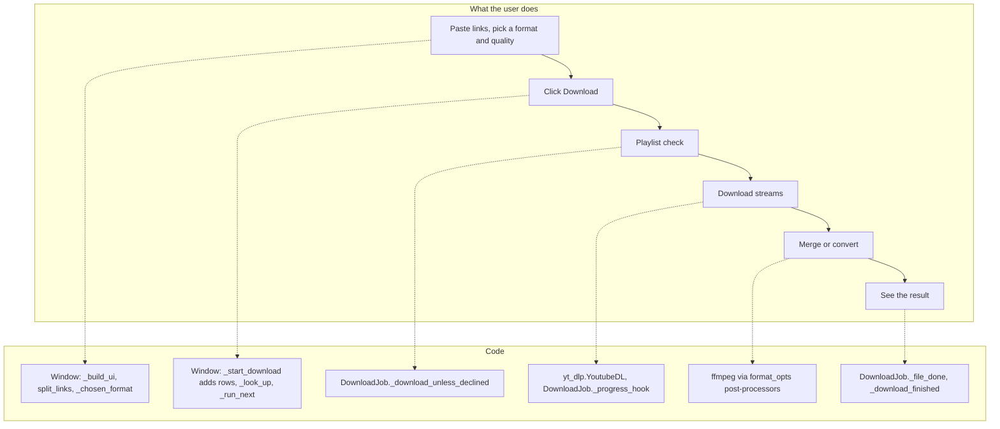

# 1 Overview

Relevant source files

- [README.md](https://github.com/lifeupnorth/YouTubeDownloader/blob/b00d4d39f0bbdb66f9610548ccf49a57481e4f08/README.md)
- [LICENSE](https://github.com/lifeupnorth/YouTubeDownloader/blob/b00d4d39f0bbdb66f9610548ccf49a57481e4f08/LICENSE)
- [youtube_downloader.py](https://github.com/lifeupnorth/YouTubeDownloader/blob/b00d4d39f0bbdb66f9610548ccf49a57481e4f08/youtube_downloader.py)
- [download_engine.py](https://github.com/lifeupnorth/YouTubeDownloader/blob/b00d4d39f0bbdb66f9610548ccf49a57481e4f08/download_engine.py)
- [requirements.txt](https://github.com/lifeupnorth/YouTubeDownloader/blob/b00d4d39f0bbdb66f9610548ccf49a57481e4f08/requirements.txt)
- [packaging/build_exe.py](https://github.com/lifeupnorth/YouTubeDownloader/blob/b00d4d39f0bbdb66f9610548ccf49a57481e4f08/packaging/build_exe.py)
- [.github/workflows/build-exe.yml](https://github.com/lifeupnorth/YouTubeDownloader/blob/b00d4d39f0bbdb66f9610548ccf49a57481e4f08/.github/workflows/build-exe.yml)
- [.github/dependabot.yml](https://github.com/lifeupnorth/YouTubeDownloader/blob/b00d4d39f0bbdb66f9610548ccf49a57481e4f08/.github/dependabot.yml)

**YouTubeDownloader** is a small desktop app, written in Python with Qt (PySide6), for downloading YouTube videos and audio. It's a graphical front end for [yt-dlp](https://github.com/yt-dlp/yt-dlp): you paste one or more links, pick a format, a quality and a folder, and click Download. yt-dlp does the extraction and downloading, ffmpeg merges and converts the files, and a JavaScript runtime (deno, node or bun) runs yt-dlp-ejs, which solves YouTube's challenges. The app adds the window, a Downloads list with thumbnails and progress for each link, playlist safeguards, Pause, Resume and Cancel for each link, and the lookup of ffmpeg and the JavaScript runtime around them.

It runs from source with Python, or as `YT-Downloader.exe`, a one-file Windows app built with PyInstaller that includes Python, Qt, yt-dlp, Pillow, ffmpeg and deno. GitHub Actions builds the .exe and attaches it to each release: one for every version tag, and one automatically whenever the yt-dlp pin on `main` differs from the latest release's. The .exe checks for a newer release at most once a day, unless that's turned off.

The code is split in two, plus the packaging scripts:

- **`youtube_downloader.py`** is the window: widgets, the Downloads list, themes, settings, dialogs, the update check, and the plumbing that gets updates from background threads onto the screen. It runs a few links at a time (two by default). It also has a check-only command-line mode, `--self-check`.
- **`download_engine.py`** does the work without any Qt: it finds yt-dlp, ffmpeg and a JavaScript runtime, builds yt-dlp's options, looks up links, asks GitHub for the latest release, and downloads one link per `DownloadJob`, several at a time if the window asks.
- **`packaging/`** builds and checks the .exe, and looks for newer ffmpeg and deno builds.

The pages in this wiki:

- [Getting Started](02-getting-started.md): requirements, running from source or as the .exe, building and releasing the .exe, settings, tests
- [Architecture and Threading](03-architecture.md): the two modules, and how worker threads update the window safely
- [Download Pipeline](04-download-pipeline.md): what happens from clicking Download to the final summary, including playlists, several links and Cancel
- [Formats and ffmpeg](05-formats-ffmpeg.md): how each format choice maps to yt-dlp options, and how ffmpeg is found
- [User Interface](06-user-interface.md): widgets, the Downloads list, link lookups, status colors, themes and dialogs
- [Testing](07-testing.md): the unit tests and the CI
- [Glossary](08-glossary.md)

Sources: [README.md:1-11](https://github.com/lifeupnorth/YouTubeDownloader/blob/b00d4d39f0bbdb66f9610548ccf49a57481e4f08/README.md#L1-L11), [README.md:46-65](https://github.com/lifeupnorth/YouTubeDownloader/blob/b00d4d39f0bbdb66f9610548ccf49a57481e4f08/README.md#L46-L65), [download_engine.py:1-7](https://github.com/lifeupnorth/YouTubeDownloader/blob/b00d4d39f0bbdb66f9610548ccf49a57481e4f08/download_engine.py#L1-L7), [youtube_downloader.py:2-8](https://github.com/lifeupnorth/YouTubeDownloader/blob/b00d4d39f0bbdb66f9610548ccf49a57481e4f08/youtube_downloader.py#L2-L8), [youtube_downloader.py:159-161](https://github.com/lifeupnorth/YouTubeDownloader/blob/b00d4d39f0bbdb66f9610548ccf49a57481e4f08/youtube_downloader.py#L159-L161), [youtube_downloader.py:1088-1092](https://github.com/lifeupnorth/YouTubeDownloader/blob/b00d4d39f0bbdb66f9610548ccf49a57481e4f08/youtube_downloader.py#L1088-L1092), [youtube_downloader.py:2209-2213](https://github.com/lifeupnorth/YouTubeDownloader/blob/b00d4d39f0bbdb66f9610548ccf49a57481e4f08/youtube_downloader.py#L2209-L2213), [packaging/build_exe.py:1-15](https://github.com/lifeupnorth/YouTubeDownloader/blob/b00d4d39f0bbdb66f9610548ccf49a57481e4f08/packaging/build_exe.py#L1-L15), [.github/workflows/build-exe.yml:1-20](https://github.com/lifeupnorth/YouTubeDownloader/blob/b00d4d39f0bbdb66f9610548ccf49a57481e4f08/.github/workflows/build-exe.yml#L1-L20)

## Key capabilities

| Capability | Where |
|---|---|
| Eight choices: MP4 video at Best quality, 2160p (4K), 1440p, 1080p, 720p or 480p, MP3 or M4A; resolution choices fall back to the nearest available instead of failing | `engine.format_opts`, `_chosen_format` |
| Links dragged onto the window download right away; a folder dragged onto it becomes the folder to save to | `dropped`, `dropEvent` |
| A Downloads list: each link is a row with its thumbnail, title, format, quality, progress and status; links download two at a time by default (1 to 3, `parallel_downloads`), more can be added at any time, and a failed link doesn't stop the others | `DownloadsModel`, `RowDelegate`, `_start_download`, `_run_next` |
| Safe playlist handling: a single video by default; asks before downloading a whole playlist, channel or tab; skips unavailable entries; numbered files in a per-playlist folder | `DownloadJob._download_unless_declined`, `DownloadJob.options` |
| One progress bar per row across video and audio streams, with "Video n/N" in a playlist | `DownloadJob._progress_hook`, `_show_progress` |
| Each link looked up as soon as it's added (three at a time): thumbnail, title, and length or playlist size | `engine.preview_link`, `_look_up` |
| Cancel for each row: a waiting link is skipped; a running one stops its ffmpeg and removes only the files this run wrote for the unfinished video | `_cancel_row`, `DownloadJob.stop_processes`, `DownloadJob._remove_partial_files` |
| Pause and Resume for each row: a paused download keeps its partial files and continues them (yt-dlp resumes `.part` files), also after a restart; closing during a download pauses it | `_pause_row`, `_resume_row`, `DownloadJob.pause`, `DownloadJob._keep_partial_files` |
| Show in folder and Remove from the list for each finished row, Clear finished; no pop-ups for results. Last folder, format and theme remembered | `_open_folder`, `_clear_finished`, `load_settings` |
| The Downloads list kept between runs: the last 200 rows, with cached thumbnails, come back at the next start; rows that hadn't finished come back Paused | `row_entry`, `restored_row`, `_save_history` |
| YouTube's look in a light or dark theme, or the system's | `THEMES`, `apply_theme` |
| ffmpeg detection at startup and before each download (the .exe's bundled copy first), including a Windows install made while the app is open | `engine.find_ffmpeg`, `_recheck_ffmpeg` |
| JavaScript runtime lookup on a worker: the .exe's bundled deno, else deno, node or bun on PATH; a note in the log when there's none | `engine.find_js_runtime`, `_find_js_runtime_thread` |
| From source: installs the pinned yt-dlp when it's missing and uses it without a restart; shows the version in use | `_install_ytdlp`, `engine.load_yt_dlp` |
| Release .exe only: a line in the log when a newer release is out, checked at most once a day while "Check for updates at startup" is on | `engine.check_for_update`, `_maybe_check_for_update` |
| A window that stays responsive: downloads and lookups run on worker threads, UI updates go to the main thread through a queued Qt signal, and a crash in a worker or a Qt callback ends up in the log | `_post`, `_call`, `_run_worker`, `report_error` |

Sources: [download_engine.py:60-90](https://github.com/lifeupnorth/YouTubeDownloader/blob/b00d4d39f0bbdb66f9610548ccf49a57481e4f08/download_engine.py#L60-L90), [download_engine.py:146-168](https://github.com/lifeupnorth/YouTubeDownloader/blob/b00d4d39f0bbdb66f9610548ccf49a57481e4f08/download_engine.py#L146-L168), [download_engine.py:171-221](https://github.com/lifeupnorth/YouTubeDownloader/blob/b00d4d39f0bbdb66f9610548ccf49a57481e4f08/download_engine.py#L171-L221), [download_engine.py:250-313](https://github.com/lifeupnorth/YouTubeDownloader/blob/b00d4d39f0bbdb66f9610548ccf49a57481e4f08/download_engine.py#L250-L313), [download_engine.py:519-559](https://github.com/lifeupnorth/YouTubeDownloader/blob/b00d4d39f0bbdb66f9610548ccf49a57481e4f08/download_engine.py#L519-L559), [download_engine.py:650-672](https://github.com/lifeupnorth/YouTubeDownloader/blob/b00d4d39f0bbdb66f9610548ccf49a57481e4f08/download_engine.py#L650-L672), [download_engine.py:695-722](https://github.com/lifeupnorth/YouTubeDownloader/blob/b00d4d39f0bbdb66f9610548ccf49a57481e4f08/download_engine.py#L695-L722), [download_engine.py:774-827](https://github.com/lifeupnorth/YouTubeDownloader/blob/b00d4d39f0bbdb66f9610548ccf49a57481e4f08/download_engine.py#L774-L827), [download_engine.py:858-876](https://github.com/lifeupnorth/YouTubeDownloader/blob/b00d4d39f0bbdb66f9610548ccf49a57481e4f08/download_engine.py#L858-L876), [youtube_downloader.py:83-131](https://github.com/lifeupnorth/YouTubeDownloader/blob/b00d4d39f0bbdb66f9610548ccf49a57481e4f08/youtube_downloader.py#L83-L131), [youtube_downloader.py:151-161](https://github.com/lifeupnorth/YouTubeDownloader/blob/b00d4d39f0bbdb66f9610548ccf49a57481e4f08/youtube_downloader.py#L151-L161), [youtube_downloader.py:309-322](https://github.com/lifeupnorth/YouTubeDownloader/blob/b00d4d39f0bbdb66f9610548ccf49a57481e4f08/youtube_downloader.py#L309-L322), [youtube_downloader.py:431-486](https://github.com/lifeupnorth/YouTubeDownloader/blob/b00d4d39f0bbdb66f9610548ccf49a57481e4f08/youtube_downloader.py#L431-L486), [youtube_downloader.py:509-565](https://github.com/lifeupnorth/YouTubeDownloader/blob/b00d4d39f0bbdb66f9610548ccf49a57481e4f08/youtube_downloader.py#L509-L565), [youtube_downloader.py:1348-1385](https://github.com/lifeupnorth/YouTubeDownloader/blob/b00d4d39f0bbdb66f9610548ccf49a57481e4f08/youtube_downloader.py#L1348-L1385), [youtube_downloader.py:1419-1434](https://github.com/lifeupnorth/YouTubeDownloader/blob/b00d4d39f0bbdb66f9610548ccf49a57481e4f08/youtube_downloader.py#L1419-L1434), [youtube_downloader.py:1485-1538](https://github.com/lifeupnorth/YouTubeDownloader/blob/b00d4d39f0bbdb66f9610548ccf49a57481e4f08/youtube_downloader.py#L1485-L1538), [youtube_downloader.py:1549-1607](https://github.com/lifeupnorth/YouTubeDownloader/blob/b00d4d39f0bbdb66f9610548ccf49a57481e4f08/youtube_downloader.py#L1549-L1607), [youtube_downloader.py:1611-1656](https://github.com/lifeupnorth/YouTubeDownloader/blob/b00d4d39f0bbdb66f9610548ccf49a57481e4f08/youtube_downloader.py#L1611-L1656), [youtube_downloader.py:1662-1714](https://github.com/lifeupnorth/YouTubeDownloader/blob/b00d4d39f0bbdb66f9610548ccf49a57481e4f08/youtube_downloader.py#L1662-L1714), [youtube_downloader.py:1770-1784](https://github.com/lifeupnorth/YouTubeDownloader/blob/b00d4d39f0bbdb66f9610548ccf49a57481e4f08/youtube_downloader.py#L1770-L1784), [youtube_downloader.py:1900-1959](https://github.com/lifeupnorth/YouTubeDownloader/blob/b00d4d39f0bbdb66f9610548ccf49a57481e4f08/youtube_downloader.py#L1900-L1959), [youtube_downloader.py:1963-1976](https://github.com/lifeupnorth/YouTubeDownloader/blob/b00d4d39f0bbdb66f9610548ccf49a57481e4f08/youtube_downloader.py#L1963-L1976), [youtube_downloader.py:1980-2027](https://github.com/lifeupnorth/YouTubeDownloader/blob/b00d4d39f0bbdb66f9610548ccf49a57481e4f08/youtube_downloader.py#L1980-L2027), [youtube_downloader.py:2038-2061](https://github.com/lifeupnorth/YouTubeDownloader/blob/b00d4d39f0bbdb66f9610548ccf49a57481e4f08/youtube_downloader.py#L2038-L2061), [youtube_downloader.py:2086-2128](https://github.com/lifeupnorth/YouTubeDownloader/blob/b00d4d39f0bbdb66f9610548ccf49a57481e4f08/youtube_downloader.py#L2086-L2128)

## From concepts to code

Sources: [youtube_downloader.py:1213-1271](https://github.com/lifeupnorth/YouTubeDownloader/blob/b00d4d39f0bbdb66f9610548ccf49a57481e4f08/youtube_downloader.py#L1213-L1271), [youtube_downloader.py:238-251](https://github.com/lifeupnorth/YouTubeDownloader/blob/b00d4d39f0bbdb66f9610548ccf49a57481e4f08/youtube_downloader.py#L238-L251), [youtube_downloader.py:1382-1385](https://github.com/lifeupnorth/YouTubeDownloader/blob/b00d4d39f0bbdb66f9610548ccf49a57481e4f08/youtube_downloader.py#L1382-L1385), [youtube_downloader.py:1549-1607](https://github.com/lifeupnorth/YouTubeDownloader/blob/b00d4d39f0bbdb66f9610548ccf49a57481e4f08/youtube_downloader.py#L1549-L1607), [youtube_downloader.py:1662-1714](https://github.com/lifeupnorth/YouTubeDownloader/blob/b00d4d39f0bbdb66f9610548ccf49a57481e4f08/youtube_downloader.py#L1662-L1714), [download_engine.py:171-221](https://github.com/lifeupnorth/YouTubeDownloader/blob/b00d4d39f0bbdb66f9610548ccf49a57481e4f08/download_engine.py#L171-L221), [download_engine.py:724-789](https://github.com/lifeupnorth/YouTubeDownloader/blob/b00d4d39f0bbdb66f9610548ccf49a57481e4f08/download_engine.py#L724-L789), [download_engine.py:800-844](https://github.com/lifeupnorth/YouTubeDownloader/blob/b00d4d39f0bbdb66f9610548ccf49a57481e4f08/download_engine.py#L800-L844), [youtube_downloader.py:1786-1833](https://github.com/lifeupnorth/YouTubeDownloader/blob/b00d4d39f0bbdb66f9610548ccf49a57481e4f08/youtube_downloader.py#L1786-L1833)

## Tech stack

| Component | Role |
|---|---|
| Python 3.12+ | Language (`MIN_PYTHON`: before 3.12, PySide6 on Linux loses a reference to `None` with every Qt call that returns nothing, and Python aborts once there are none left, a few minutes into a download); the .exe is built with Python 3.14 |
| Qt 6 through PySide6 | Window and widgets; pinned as `PySide6-Essentials` (Qt's core modules, without QML or 3D) in `requirements.txt`, used under the LGPL v3 |
| yt-dlp | Extraction, format selection, downloading, post-processing; pinned as `yt-dlp[default]` in `requirements.txt`. The `default` extra brings yt-dlp-ejs and libraries such as requests, websockets and brotli; the .exe leaves out mutagen, which the app doesn't use |
| JavaScript runtime | deno (yt-dlp's default), node or bun, which runs yt-dlp-ejs to solve YouTube's challenges; without one, some formats may be missing. The .exe bundles deno |
| ffmpeg | External tool for merging, remuxing and audio conversion; the .exe bundles gyan.dev's "essentials" build |
| Pillow | Optional: thumbnails in the Downloads list (also pinned) |
| PyInstaller | Builds the .exe; pinned with its dependencies' hashes in `packaging/requirements-build.txt` |
| unittest, ruff | Tests (standard library; the window's run on Qt's "offscreen" platform) and lint (pinned in `requirements-dev.txt`) |

Dependabot proposes updates to the pins: daily for `requirements.txt`, weekly for PyInstaller and the GitHub Actions versions. The ffmpeg and deno builds the .exe bundles are pinned in `packaging/build_exe.py` with their SHA-256 checksums, which Dependabot can't see, so the weekly "Bundled programs" workflow opens an issue when either has a newer release. The project is licensed under MIT; the licenses of the bundled programs are in `packaging/THIRD-PARTY-NOTICES.txt` (an overview) and in the `THIRD-PARTY-LICENSES.txt` the build writes (the full texts).

Sources: [requirements.txt:6-18](https://github.com/lifeupnorth/YouTubeDownloader/blob/b00d4d39f0bbdb66f9610548ccf49a57481e4f08/requirements.txt#L6-L18), [requirements-dev.txt](https://github.com/lifeupnorth/YouTubeDownloader/blob/b00d4d39f0bbdb66f9610548ccf49a57481e4f08/requirements-dev.txt), [packaging/requirements-build.txt:1-6](https://github.com/lifeupnorth/YouTubeDownloader/blob/b00d4d39f0bbdb66f9610548ccf49a57481e4f08/packaging/requirements-build.txt#L1-L6), [download_engine.py:65-67](https://github.com/lifeupnorth/YouTubeDownloader/blob/b00d4d39f0bbdb66f9610548ccf49a57481e4f08/download_engine.py#L65-L67), [download_engine.py:281-283](https://github.com/lifeupnorth/YouTubeDownloader/blob/b00d4d39f0bbdb66f9610548ccf49a57481e4f08/download_engine.py#L281-L283), [packaging/build_exe.py:38-52](https://github.com/lifeupnorth/YouTubeDownloader/blob/b00d4d39f0bbdb66f9610548ccf49a57481e4f08/packaging/build_exe.py#L38-L52), [packaging/build_exe.py:313-317](https://github.com/lifeupnorth/YouTubeDownloader/blob/b00d4d39f0bbdb66f9610548ccf49a57481e4f08/packaging/build_exe.py#L313-L317), [packaging/build_exe.py:226-268](https://github.com/lifeupnorth/YouTubeDownloader/blob/b00d4d39f0bbdb66f9610548ccf49a57481e4f08/packaging/build_exe.py#L226-L268), [.github/workflows/build-exe.yml:94-100](https://github.com/lifeupnorth/YouTubeDownloader/blob/b00d4d39f0bbdb66f9610548ccf49a57481e4f08/.github/workflows/build-exe.yml#L94-L100), [.github/workflows/tests.yml:16-26](https://github.com/lifeupnorth/YouTubeDownloader/blob/b00d4d39f0bbdb66f9610548ccf49a57481e4f08/.github/workflows/tests.yml#L16-L26), [.github/dependabot.yml:1-30](https://github.com/lifeupnorth/YouTubeDownloader/blob/b00d4d39f0bbdb66f9610548ccf49a57481e4f08/.github/dependabot.yml#L1-L30), [.github/workflows/pins.yml:1-11](https://github.com/lifeupnorth/YouTubeDownloader/blob/b00d4d39f0bbdb66f9610548ccf49a57481e4f08/.github/workflows/pins.yml#L1-L11), [LICENSE](https://github.com/lifeupnorth/YouTubeDownloader/blob/b00d4d39f0bbdb66f9610548ccf49a57481e4f08/LICENSE)

## Repository map

| Path | Lines | Contents |
|---|---|---|
| `youtube_downloader.py` | 2213 | The window (Qt): UI, the Downloads list (kept between runs), themes, settings, dialogs, worker plumbing, update check, entry point with `--self-check` |
| `download_engine.py` | 897 | Downloading without Qt: yt-dlp, ffmpeg and the JavaScript runtime, formats, link lookups, the release check, `DownloadJob` |
| `tests/test_engine.py` | 1038 | The engine with a fake yt-dlp; needs no display |
| `tests/test_window.py` | 1519 | The real window driven with a fake yt-dlp, on Qt's offscreen platform; fails on any main-thread-only call or dialog from a worker thread |
| `tests/test_app.py` | 243 | Settings and saved-list files, the Python version check, Show in folder, ffmpeg help, the update check, `split_links`, the .exe's self-check report |
| `tests/test_real_yt_dlp.py` | 142 | The engine with the real yt-dlp, offline, against a local web server (the MP3 test needs ffmpeg) |
| `tests/test_requirements.py` | 93 | The yt-dlp pin is exact, brings yt-dlp-ejs, and is what the installer uses |
| `tests/test_build_exe.py` | 287 | Checksum-checked downloads, the icon, the `--check` verdict and the third-party licenses of `packaging/build_exe.py` |
| `tests/test_check_pins.py` | 77 | `packaging/check_pins.py` with GitHub's API faked |
| `tests/fakes.py` | 150 | The fake yt-dlp shared by the tests |
| `requirements.txt` / `requirements-dev.txt` | 18 / 3 | Pinned `yt-dlp[default]` (which brings yt-dlp-ejs), PySide6-Essentials and Pillow / ruff |
| `ruff.toml` | 8 | Lint rules |
| `packaging/build_exe.py` | 376 | Builds the one-file Windows app with PyInstaller, with the app's icon, and ffmpeg and deno downloaded and checked against pinned checksums (`FFMPEG_VERSION`, `DENO_VERSION`); `--check` runs the .exe's `--self-check` |
| `packaging/requirements-build.txt` | 38 | PyInstaller and its dependencies, pinned with hashes |
| `packaging/check_pins.py` | 115 | Reports newer ffmpeg and deno releases; `--open-issues` opens an issue for each |
| `packaging/THIRD-PARTY-NOTICES.txt` / `DENO-LICENSE.txt` | 79 / 20 | Licenses of the bundled programs, shipped next to the .exe |
| `packaging/PYTHON-LICENSES.rst` | 1226 | CPython's licenses for the software built into Python, copied into `THIRD-PARTY-LICENSES.txt` |
| `packaging/LGPL-3.0.txt` / `GPL-3.0.txt` | 165 / 674 | The GNU LGPL v3, under which Qt and PySide6 are used, and the GPL v3 it builds on, copied into `THIRD-PARTY-LICENSES.txt` (the Qt packages only ship the commercial license's text) |
| `.github/workflows/tests.yml` | 82 | Tests (Windows and Ubuntu, Python 3.12 and 3.14, with and without yt-dlp, on Qt's offscreen platform) and lint on every push to `main` and every PR |
| `.github/workflows/build-exe.yml` | 226 | Builds and checks the .exe on every PR, every push to `main` and by hand; releases it for a `vX.Y.Z` tag, or as the next patch version when `main` pins another yt-dlp than the latest release, with SHA-256 checksums and a build provenance attestation |
| `.github/workflows/pins.yml` | 36 | "Bundled programs": runs `check_pins.py --open-issues` every Monday |
| `.github/dependabot.yml` | 30 | Dependabot: daily for `requirements.txt`, weekly for `packaging/requirements-build.txt` and GitHub Actions |
| `README.md` | 216 | Requirements, install, run, the Windows app (releases, building, signing), usage, tests, disclaimer, license |
| `LICENSE` | 21 | MIT |

Sources: [.github/workflows/tests.yml](https://github.com/lifeupnorth/YouTubeDownloader/blob/b00d4d39f0bbdb66f9610548ccf49a57481e4f08/.github/workflows/tests.yml), [.github/workflows/build-exe.yml:1-75](https://github.com/lifeupnorth/YouTubeDownloader/blob/b00d4d39f0bbdb66f9610548ccf49a57481e4f08/.github/workflows/build-exe.yml#L1-L75), [.github/workflows/build-exe.yml:180-226](https://github.com/lifeupnorth/YouTubeDownloader/blob/b00d4d39f0bbdb66f9610548ccf49a57481e4f08/.github/workflows/build-exe.yml#L180-L226), [.github/workflows/pins.yml](https://github.com/lifeupnorth/YouTubeDownloader/blob/b00d4d39f0bbdb66f9610548ccf49a57481e4f08/.github/workflows/pins.yml), [packaging/build_exe.py:38-52](https://github.com/lifeupnorth/YouTubeDownloader/blob/b00d4d39f0bbdb66f9610548ccf49a57481e4f08/packaging/build_exe.py#L38-L52), [packaging/build_exe.py:327-372](https://github.com/lifeupnorth/YouTubeDownloader/blob/b00d4d39f0bbdb66f9610548ccf49a57481e4f08/packaging/build_exe.py#L327-L372), [packaging/check_pins.py:1-9](https://github.com/lifeupnorth/YouTubeDownloader/blob/b00d4d39f0bbdb66f9610548ccf49a57481e4f08/packaging/check_pins.py#L1-L9), [tests/test_window.py:43-53](https://github.com/lifeupnorth/YouTubeDownloader/blob/b00d4d39f0bbdb66f9610548ccf49a57481e4f08/tests/test_window.py#L43-L53), [ruff.toml](https://github.com/lifeupnorth/YouTubeDownloader/blob/b00d4d39f0bbdb66f9610548ccf49a57481e4f08/ruff.toml), [README.md](https://github.com/lifeupnorth/YouTubeDownloader/blob/b00d4d39f0bbdb66f9610548ccf49a57481e4f08/README.md)
