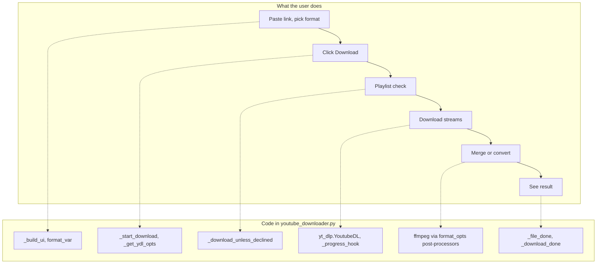

# 1 Overview

Relevant source files

- [README.md](https://github.com/lifeupnorth/YouTubeDownloader/blob/bd3fd4242f83ee2cf111812e71b6d2db5aa71bdf/README.md)
- [LICENSE](https://github.com/lifeupnorth/YouTubeDownloader/blob/bd3fd4242f83ee2cf111812e71b6d2db5aa71bdf/LICENSE)
- [youtube_downloader.py](https://github.com/lifeupnorth/YouTubeDownloader/blob/bd3fd4242f83ee2cf111812e71b6d2db5aa71bdf/youtube_downloader.py)

**YouTubeDownloader** is a small desktop app, written in Python with Tkinter, for downloading YouTube videos and audio. It is a graphical front end for [yt-dlp](https://github.com/yt-dlp/yt-dlp): you paste a link, pick a format and a folder, and click Download. yt-dlp does the extraction and downloading, and ffmpeg merges and converts the files. The app adds the window, progress reporting, playlist safeguards and ffmpeg detection around them.

The pages in this wiki:

- [Getting Started](02-getting-started.md): requirements, running the app, running the tests
- [Architecture and Threading](03-architecture.md): the single-module layout and how worker threads update the UI safely
- [Download Pipeline](04-download-pipeline.md): what happens from clicking Download to the final summary, including playlists
- [Formats and ffmpeg](05-formats-ffmpeg.md): how each format choice maps to yt-dlp options, and how ffmpeg is found
- [User Interface](06-user-interface.md): widgets, bindings, status colors and dialogs
- [Testing](07-testing.md): the thread-safety harness and the format and ffmpeg tests
- [Glossary](08-glossary.md)

Sources: [README.md:1-11](https://github.com/lifeupnorth/YouTubeDownloader/blob/bd3fd4242f83ee2cf111812e71b6d2db5aa71bdf/README.md#L1-L11), [youtube_downloader.py:1-5](https://github.com/lifeupnorth/YouTubeDownloader/blob/bd3fd4242f83ee2cf111812e71b6d2db5aa71bdf/youtube_downloader.py#L1-L5)

## Key capabilities

| Capability | Where |
|---|---|
| Six formats: Best MP4, 1080p, 720p, 480p, MP3, M4A; resolution choices fall back to the nearest available instead of failing | `format_opts` |
| Safe playlist handling: a single video by default; the app asks before downloading a whole playlist, channel or tab; skips unavailable entries; numbered files in a per-playlist folder | `_download_unless_declined`, `_get_ydl_opts` |
| One progress bar across video and audio streams, with "Video n/N" for playlists | `StreamCounter`, `_progress_hook` |
| Log of the final files, with "already downloaded" and skipped entries reported separately | `_file_done`, `_entry_failed` |
| ffmpeg detection at startup and before each download, including a Windows install made while the app is open | `find_ffmpeg`, `_recheck_ffmpeg` |
| Offers to install the pinned yt-dlp version with pip when it's missing | `_prompt_install`, `_install_ytdlp` |
| UI that stays responsive: downloads run on a worker thread, and UI updates go through a queue | `_post`, `_poll_ui_queue` |

Sources: [youtube_downloader.py:84-115](https://github.com/lifeupnorth/YouTubeDownloader/blob/bd3fd4242f83ee2cf111812e71b6d2db5aa71bdf/youtube_downloader.py#L84-L115), [youtube_downloader.py:401-434](https://github.com/lifeupnorth/YouTubeDownloader/blob/bd3fd4242f83ee2cf111812e71b6d2db5aa71bdf/youtube_downloader.py#L401-L434), [youtube_downloader.py:476-519](https://github.com/lifeupnorth/YouTubeDownloader/blob/bd3fd4242f83ee2cf111812e71b6d2db5aa71bdf/youtube_downloader.py#L476-L519), [youtube_downloader.py:586-605](https://github.com/lifeupnorth/YouTubeDownloader/blob/bd3fd4242f83ee2cf111812e71b6d2db5aa71bdf/youtube_downloader.py#L586-L605), [youtube_downloader.py:657-695](https://github.com/lifeupnorth/YouTubeDownloader/blob/bd3fd4242f83ee2cf111812e71b6d2db5aa71bdf/youtube_downloader.py#L657-L695)

## From concepts to code

Sources: [youtube_downloader.py:209-290](https://github.com/lifeupnorth/YouTubeDownloader/blob/bd3fd4242f83ee2cf111812e71b6d2db5aa71bdf/youtube_downloader.py#L209-L290), [youtube_downloader.py:449-474](https://github.com/lifeupnorth/YouTubeDownloader/blob/bd3fd4242f83ee2cf111812e71b6d2db5aa71bdf/youtube_downloader.py#L449-L474), [youtube_downloader.py:535-644](https://github.com/lifeupnorth/YouTubeDownloader/blob/bd3fd4242f83ee2cf111812e71b6d2db5aa71bdf/youtube_downloader.py#L535-L644)

## Tech stack

| Component | Role |
|---|---|
| Python 3.9+ | Language (uses `str.removeprefix`) |
| Tkinter / ttk | Window and widgets, standard library |
| yt-dlp | Extraction, format selection, downloading, post-processing |
| ffmpeg | External tool for merging, remuxing and audio conversion |
| unittest | Tests, standard library |

yt-dlp is pinned to an exact version in `requirements.txt` (and `YT_DLP_REQUIREMENT` in the script). There are no other Python dependencies and no packaging metadata. The project is licensed under MIT.

Sources: [youtube_downloader.py:7-22](https://github.com/lifeupnorth/YouTubeDownloader/blob/bd3fd4242f83ee2cf111812e71b6d2db5aa71bdf/youtube_downloader.py#L7-L22), [LICENSE](https://github.com/lifeupnorth/YouTubeDownloader/blob/bd3fd4242f83ee2cf111812e71b6d2db5aa71bdf/LICENSE)

## Repository map

| Path | Lines | Contents |
|---|---|---|
| `youtube_downloader.py` | 701 | The entire app: helpers, the `YouTubeDownloader` window class, entry point |
| `tests/test_thread_safety.py` | 352 | Simulated downloads through a real Tk window, using a fake `YoutubeDL` |
| `tests/test_formats.py` | 249 | Format selection with real yt-dlp, ffmpeg detection, help text, error formatting |
| `tests/test_requirements.py` | 42 | Checks the yt-dlp pin matches everywhere it's used |
| `requirements.txt` | 4 | The pinned yt-dlp version |
| `README.md` | 30 | Install commands, test command, disclaimer, license |
| `LICENSE` | 21 | MIT |
| `.gitignore` | 1 | `__pycache__/` |

Sources: [README.md](https://github.com/lifeupnorth/YouTubeDownloader/blob/bd3fd4242f83ee2cf111812e71b6d2db5aa71bdf/README.md), [.gitignore](https://github.com/lifeupnorth/YouTubeDownloader/blob/bd3fd4242f83ee2cf111812e71b6d2db5aa71bdf/.gitignore)
