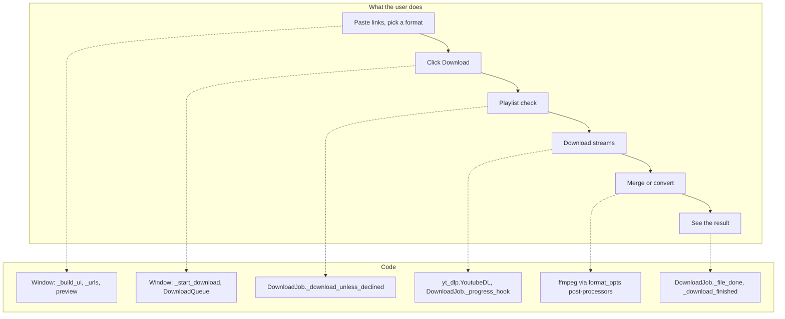

# 1 Overview

Relevant source files

- [README.md](https://github.com/lifeupnorth/YouTubeDownloader/blob/fed021846b04c093d045f0ec3de2b53d5ea42060/README.md)
- [LICENSE](https://github.com/lifeupnorth/YouTubeDownloader/blob/fed021846b04c093d045f0ec3de2b53d5ea42060/LICENSE)
- [youtube_downloader.py](https://github.com/lifeupnorth/YouTubeDownloader/blob/fed021846b04c093d045f0ec3de2b53d5ea42060/youtube_downloader.py)
- [download_engine.py](https://github.com/lifeupnorth/YouTubeDownloader/blob/fed021846b04c093d045f0ec3de2b53d5ea42060/download_engine.py)

**YouTubeDownloader** is a small desktop app, written in Python with Tkinter, for downloading YouTube videos and audio. It's a graphical front end for [yt-dlp](https://github.com/yt-dlp/yt-dlp): you paste one or more links, pick a format and a folder, and click Download. yt-dlp does the extraction and downloading, and ffmpeg merges and converts the files. The app adds the window, previews, progress reporting, playlist safeguards, a download queue, Cancel and ffmpeg detection around them.

The code is split in two:

- **`youtube_downloader.py`** is the window: widgets, settings, dialogs, and the plumbing that gets updates from background threads onto the screen.
- **`download_engine.py`** does the work without any Tk: it finds yt-dlp and ffmpeg, builds yt-dlp's options, previews links, and runs downloads (`DownloadJob` for one link, `DownloadQueue` for several in a row).

The pages in this wiki:

- [Getting Started](02-getting-started.md): requirements, running the app, settings, tests
- [Architecture and Threading](03-architecture.md): the two modules, and how worker threads update the window safely
- [Download Pipeline](04-download-pipeline.md): what happens from clicking Download to the final summary, including playlists, several links and Cancel
- [Formats and ffmpeg](05-formats-ffmpeg.md): how each format choice maps to yt-dlp options, and how ffmpeg is found
- [User Interface](06-user-interface.md): widgets, bindings, status colors, previews and dialogs
- [Testing](07-testing.md): the engine tests, the window tests and the CI
- [Glossary](08-glossary.md)

Sources: [README.md:1-35](https://github.com/lifeupnorth/YouTubeDownloader/blob/fed021846b04c093d045f0ec3de2b53d5ea42060/README.md#L1-L35), [download_engine.py:1-7](https://github.com/lifeupnorth/YouTubeDownloader/blob/fed021846b04c093d045f0ec3de2b53d5ea42060/download_engine.py#L1-L7), [youtube_downloader.py:2-8](https://github.com/lifeupnorth/YouTubeDownloader/blob/fed021846b04c093d045f0ec3de2b53d5ea42060/youtube_downloader.py#L2-L8)

## Key capabilities

| Capability | Where |
|---|---|
| Six formats: Best MP4, 1080p, 720p, 480p, MP3, M4A; resolution choices fall back to the nearest available instead of failing | `engine.format_opts` |
| Several links in a row, one per line; a failed link doesn't stop the others | `engine.DownloadQueue`, `_urls` |
| Safe playlist handling: a single video by default; asks before downloading a whole playlist, channel or tab; skips unavailable entries; numbered files in a per-playlist folder | `DownloadJob._download_unless_declined`, `DownloadJob.options` |
| One progress bar across video and audio streams, with "Link n/N" and "Video n/N" | `DownloadJob._progress_hook` |
| Link preview: thumbnail, title, and length or playlist size | `engine.preview_link`, `_start_preview` |
| Cancel, which removes the unfinished video's partial files and skips links still waiting | `DownloadJob._remove_partial_files`, `_cancel_download` |
| Open folder button after a download instead of a pop-up; last folder and format remembered | `_open_folder`, `load_settings` |
| ffmpeg detection at startup and before each download, including a Windows install made while the app is open | `engine.find_ffmpeg`, `_recheck_ffmpeg` |
| Installs the pinned yt-dlp when it's missing and uses it without a restart; shows the version in use | `_install_ytdlp`, `engine.load_yt_dlp` |
| A window that stays responsive: downloads run on a worker thread, and UI updates go through a queue | `_post`, `_poll_ui_queue` |

Sources: [download_engine.py:102-133](https://github.com/lifeupnorth/YouTubeDownloader/blob/fed021846b04c093d045f0ec3de2b53d5ea42060/download_engine.py#L102-L133), [download_engine.py:295-503](https://github.com/lifeupnorth/YouTubeDownloader/blob/fed021846b04c093d045f0ec3de2b53d5ea42060/download_engine.py#L295-L503), [download_engine.py:506-630](https://github.com/lifeupnorth/YouTubeDownloader/blob/fed021846b04c093d045f0ec3de2b53d5ea42060/download_engine.py#L506-L630), [youtube_downloader.py:460-490](https://github.com/lifeupnorth/YouTubeDownloader/blob/fed021846b04c093d045f0ec3de2b53d5ea42060/youtube_downloader.py#L460-L490), [youtube_downloader.py:522-627](https://github.com/lifeupnorth/YouTubeDownloader/blob/fed021846b04c093d045f0ec3de2b53d5ea42060/youtube_downloader.py#L522-L627), [youtube_downloader.py:649-687](https://github.com/lifeupnorth/YouTubeDownloader/blob/fed021846b04c093d045f0ec3de2b53d5ea42060/youtube_downloader.py#L649-L687), [youtube_downloader.py:725-758](https://github.com/lifeupnorth/YouTubeDownloader/blob/fed021846b04c093d045f0ec3de2b53d5ea42060/youtube_downloader.py#L725-L758)

## From concepts to code

Sources: [youtube_downloader.py:172-352](https://github.com/lifeupnorth/YouTubeDownloader/blob/fed021846b04c093d045f0ec3de2b53d5ea42060/youtube_downloader.py#L172-L352), [youtube_downloader.py:522-557](https://github.com/lifeupnorth/YouTubeDownloader/blob/fed021846b04c093d045f0ec3de2b53d5ea42060/youtube_downloader.py#L522-L557), [download_engine.py:356-383](https://github.com/lifeupnorth/YouTubeDownloader/blob/fed021846b04c093d045f0ec3de2b53d5ea42060/download_engine.py#L356-L383), [download_engine.py:393-409](https://github.com/lifeupnorth/YouTubeDownloader/blob/fed021846b04c093d045f0ec3de2b53d5ea42060/download_engine.py#L393-L409), [download_engine.py:420-460](https://github.com/lifeupnorth/YouTubeDownloader/blob/fed021846b04c093d045f0ec3de2b53d5ea42060/download_engine.py#L420-L460), [youtube_downloader.py:605-627](https://github.com/lifeupnorth/YouTubeDownloader/blob/fed021846b04c093d045f0ec3de2b53d5ea42060/youtube_downloader.py#L605-L627)

## Tech stack

| Component | Role |
|---|---|
| Python 3.10+ | Language (the pinned yt-dlp needs 3.10) |
| Tkinter / ttk | Window and widgets, standard library |
| yt-dlp | Extraction, format selection, downloading, post-processing (pinned in `requirements.txt`) |
| ffmpeg | External tool for merging, remuxing and audio conversion |
| Pillow | Optional: thumbnails in the link preview (also pinned) |
| unittest, ruff | Tests (standard library) and lint (pinned in `requirements-dev.txt`) |

Dependabot keeps the pins and the GitHub Actions versions current. The project is licensed under MIT.

Sources: [requirements.txt](https://github.com/lifeupnorth/YouTubeDownloader/blob/fed021846b04c093d045f0ec3de2b53d5ea42060/requirements.txt), [requirements-dev.txt](https://github.com/lifeupnorth/YouTubeDownloader/blob/fed021846b04c093d045f0ec3de2b53d5ea42060/requirements-dev.txt), [.github/dependabot.yml](https://github.com/lifeupnorth/YouTubeDownloader/blob/fed021846b04c093d045f0ec3de2b53d5ea42060/.github/dependabot.yml), [LICENSE](https://github.com/lifeupnorth/YouTubeDownloader/blob/fed021846b04c093d045f0ec3de2b53d5ea42060/LICENSE)

## Repository map

| Path | Lines | Contents |
|---|---|---|
| `youtube_downloader.py` | 847 | The window: UI, settings, dialogs, worker plumbing, entry point |
| `download_engine.py` | 698 | Downloading without Tk: yt-dlp and ffmpeg, formats, previews, `DownloadJob`, `DownloadQueue` |
| `tests/test_engine.py` | 614 | The engine with a fake yt-dlp; needs no display |
| `tests/test_thread_safety.py` | 602 | The real window driven through simulated downloads |
| `tests/test_app.py` | 197 | Settings file, Open folder, ffmpeg help and checks |
| `tests/test_requirements.py` | 72 | The yt-dlp pin is what the installer uses |
| `tests/fakes.py` | 118 | The fake yt-dlp shared by the tests |
| `requirements.txt` / `requirements-dev.txt` | 14 / 3 | Pinned yt-dlp, yt-dlp-ejs and Pillow / ruff |
| `ruff.toml` | 8 | Lint rules |
| `.github/workflows/tests.yml` | 73 | Tests (Windows and Ubuntu, Python 3.10 and 3.14) and lint on every push to `main` and every PR |
| `packaging/build_exe.py` | 172 | Builds the one-file Windows app with PyInstaller and the bundled ffmpeg and deno (deno's version is pinned there by `DENO_VERSION`/`DENO_SHA256`; Dependabot doesn't update it) |
| `.github/workflows/build-exe.yml` | 74 | Builds and checks the .exe; attaches it to releases for version tags |
| `.github/dependabot.yml` | 27 | Weekly Dependabot checks for pip packages (including PyInstaller) and GitHub Actions |
| `README.md` | 102 | Requirements, install, run and usage, tests, disclaimer, license |
| `LICENSE` | 21 | MIT |

Sources: [.github/workflows/tests.yml](https://github.com/lifeupnorth/YouTubeDownloader/blob/fed021846b04c093d045f0ec3de2b53d5ea42060/.github/workflows/tests.yml), [ruff.toml](https://github.com/lifeupnorth/YouTubeDownloader/blob/fed021846b04c093d045f0ec3de2b53d5ea42060/ruff.toml), [README.md](https://github.com/lifeupnorth/YouTubeDownloader/blob/fed021846b04c093d045f0ec3de2b53d5ea42060/README.md)
