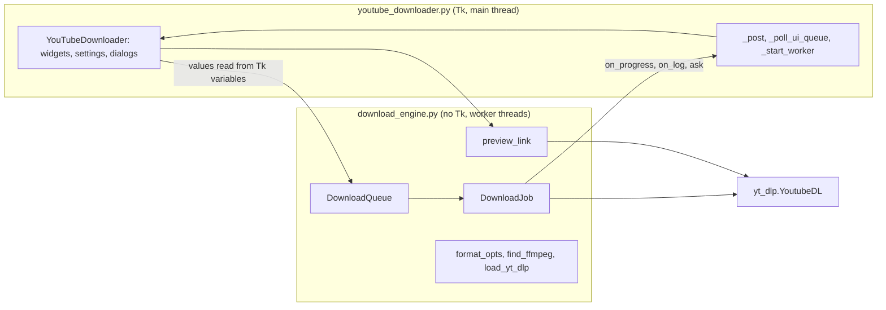
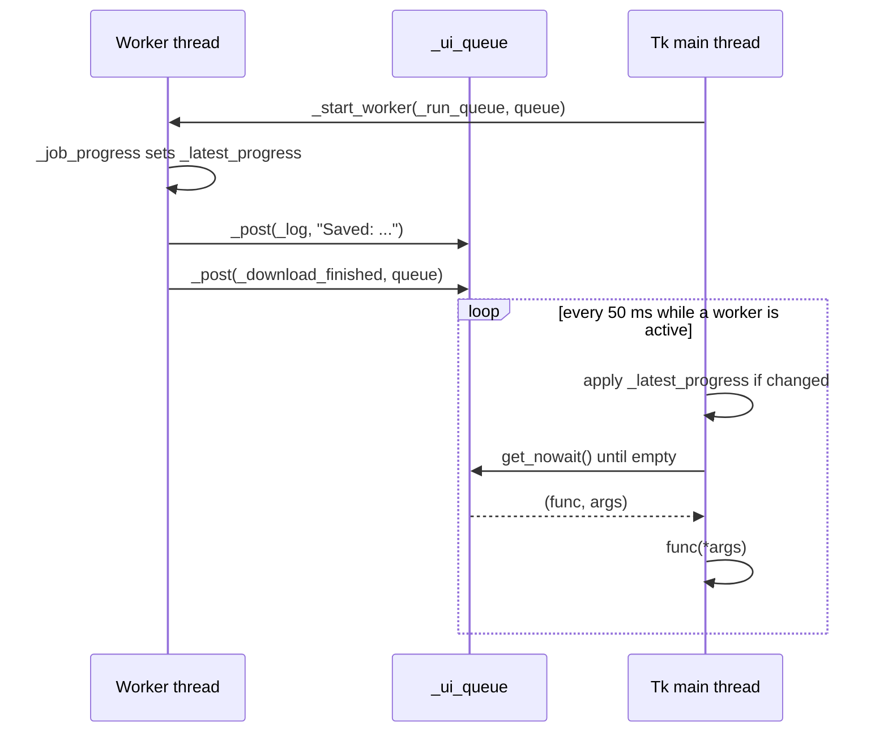
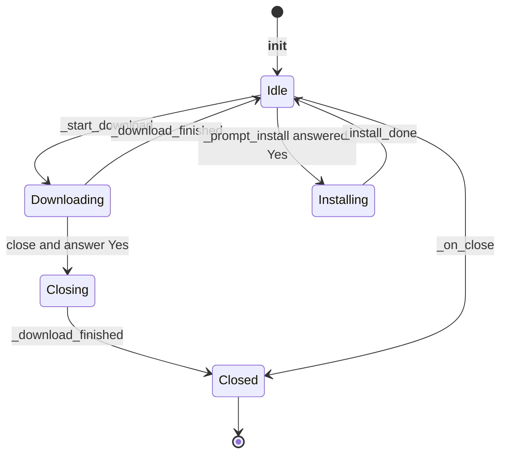

# 3 Architecture and Threading

Relevant source files

- [youtube_downloader.py](https://github.com/lifeupnorth/YouTubeDownloader/blob/fed021846b04c093d045f0ec3de2b53d5ea42060/youtube_downloader.py)
- [download_engine.py](https://github.com/lifeupnorth/YouTubeDownloader/blob/fed021846b04c093d045f0ec3de2b53d5ea42060/download_engine.py)

The app is two modules. **`download_engine.py`** does the downloading and knows nothing about Tk, so it can be tested on its own. **`youtube_downloader.py`** is the window: a single class, `YouTubeDownloader`, which subclasses `tk.Tk`. Long-running work (a download, a link preview, or a `pip install`) runs on background threads. Tkinter isn't thread-safe, so those threads never touch widgets or Tk variables: everything they want to show goes through a queue that the Tk main thread drains. This page covers that split, the threading model and the window's lifecycle. For what a download does, see [Download Pipeline](04-download-pipeline.md); for the widgets, see [User Interface](06-user-interface.md).

## The two modules

| Module | Part | Lines | Role |
|---|---|---|---|
| `download_engine.py` | yt-dlp loading and version | 21–92 | Optional `yt_dlp` import, the pin from `requirements.txt`, `load_yt_dlp`, version helpers |
| | Formats, ffmpeg | 95–166 | `VIDEO_MAX_RES`, `format_opts`, `format_eta`, `find_ffmpeg` (see [Formats and ffmpeg](05-formats-ffmpeg.md)) |
| | yt-dlp plumbing | 169–221 | `_YdlLogger`, `_callback_pp_class`, `_follow_url_results` |
| | Link preview | 224–290 | `describe_info`, `thumbnail_url`, `fetch_thumbnail`, `preview_link` |
| | Downloading | 293–630 | `DownloadJob` (one link) and `DownloadQueue` (several) |
| `youtube_downloader.py` | Palette, fonts, settings, help text | 28–124 | Colors, `FORMATS`, `settings_path`/`load_settings`/`save_settings`, `reveal_in_file_manager`, `ffmpeg_help` |
| | `YouTubeDownloader` | 127–758 | The window, its state, the worker plumbing, and the download, preview and install handlers |
| | Entry point | 761–764 | Creates the window and runs `mainloop()` |

The engine reports through plain callbacks and keeps its own results, so the window only has to turn callbacks into queued updates and show a summary. The window reads Tk variables (format, folder, the playlist box) on the main thread and passes their values to the engine.

Sources: [download_engine.py:1-7](https://github.com/lifeupnorth/YouTubeDownloader/blob/fed021846b04c093d045f0ec3de2b53d5ea42060/download_engine.py#L1-L7), [download_engine.py:21-92](https://github.com/lifeupnorth/YouTubeDownloader/blob/fed021846b04c093d045f0ec3de2b53d5ea42060/download_engine.py#L21-L92), [download_engine.py:169-221](https://github.com/lifeupnorth/YouTubeDownloader/blob/fed021846b04c093d045f0ec3de2b53d5ea42060/download_engine.py#L169-L221), [download_engine.py:293-630](https://github.com/lifeupnorth/YouTubeDownloader/blob/fed021846b04c093d045f0ec3de2b53d5ea42060/download_engine.py#L293-L630), [youtube_downloader.py:2-25](https://github.com/lifeupnorth/YouTubeDownloader/blob/fed021846b04c093d045f0ec3de2b53d5ea42060/youtube_downloader.py#L2-L25), [youtube_downloader.py:127-168](https://github.com/lifeupnorth/YouTubeDownloader/blob/fed021846b04c093d045f0ec3de2b53d5ea42060/youtube_downloader.py#L127-L168), [youtube_downloader.py:761-764](https://github.com/lifeupnorth/YouTubeDownloader/blob/fed021846b04c093d045f0ec3de2b53d5ea42060/youtube_downloader.py#L761-L764)

## Threads and the UI queue

There are two kinds of threads:

- **The Tk main thread** builds the UI, handles clicks, shows dialogs and applies every UI update.
- **Worker threads** are daemon threads started by `_start_worker`: `_run_queue` for downloads, `_preview_thread` for a preview, or the inner `run()` of `_install_ytdlp` for a pip install.

Workers reach the main thread in two ways:

1. **Discrete events** go through `_post(func, *args)`, which puts `(func, args)` on `self._ui_queue`, a `queue.Queue`: log lines, "download finished", a preview result, a yes/no question.
2. **Progress** is coalesced: the engine's `on_progress` callback (`_job_progress`) just overwrites `self._latest_progress` with a `(pct, message, color)` tuple. Only the newest value matters, so nothing is queued per progress event.

`_poll_ui_queue` runs on the main thread every 50 ms. It first applies `_latest_progress` if it changed since the last tick (an identity check against `_shown_progress`), then drains the queue. Each callback runs in its own `try`, and errors go to `report_callback_exception`, so one failing callback doesn't drop the rest. Progress is applied *before* the queue is drained, so a stale progress value can never overwrite the final state set by `_download_finished`.

Sources: [youtube_downloader.py:457-490](https://github.com/lifeupnorth/YouTubeDownloader/blob/fed021846b04c093d045f0ec3de2b53d5ea42060/youtube_downloader.py#L457-L490), [youtube_downloader.py:516-518](https://github.com/lifeupnorth/YouTubeDownloader/blob/fed021846b04c093d045f0ec3de2b53d5ea42060/youtube_downloader.py#L516-L518), [youtube_downloader.py:559-573](https://github.com/lifeupnorth/YouTubeDownloader/blob/fed021846b04c093d045f0ec3de2b53d5ea42060/youtube_downloader.py#L559-L573)

## When polling runs

Polling isn't permanent. `_start_worker` increments `_active_workers` and schedules the first poll only if none is pending (`_after_id is None`). Each tick sets `_after_id = None` and reschedules itself only while a worker is active or the queue still has items. The finishing handlers (`_download_finished` via `_end_download`, `_preview_done`, `_install_done`) call `_worker_finished`, so polling stops on the tick that handles the last event. When nothing is running, the app has no timer at all.

Sources: [youtube_downloader.py:463-470](https://github.com/lifeupnorth/YouTubeDownloader/blob/fed021846b04c093d045f0ec3de2b53d5ea42060/youtube_downloader.py#L463-L470), [youtube_downloader.py:487-490](https://github.com/lifeupnorth/YouTubeDownloader/blob/fed021846b04c093d045f0ec3de2b53d5ea42060/youtube_downloader.py#L487-L490), [youtube_downloader.py:599-603](https://github.com/lifeupnorth/YouTubeDownloader/blob/fed021846b04c093d045f0ec3de2b53d5ea42060/youtube_downloader.py#L599-L603), [youtube_downloader.py:678-681](https://github.com/lifeupnorth/YouTubeDownloader/blob/fed021846b04c093d045f0ec3de2b53d5ea42060/youtube_downloader.py#L678-L681), [youtube_downloader.py:743-744](https://github.com/lifeupnorth/YouTubeDownloader/blob/fed021846b04c093d045f0ec3de2b53d5ea42060/youtube_downloader.py#L743-L744)

## Asking the user from a worker

A download sometimes needs an answer before it can continue: whether to download a whole playlist (see [Download Pipeline](04-download-pipeline.md)). The engine calls its `ask` callback, which the window wires to `_ask_on_main`. That posts a small `ask()` closure that shows `messagebox.askyesno` on the main thread, stores the answer and sets a `threading.Event`. The worker waits on the event in 0.1 s steps and gives up with `False` if the window starts closing, so it can't hang on a dialog that will never be answered.

Sources: [youtube_downloader.py:567-568](https://github.com/lifeupnorth/YouTubeDownloader/blob/fed021846b04c093d045f0ec3de2b53d5ea42060/youtube_downloader.py#L567-L568), [youtube_downloader.py:576-587](https://github.com/lifeupnorth/YouTubeDownloader/blob/fed021846b04c093d045f0ec3de2b53d5ea42060/youtube_downloader.py#L576-L587)

## Window lifecycle

`__init__` sets up the state (Tk variables plus plain attributes for worker coordination), applies the saved settings, builds the UI, sizes the window (`_fit_window`) and registers `_on_close` for the close button (`WM_DELETE_WINDOW`). Then it runs three startup checks:

- If yt-dlp is missing, it schedules `_prompt_install` 300 ms later.
- If ffmpeg isn't found, it shows a warning in the status line and the log; a `<FocusIn>` binding (`_recheck_ffmpeg`) checks again when the window regains focus.
- If the installed yt-dlp isn't the pinned version, it says so in the log (`_note_yt_dlp_version`).

If a download is running, `_on_close` first asks "Cancel it and close the app?". On Yes it sets `_close_when_stopped` and cancels the queue; `_download_finished` then calls `_on_close` again once the partial files are removed. Clicking close a second time while that runs (ffmpeg can't be interrupted) closes right away. Otherwise `_on_close` saves the settings, sets `_closing`, cancels pending timers and destroys the window. `_closing` stops the poll loop and makes `_ask_on_main` return. Worker threads are daemons, so anything still running when the window is destroyed (a pip install, or a download after a forced second close) ends with the process.

Sources: [youtube_downloader.py:128-168](https://github.com/lifeupnorth/YouTubeDownloader/blob/fed021846b04c093d045f0ec3de2b53d5ea42060/youtube_downloader.py#L128-L168), [youtube_downloader.py:492-514](https://github.com/lifeupnorth/YouTubeDownloader/blob/fed021846b04c093d045f0ec3de2b53d5ea42060/youtube_downloader.py#L492-L514), [youtube_downloader.py:605-608](https://github.com/lifeupnorth/YouTubeDownloader/blob/fed021846b04c093d045f0ec3de2b53d5ea42060/youtube_downloader.py#L605-L608), [youtube_downloader.py:689-698](https://github.com/lifeupnorth/YouTubeDownloader/blob/fed021846b04c093d045f0ec3de2b53d5ea42060/youtube_downloader.py#L689-L698), [youtube_downloader.py:709-713](https://github.com/lifeupnorth/YouTubeDownloader/blob/fed021846b04c093d045f0ec3de2b53d5ea42060/youtube_downloader.py#L709-L713)

## Installing yt-dlp at runtime

If yt-dlp is missing, `_prompt_install` asks whether to install it. On Yes, `_install_ytdlp` runs `python -m pip install <pin>` (`engine.YT_DLP_REQUIREMENT`, read from `requirements.txt` next to the code, or plain `yt-dlp` without that file) on a worker. After pip finishes, the worker calls `engine.load_yt_dlp()`, which imports yt-dlp into the running app, adding the per-user site-packages folder if pip just created it. The header then shows the version and downloads work without a restart. Only if that import fails does the app ask for a restart.

Sources: [download_engine.py:37-72](https://github.com/lifeupnorth/YouTubeDownloader/blob/fed021846b04c093d045f0ec3de2b53d5ea42060/download_engine.py#L37-L72), [youtube_downloader.py:715-758](https://github.com/lifeupnorth/YouTubeDownloader/blob/fed021846b04c093d045f0ec3de2b53d5ea42060/youtube_downloader.py#L715-L758)

## Shared state

| Attribute | Written by | Read by | Purpose |
|---|---|---|---|
| `_ui_queue` | workers (`_post`) | main (`_poll_ui_queue`) | Discrete UI events |
| `_latest_progress` / `_shown_progress` | worker / main | main | Coalesced progress, change detection |
| `_active_workers`, `_after_id` | main | main | Whether to keep polling |
| `_closing`, `_close_when_stopped` | main (`_on_close`) | main, worker | Shutdown |
| `_queue` | main (`_start_download`) | main, worker | The running `DownloadQueue`; its jobs hold the per-run state (stream counters, files written, counts) |
| `_preview_token` | main | main | Drops preview answers for an older link |
| `_preview_cancel` | main | worker | Stops the lookup for an older link |
| `is_running` | main | main | Blocks a second concurrent download |

Sources: [youtube_downloader.py:133-155](https://github.com/lifeupnorth/YouTubeDownloader/blob/fed021846b04c093d045f0ec3de2b53d5ea42060/youtube_downloader.py#L133-L155), [download_engine.py:306-324](https://github.com/lifeupnorth/YouTubeDownloader/blob/fed021846b04c093d045f0ec3de2b53d5ea42060/download_engine.py#L306-L324), [download_engine.py:516-521](https://github.com/lifeupnorth/YouTubeDownloader/blob/fed021846b04c093d045f0ec3de2b53d5ea42060/download_engine.py#L516-L521)
