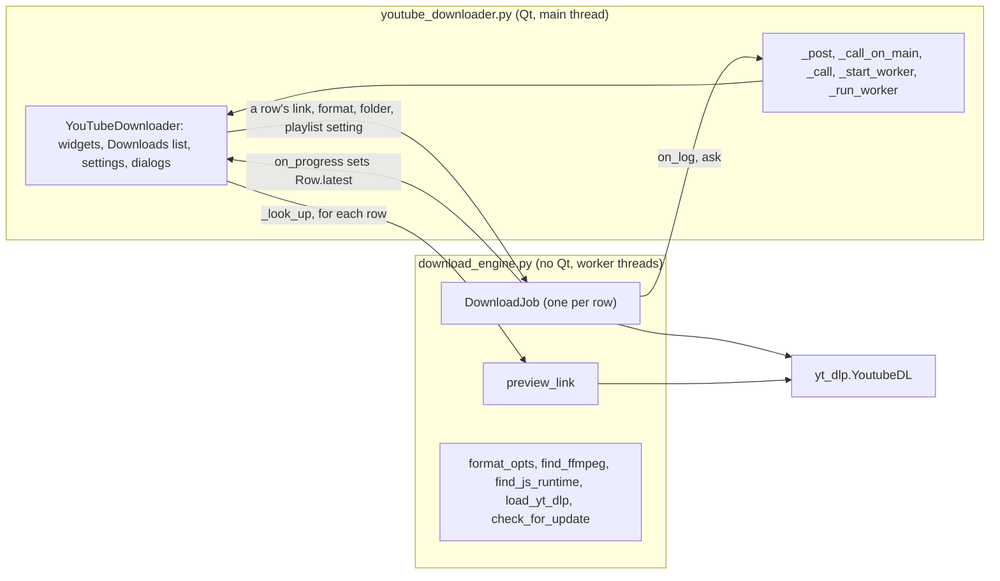
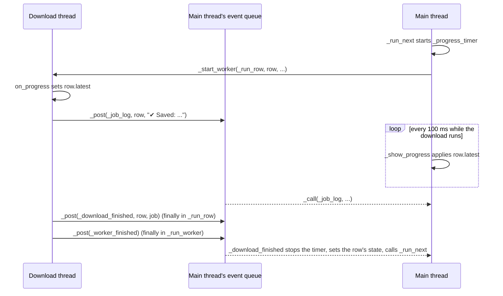
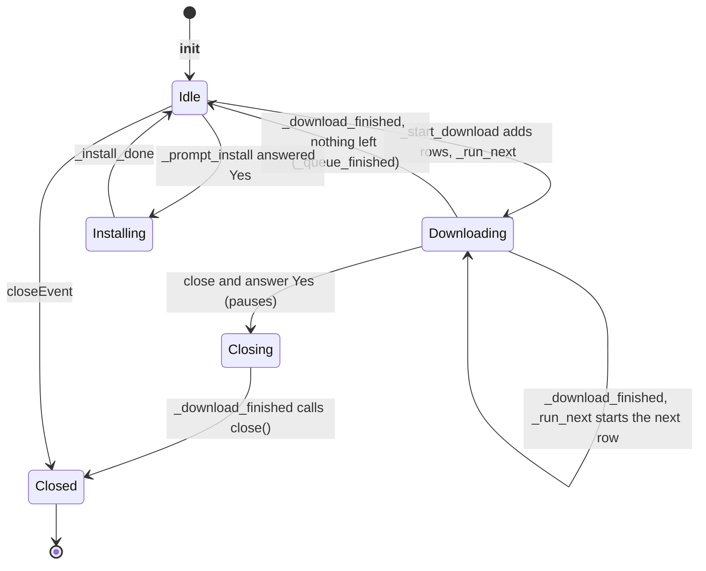

# 3 Architecture and Threading

Relevant source files

- [youtube_downloader.py](https://github.com/lifeupnorth/YouTubeDownloader/blob/47e016f109accff408446b290ced9684d980c667/youtube_downloader.py)
- [download_engine.py](https://github.com/lifeupnorth/YouTubeDownloader/blob/47e016f109accff408446b290ced9684d980c667/download_engine.py)

The app is two modules. **`download_engine.py`** does the downloading and knows nothing about Qt, so it can be tested on its own. **`youtube_downloader.py`** is the window: `YouTubeDownloader`, a Qt `QMainWindow` (PySide6), and the model and delegate of its Downloads list. Long-running work (a download, a link lookup, the JavaScript-runtime lookup, the update check, or a `pip install`) runs on background threads. Qt's widgets may only be used from the main thread, so those threads never touch them: they hand calls to the main thread through a queued Qt signal, and a download's progress goes through one field that the main thread reads 10 times a second. This page covers that split, the threading model and the window's lifecycle. For what a download does, see [Download Pipeline](04-download-pipeline.md); for the widgets, see [User Interface](06-user-interface.md).

## The two modules

| Module | Part | Lines | Role |
|---|---|---|---|
| `download_engine.py` | yt-dlp loading and version | 24–110 | Optional `yt_dlp` and Pillow imports, the pin from `requirements.txt`, `missing_yt_dlp_extras`, `load_yt_dlp`, version helpers |
| | Update check | 113–168 | `app_version` (from the .exe's bundled `VERSION` file), `newer_version`, `check_for_update`, `fetch_update_notice` |
| | Formats, ffmpeg | 171–276 | `VIDEO_MAX_RES`, `format_opts`, `format_eta`, `bundled_ffmpeg`, `find_ffmpeg` (see [Formats and ffmpeg](05-formats-ffmpeg.md)) |
| | JavaScript runtime | 279–313 | `JS_RUNTIMES`, `js_solver_version`, `find_js_runtime` |
| | yt-dlp plumbing | 316–439 | `_YdlLogger`, `_callback_pp_class`, `_current` and `_tracked_popen_class` and `_track_processes` (tracking ffmpeg runs, under `_track_lock`), `_follow_url_results` |
| | Link preview | 442–559 | `THUMB_SIZE`, `describe_info`, `thumbnail_url`, `fetch_thumbnail`, `encode_thumbnail` and `decode_thumbnail` (for the saved list), `preview_link` |
| | Downloading | 562–897 | `remove_partial_files`, `canceled_summary`, `DownloadJob`, which downloads one link and can be canceled or paused |
| `youtube_downloader.py` | Themes, settings, helpers | 81–332 | `THEMES`, `FORMATS` and `QUALITIES`, `settings_path`/`load_settings`/`save_settings`, `history_path`/`load_history`/`save_history`, `split_links`, `dropped`, `reveal_in_file_manager`, the help texts for ffmpeg and the JavaScript runtime, `application()` |
| | The Downloads list | 335–818 | `STATES`, `ROW_ACTIONS` and `row_actions`, `bar_percent`, `Row`, `row_entry` and `restored_row` (the saved list), `queue_summary`, `DownloadsModel`, `RowDelegate`, `DownloadsView` |
| | Drawing | 821–1028 | The icons, the logo, `to_qimage`, `write_svgs`, `translucent`, `style_sheet` |
| | `YouTubeDownloader` | 1031–2064 | The window, its state, the worker plumbing, and the lookup, download, drag-and-drop, cancel, pause and resume, saved list, update and install handlers |
| | Command-line check | 2067–2108 | `self_check` (`--self-check`), see [Getting Started](02-getting-started.md) |
| | Entry point | 2111–2140 | `main()`: runs the check, or creates the window and runs Qt's event loop (`app.exec()`) |

The engine reports through plain callbacks and keeps its own results (outcome, counts, error, last file, summary), so the window only has to turn callbacks into main-thread calls and show the result in the row. The window reads its widgets (format, quality, folder, the playlist switch) on the main thread when a link is added, keeps the values in the link's `Row`, and passes them to the engine.

Sources: [download_engine.py:1-7](https://github.com/lifeupnorth/YouTubeDownloader/blob/47e016f109accff408446b290ced9684d980c667/download_engine.py#L1-L7), [download_engine.py:75-90](https://github.com/lifeupnorth/YouTubeDownloader/blob/47e016f109accff408446b290ced9684d980c667/download_engine.py#L75-L90), [download_engine.py:180-221](https://github.com/lifeupnorth/YouTubeDownloader/blob/47e016f109accff408446b290ced9684d980c667/download_engine.py#L180-L221), [download_engine.py:306-313](https://github.com/lifeupnorth/YouTubeDownloader/blob/47e016f109accff408446b290ced9684d980c667/download_engine.py#L306-L313), [download_engine.py:519-559](https://github.com/lifeupnorth/YouTubeDownloader/blob/47e016f109accff408446b290ced9684d980c667/download_engine.py#L519-L559), [download_engine.py:605-648](https://github.com/lifeupnorth/YouTubeDownloader/blob/47e016f109accff408446b290ced9684d980c667/download_engine.py#L605-L648), [download_engine.py:878-897](https://github.com/lifeupnorth/YouTubeDownloader/blob/47e016f109accff408446b290ced9684d980c667/download_engine.py#L878-L897), [youtube_downloader.py:1-8](https://github.com/lifeupnorth/YouTubeDownloader/blob/47e016f109accff408446b290ced9684d980c667/youtube_downloader.py#L1-L8), [youtube_downloader.py:397-419](https://github.com/lifeupnorth/YouTubeDownloader/blob/47e016f109accff408446b290ced9684d980c667/youtube_downloader.py#L397-L419), [youtube_downloader.py:1515-1545](https://github.com/lifeupnorth/YouTubeDownloader/blob/47e016f109accff408446b290ced9684d980c667/youtube_downloader.py#L1515-L1545), [youtube_downloader.py:1680-1700](https://github.com/lifeupnorth/YouTubeDownloader/blob/47e016f109accff408446b290ced9684d980c667/youtube_downloader.py#L1680-L1700)

## Threads and main-thread calls

There are two kinds of threads:

- **The main thread** runs Qt's event loop. It builds the UI, handles clicks, shows dialogs and applies every UI update.
- **Worker threads** are daemon threads started by `_start_worker`: `_run_row` for a row's download (one thread per download, up to three at a time), `_look_up` for each row's lookup (three at a time), `_find_js_runtime_thread` (at startup and after an in-app install), `_update_thread` for the release .exe's update check, or the inner `run()` of `_install_ytdlp` for a pip install.

Every worker runs inside `_run_worker`. If the target raises, it posts `_worker_crashed`, which writes "✘ Unexpected error: …" (the exception's last line) to the log, opens the log, and prints the full traceback when there is a console. Its `finally` always posts `_worker_finished`, after anything the target posted.

Workers reach the main thread in two ways:

1. **Discrete events** go through `_post(func, *args)`, which emits the window's `_call_on_main` signal. The signal is connected with `Qt.QueuedConnection`, so Qt adds the call to the main thread's event queue and runs `_call(func, args)` there, in the order they were posted. `_call` catches any exception and hands it to `report_error`, which logs "✘ Unexpected error: …" (and prints the traceback when there is a console), so one failing call doesn't stop the others. Log lines, a lookup's result, "download finished" and a yes/no question all go this way.
2. **Progress** is coalesced: the engine's `on_progress` callback only sets the row's `latest` to `(pct, message)`. Only the newest value matters, so nothing is posted per progress event. While a download runs, a `QTimer` (`_progress_timer`, every 100 ms) runs `_show_progress` on the main thread, which, for each running row, takes `latest` (and sets it back to `None`), updates the row's percentage, state (`processing` when the message says "Processing…") and message, and tells the model the row changed. After a Cancel or Pause it leaves the row alone, so "Canceling…" or "Pausing…" stays. `_run_next` starts the timer, and `_download_finished` takes the row out of `_running` (and stops the timer once none is left) before setting the row's final state, so a late progress value can't overwrite that state.

`_run_row` has its own `try`/`finally`. If no JavaScript runtime was found at startup it looks again (one may have been installed since), creates the row's `DownloadJob` (with the row's cancel and pause events, and the partial files an earlier pause kept), stores it in `row.job`, and runs it unless the row was already canceled or paused. It always posts `_download_finished(row, job)`, so the queue can't get stuck. If it crashed, the error goes to the log first and `job` is `None`, which `_download_finished` shows as a Failed row with "An unexpected error (see the log)", or a Canceled or Paused one if the row was canceled or paused.

Errors raised in Qt's own callbacks on the main thread (a button's slot, for example) go to `sys.excepthook`. `main()` sets it to a function that calls the window's `report_error` (or Python's own hook once the window is gone), so in the windowed .exe, which has no console, they reach the log too.

Sources: [youtube_downloader.py:1033-1037](https://github.com/lifeupnorth/YouTubeDownloader/blob/47e016f109accff408446b290ced9684d980c667/youtube_downloader.py#L1033-L1037), [youtube_downloader.py:1073-1074](https://github.com/lifeupnorth/YouTubeDownloader/blob/47e016f109accff408446b290ced9684d980c667/youtube_downloader.py#L1073-L1074), [youtube_downloader.py:1432-1471](https://github.com/lifeupnorth/YouTubeDownloader/blob/47e016f109accff408446b290ced9684d980c667/youtube_downloader.py#L1432-L1471), [youtube_downloader.py:1634-1652](https://github.com/lifeupnorth/YouTubeDownloader/blob/47e016f109accff408446b290ced9684d980c667/youtube_downloader.py#L1634-L1652), [youtube_downloader.py:1678-1769](https://github.com/lifeupnorth/YouTubeDownloader/blob/47e016f109accff408446b290ced9684d980c667/youtube_downloader.py#L1678-L1769), [youtube_downloader.py:2123-2131](https://github.com/lifeupnorth/YouTubeDownloader/blob/47e016f109accff408446b290ced9684d980c667/youtube_downloader.py#L2123-L2131)

## No polling

Nothing polls. The main thread waits in Qt's event loop until there's something to do: a click, a call posted by a worker, or a timer. The only repeating timer is `_progress_timer`, which runs only while a download does; the saved list's `_history_timer` fires once, a second after the list last changed. `_active_workers` still counts the running workers: `_start_worker` increments it, and `_worker_finished`, which `_run_worker` posts for every worker, even one that crashed, decrements it; the tests wait on it to know the window is idle. Following the system's light or dark setting needs no timer either: Qt emits `colorSchemeChanged` when it switches (see [User Interface](06-user-interface.md#themes)).

Sources: [youtube_downloader.py:1071-1078](https://github.com/lifeupnorth/YouTubeDownloader/blob/47e016f109accff408446b290ced9684d980c667/youtube_downloader.py#L1071-L1078), [youtube_downloader.py:1441-1458](https://github.com/lifeupnorth/YouTubeDownloader/blob/47e016f109accff408446b290ced9684d980c667/youtube_downloader.py#L1441-L1458), [youtube_downloader.py:1907-1912](https://github.com/lifeupnorth/YouTubeDownloader/blob/47e016f109accff408446b290ced9684d980c667/youtube_downloader.py#L1907-L1912), [tests/test_window.py:164-168](https://github.com/lifeupnorth/YouTubeDownloader/blob/47e016f109accff408446b290ced9684d980c667/tests/test_window.py#L164-L168)

## Several downloads at once

The window runs up to `_parallel` downloads at the same time (1 to 3, two by default), each a `DownloadJob` on its own thread. What the engine shares between them:

- **`_current`**, the job running on this thread, is a `threading.local`, so each thread sees its own job.
- **Process tracking**: `_track_processes` swaps the `Popen` that yt-dlp's ffmpeg post-processors and external downloaders use for `_tracked_popen_class`, once for the whole process. Each process reports to the job on the thread that starts it (`_current.job`; yt-dlp runs post-processors and ffmpeg downloads on the download's own thread), and a job's `_processes` and `_killed_outputs` are its own, behind its own `_lock`, so Cancel or Pause stops only that job's ffmpeg. Every job calls `_track_processes` when it starts, so two can call it at once: `functools.cache` doesn't lock, and without `_track_lock` both could make a class and install one each. Tracking still worked then (both classes report to `_current.job`), but the swap is now done once, under the lock.
- **yt-dlp**: each job has its own `YoutubeDL`, with its own options, hooks and logger. yt-dlp's on-disk cache (e.g. YouTube's player code) is written through a temporary file and a rename; a write that loses a race only becomes a warning in the log.
- **Files**: two jobs writing the same file would spoil it, so the window doesn't start a row whose link and folder are those of a download running now (`_clashes`, e.g. the same video as MP4 and MP3): it waits its turn.

The window keeps the running rows in a set (`_running`). `_run_next` starts waiting rows, in list order, while fewer than `_parallel` run; `_show_progress` updates each; `_download_finished` takes one out and starts the next; Cancel and Pause act on whichever row they're for. The speed beside the status line adds up the running rows' speeds. Raising "at a time" starts waiting rows at once; lowering it lets those running finish.

Sources: [download_engine.py:367-384](https://github.com/lifeupnorth/YouTubeDownloader/blob/47e016f109accff408446b290ced9684d980c667/download_engine.py#L367-L384), [download_engine.py:405-428](https://github.com/lifeupnorth/YouTubeDownloader/blob/47e016f109accff408446b290ced9684d980c667/download_engine.py#L405-L428), [download_engine.py:658-681](https://github.com/lifeupnorth/YouTubeDownloader/blob/47e016f109accff408446b290ced9684d980c667/download_engine.py#L658-L681), [youtube_downloader.py:158-160](https://github.com/lifeupnorth/YouTubeDownloader/blob/47e016f109accff408446b290ced9684d980c667/youtube_downloader.py#L158-L160), [youtube_downloader.py:1343-1347](https://github.com/lifeupnorth/YouTubeDownloader/blob/47e016f109accff408446b290ced9684d980c667/youtube_downloader.py#L1343-L1347), [youtube_downloader.py:1421-1428](https://github.com/lifeupnorth/YouTubeDownloader/blob/47e016f109accff408446b290ced9684d980c667/youtube_downloader.py#L1421-L1428), [youtube_downloader.py:1634-1657](https://github.com/lifeupnorth/YouTubeDownloader/blob/47e016f109accff408446b290ced9684d980c667/youtube_downloader.py#L1634-L1657)

## Asking the user from a worker

A download sometimes needs an answer before it can continue: whether to download a whole playlist (see [Download Pipeline](04-download-pipeline.md)). The engine calls its `ask` callback, which the window wires to `_ask_on_main(row, "Playlist", question)`. That takes `_question_lock` and calls `_ask`, which posts a small `ask()` closure that shows `QMessageBox.question` on the main thread, stores the answer and sets a `threading.Event`. If the row was canceled or paused before the question could show, the answer is No without asking. Only one question shows at a time: `_ask_on_main` holds `_question_lock` while it asks, and another download's question waits for it (still giving up if its row is canceled or paused, or the window closes), since two dialogs on top of each other wouldn't say which link each is about. The worker waits on the event in 0.1 s steps and gives up with `False` if the window starts closing or the row is canceled or paused (the job then ends canceled or paused, not declined), so it can't hang on a dialog that will never be answered. If the dialog itself fails, `ask()` logs "✘ Couldn't ask about the playlist: …" and re-raises, so `_call` reports the error as well; the answer counts as No, and a `finally` still sets the event.

Sources: [youtube_downloader.py:1690](https://github.com/lifeupnorth/YouTubeDownloader/blob/47e016f109accff408446b290ced9684d980c667/youtube_downloader.py#L1690), [youtube_downloader.py:1782-1819](https://github.com/lifeupnorth/YouTubeDownloader/blob/47e016f109accff408446b290ced9684d980c667/youtube_downloader.py#L1782-L1819), [download_engine.py:774-789](https://github.com/lifeupnorth/YouTubeDownloader/blob/47e016f109accff408446b290ced9684d980c667/download_engine.py#L774-L789)

## Window lifecycle

`main()` first sets a Windows AppUserModelID (`lifeupnorth.YTDownloader`), so the taskbar shows the app's own icon rather than Python's, then creates the `QApplication` (`application()`) and the window, sets `sys.excepthook`, shows the window and runs `app.exec()`.

`__init__` makes sure the `QApplication` exists, connects `_call_on_main`, sets up the state, applies the saved settings, creates the model, builds the UI, applies the theme (and connects `colorSchemeChanged`), creates the progress timer and the saved list's timer, loads the list saved by the last run (`_load_history`) and sizes the window (`_fit_window`). Then it runs its startup checks:

- If yt-dlp is missing, it schedules `_prompt_install` 300 ms later (`QTimer.singleShot`).
- If ffmpeg isn't found, it shows a warning in the status line and opens the log with the install hint. `changeEvent` checks again whenever the window becomes the active one (`QEvent.ActivationChange` → `_recheck_ffmpeg`).
- If yt-dlp is installed, it starts `_find_js_runtime_thread` on a worker (it runs `<runtime> --version`). `_js_runtime_found` stores the result in `_js_runtime` and logs a hint if no runtime or no yt-dlp-ejs was found.
- If the installed yt-dlp isn't the pinned version, it says so in the log (`_note_yt_dlp_version`).
- If the saved folder isn't available (an unplugged drive?), it says so in the log and saves to `~/Downloads` for now.
- `_maybe_check_for_update` starts `_update_thread` only in a release .exe, while "Check for updates at startup" is on, and at most once a day (`last_update_check` in the settings, saved by `_update_checked` only when the check reached GitHub); `_update_checked` logs a notice if a newer release is out. `self_check` creates the window with `update_check=False`.

Closing goes through `closeEvent`. If a download is running, it first asks "Pause it and close the app? You can resume it the next time." (with several running, "2 downloads are still running… Pause them…"). On No, `event.ignore()` keeps the window open. On Yes it checks `_running` again, since the download may have finished while the question was open; if it did, the window just closes. Otherwise it sets `_close_when_stopped`, pauses every row (the running one stops and keeps its partial files, waiting ones are marked Paused), says "Pausing… the app closes when it has stopped." and ignores the event; `_run_next` starts nothing more, and `_download_finished` calls `close()` again once every download has stopped. Clicking close a second time while that runs (e.g. stuck on a slow network request) closes right away. When the window does close, `closeEvent` sets `_closing`, sets every row's cancel event, which stops the lookups and makes `_ask_on_main` return (for a download still running after a second close, its pause event instead, so its partial files aren't removed on the way out), stops the progress timer and saves the settings and the Downloads list. `app.exec()` returns when the last window has closed. Worker threads are daemons, so anything still running then (a pip install, or a download after a forced second close) ends with the process.

Sources: [youtube_downloader.py:1039-1096](https://github.com/lifeupnorth/YouTubeDownloader/blob/47e016f109accff408446b290ced9684d980c667/youtube_downloader.py#L1039-L1096), [youtube_downloader.py:1473-1483](https://github.com/lifeupnorth/YouTubeDownloader/blob/47e016f109accff408446b290ced9684d980c667/youtube_downloader.py#L1473-L1483), [youtube_downloader.py:1765-1768](https://github.com/lifeupnorth/YouTubeDownloader/blob/47e016f109accff408446b290ced9684d980c667/youtube_downloader.py#L1765-L1768), [youtube_downloader.py:1916-1947](https://github.com/lifeupnorth/YouTubeDownloader/blob/47e016f109accff408446b290ced9684d980c667/youtube_downloader.py#L1916-L1947), [youtube_downloader.py:1949-1963](https://github.com/lifeupnorth/YouTubeDownloader/blob/47e016f109accff408446b290ced9684d980c667/youtube_downloader.py#L1949-L1963), [youtube_downloader.py:1974-1997](https://github.com/lifeupnorth/YouTubeDownloader/blob/47e016f109accff408446b290ced9684d980c667/youtube_downloader.py#L1974-L1997), [youtube_downloader.py:2112-2133](https://github.com/lifeupnorth/YouTubeDownloader/blob/47e016f109accff408446b290ced9684d980c667/youtube_downloader.py#L2112-L2133)

## Installing yt-dlp at runtime

If yt-dlp is missing, `_prompt_install` asks whether to install it. (The .exe has yt-dlp built in and no pip, so there it only shows an error.) On Yes, `_install_ytdlp` sets `_installing` and runs `python -m pip install <pin>` (`engine.YT_DLP_REQUIREMENT`, e.g. `yt-dlp[default]==2026.8.19` from `requirements.txt` next to the code, or `yt-dlp[default]` without that file) on a worker, capturing pip's output. While it runs, clicking Download only says "Installing yt-dlp, please wait…". If pip fails, the log shows the last five lines of its output. After pip succeeds, the worker calls `engine.load_yt_dlp()`, which imports yt-dlp into the running app, adding the per-user site-packages folder if pip just created it. `_install_done` then updates the header with the version and starts `_find_js_runtime_thread`, which startup skipped without yt-dlp; downloads work without a restart. Only if that import fails does the app ask for a restart.

Sources: [download_engine.py:44-63](https://github.com/lifeupnorth/YouTubeDownloader/blob/47e016f109accff408446b290ced9684d980c667/download_engine.py#L44-L63), [download_engine.py:75-90](https://github.com/lifeupnorth/YouTubeDownloader/blob/47e016f109accff408446b290ced9684d980c667/download_engine.py#L75-L90), [youtube_downloader.py:1499-1513](https://github.com/lifeupnorth/YouTubeDownloader/blob/47e016f109accff408446b290ced9684d980c667/youtube_downloader.py#L1499-L1513), [youtube_downloader.py:2007-2064](https://github.com/lifeupnorth/YouTubeDownloader/blob/47e016f109accff408446b290ced9684d980c667/youtube_downloader.py#L2007-L2064)

## Shared state

| Attribute | Written by | Read by | Purpose |
|---|---|---|---|
| `_call_on_main` (a signal) | workers (`_post`) | main (`_call`) | Calls to run on the main thread |
| `Row.latest` | download thread (`on_progress`), main (`_show_progress`) | main | Coalesced progress |
| `Row.job` | download thread (`_run_row`) | main (`_cancel_row`, `_pause_row`) | The row's running `DownloadJob`, so Cancel and Pause can stop its ffmpeg |
| `Row.cancel_event` | main (`_cancel_row`, `closeEvent`) | lookup and download threads, the engine | Stops the row's lookup, download and playlist question |
| `Row.pause_event` | main (`_pause_row`, `closeEvent`; `_resume_row` replaces it) | download thread, the engine | Stops the row's download and playlist question, keeping its partial files |
| Other `Row` fields | main | main | Title, state, progress, message and file shown in the list |
| `_running` | main (`_run_next`, `_download_finished`) | main | The rows downloading now (a set), at most `_parallel` (more for a while after it's lowered, until they finish) |
| `_parallel` | main (`_parallel_changed`, from the settings) | main | How many links download at a time (1 to 3) |
| `_question_lock` | download threads (`_ask_on_main`) | download threads | One playlist question at a time |
| `_active_workers` | main | main, tests | How many workers are running |
| `_history_timer` | main (`_history_changed`, `_save_history`) | main | Saves the Downloads list a second after it last changed |
| `_lookup_slots` | lookup threads | lookup threads | A semaphore letting three lookups run at once |
| `_closing`, `_close_when_stopped` | main (`closeEvent`) | main, workers | Shutdown |
| `_installing` | main (`_install_ytdlp`, `_install_done`) | main | An in-app install is running; Download then asks the user to wait instead of offering the install again |
| `_js_runtime` | main (`_js_runtime_found`) | main | The `(name, path)` found by the startup lookup, passed to lookups and downloads |
| `DownloadJob._processes`, `_killed_outputs` | worker (`_process_started`), main (`stop_processes` on Cancel or Pause) | main, worker (`_remove_partial_files`, `_keep_partial_files`) | ffmpeg runs of the job and the new files they were creating; both guarded by `DownloadJob._lock` |
| `_current` (engine, `threading.local`) | worker | worker | Which job the thread's ffmpeg runs belong to; each download has its own thread |
| `_track_lock` (engine) | workers (`_track_processes`) | workers | Swaps yt-dlp's `Popen` once, though several jobs start at once |

Sources: [youtube_downloader.py:397-419](https://github.com/lifeupnorth/YouTubeDownloader/blob/47e016f109accff408446b290ced9684d980c667/youtube_downloader.py#L397-L419), [youtube_downloader.py:1045-1067](https://github.com/lifeupnorth/YouTubeDownloader/blob/47e016f109accff408446b290ced9684d980c667/youtube_downloader.py#L1045-L1067), [youtube_downloader.py:1073-1078](https://github.com/lifeupnorth/YouTubeDownloader/blob/47e016f109accff408446b290ced9684d980c667/youtube_downloader.py#L1073-L1078), [download_engine.py:367-368](https://github.com/lifeupnorth/YouTubeDownloader/blob/47e016f109accff408446b290ced9684d980c667/download_engine.py#L367-L368), [download_engine.py:408-410](https://github.com/lifeupnorth/YouTubeDownloader/blob/47e016f109accff408446b290ced9684d980c667/download_engine.py#L408-L410), [download_engine.py:620-648](https://github.com/lifeupnorth/YouTubeDownloader/blob/47e016f109accff408446b290ced9684d980c667/download_engine.py#L620-L648), [download_engine.py:658-681](https://github.com/lifeupnorth/YouTubeDownloader/blob/47e016f109accff408446b290ced9684d980c667/download_engine.py#L658-L681)
