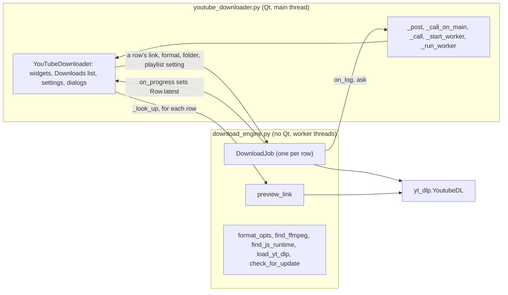
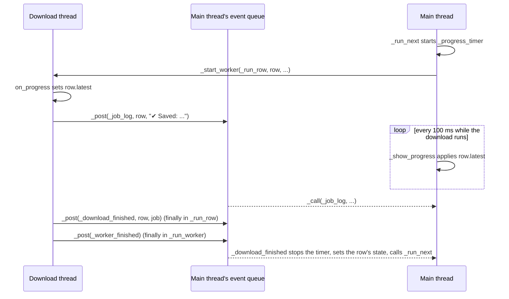
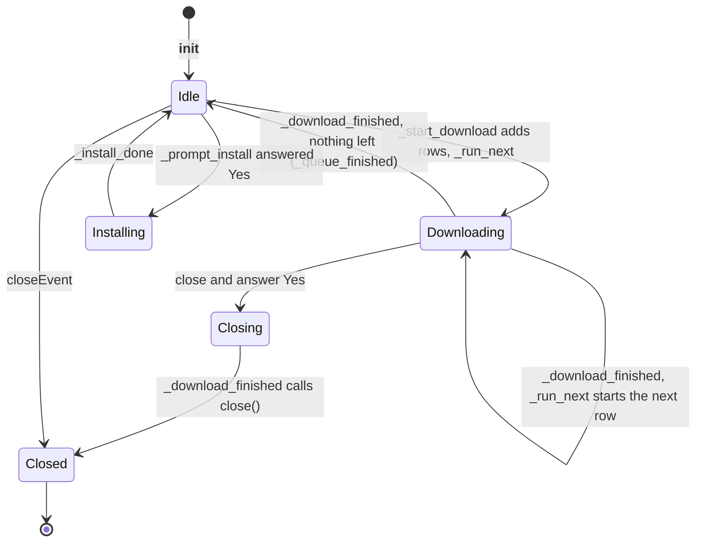

# 3 Architecture and Threading

Relevant source files

- [youtube_downloader.py](https://github.com/lifeupnorth/YouTubeDownloader/blob/b369bd269cac691e2563e27391dbd3702c986e50/youtube_downloader.py)
- [download_engine.py](https://github.com/lifeupnorth/YouTubeDownloader/blob/b369bd269cac691e2563e27391dbd3702c986e50/download_engine.py)

The app is two modules. **`download_engine.py`** does the downloading and knows nothing about Qt, so it can be tested on its own. **`youtube_downloader.py`** is the window: `YouTubeDownloader`, a Qt `QMainWindow` (PySide6), and the model and delegate of its Downloads list. Long-running work (a download, a link lookup, the JavaScript-runtime lookup, the update check, or a `pip install`) runs on background threads. Qt's widgets may only be used from the main thread, so those threads never touch them: they hand calls to the main thread through a queued Qt signal, and a download's progress goes through one field that the main thread reads 10 times a second. This page covers that split, the threading model and the window's lifecycle. For what a download does, see [Download Pipeline](04-download-pipeline.md); for the widgets, see [User Interface](06-user-interface.md).

## The two modules

| Module | Part | Lines | Role |
|---|---|---|---|
| `download_engine.py` | yt-dlp loading and version | 24–110 | Optional `yt_dlp` and Pillow imports, the pin from `requirements.txt`, `missing_yt_dlp_extras`, `load_yt_dlp`, version helpers |
| | Update check | 113–168 | `app_version` (from the .exe's bundled `VERSION` file), `newer_version`, `check_for_update`, `fetch_update_notice` |
| | Formats, ffmpeg | 171–272 | `VIDEO_MAX_RES`, `format_opts`, `format_eta`, `bundled_ffmpeg`, `find_ffmpeg` (see [Formats and ffmpeg](05-formats-ffmpeg.md)) |
| | JavaScript runtime | 275–309 | `JS_RUNTIMES`, `js_solver_version`, `find_js_runtime` |
| | yt-dlp plumbing | 312–428 | `_YdlLogger`, `_callback_pp_class`, `_current` and `_tracked_popen_class` (tracking ffmpeg runs), `_follow_url_results` |
| | Link preview | 431–522 | `THUMB_SIZE`, `describe_info`, `thumbnail_url`, `fetch_thumbnail`, `preview_link` |
| | Downloading | 525–806 | `DownloadJob`, which downloads one link |
| `youtube_downloader.py` | Themes, settings, helpers | 80–283 | `THEMES`, `FORMATS` and `QUALITIES`, `settings_path`/`load_settings`/`save_settings`, `split_links`, `reveal_in_file_manager`, the help texts for ffmpeg and the JavaScript runtime, `application()` |
| | The Downloads list | 286–660 | `STATES`, `ROW_ACTIONS` and `row_actions`, `Row`, `DownloadsModel`, `RowDelegate`, `DownloadsView` |
| | Drawing | 663–851 | The icons, the logo, `to_qimage`, `write_svgs`, `style_sheet` |
| | `YouTubeDownloader` | 854–1681 | The window, its state, the worker plumbing, and the lookup, download, cancel, update and install handlers |
| | Command-line check | 1684–1725 | `self_check` (`--self-check`), see [Getting Started](02-getting-started.md) |
| | Entry point | 1728–1757 | `main()`: runs the check, or creates the window and runs Qt's event loop (`app.exec()`) |

The engine reports through plain callbacks and keeps its own results (outcome, counts, error, last file, summary), so the window only has to turn callbacks into main-thread calls and show the result in the row. The window reads its widgets (format, quality, folder, the playlist switch) on the main thread when a link is added, keeps the values in the link's `Row`, and passes them to the engine.

Sources: [download_engine.py:1-7](https://github.com/lifeupnorth/YouTubeDownloader/blob/b369bd269cac691e2563e27391dbd3702c986e50/download_engine.py#L1-L7), [download_engine.py:23-109](https://github.com/lifeupnorth/YouTubeDownloader/blob/b369bd269cac691e2563e27391dbd3702c986e50/download_engine.py#L23-L109), [download_engine.py:112-161](https://github.com/lifeupnorth/YouTubeDownloader/blob/b369bd269cac691e2563e27391dbd3702c986e50/download_engine.py#L112-L161), [download_engine.py:268-302](https://github.com/lifeupnorth/YouTubeDownloader/blob/b369bd269cac691e2563e27391dbd3702c986e50/download_engine.py#L268-L302), [download_engine.py:305-413](https://github.com/lifeupnorth/YouTubeDownloader/blob/b369bd269cac691e2563e27391dbd3702c986e50/download_engine.py#L305-L413), [download_engine.py:506-897](https://github.com/lifeupnorth/YouTubeDownloader/blob/b369bd269cac691e2563e27391dbd3702c986e50/download_engine.py#L506-L897), [youtube_downloader.py:2-27](https://github.com/lifeupnorth/YouTubeDownloader/blob/b369bd269cac691e2563e27391dbd3702c986e50/youtube_downloader.py#L2-L27), [youtube_downloader.py:176-225](https://github.com/lifeupnorth/YouTubeDownloader/blob/b369bd269cac691e2563e27391dbd3702c986e50/youtube_downloader.py#L176-L225), [youtube_downloader.py:961-1034](https://github.com/lifeupnorth/YouTubeDownloader/blob/b369bd269cac691e2563e27391dbd3702c986e50/youtube_downloader.py#L961-L1034)

## Threads and main-thread calls

There are two kinds of threads:

- **The main thread** runs Qt's event loop. It builds the UI, handles clicks, shows dialogs and applies every UI update.
- **Worker threads** are daemon threads started by `_start_worker`: `_run_row` for a row's download (one at a time), `_look_up` for each row's lookup (three at a time), `_find_js_runtime_thread` (at startup and after an in-app install), `_update_thread` for the release .exe's update check, or the inner `run()` of `_install_ytdlp` for a pip install.

Every worker runs inside `_run_worker`. If the target raises, it posts `_worker_crashed`, which writes "✘ Unexpected error: …" (the exception's last line) to the log, opens the log, and prints the full traceback when there is a console. Its `finally` always posts `_worker_finished`, after anything the target posted.

Workers reach the main thread in two ways:

1. **Discrete events** go through `_post(func, *args)`, which emits the window's `_call_on_main` signal. The signal is connected with `Qt.QueuedConnection`, so Qt adds the call to the main thread's event queue and runs `_call(func, args)` there, in the order they were posted. `_call` catches any exception and hands it to `report_error`, which logs "✘ Unexpected error: …" (and prints the traceback when there is a console), so one failing call doesn't stop the others. Log lines, a lookup's result, "download finished" and a yes/no question all go this way.
2. **Progress** is coalesced: the engine's `on_progress` callback only sets the row's `latest` to `(pct, message)`. Only the newest value matters, so nothing is posted per progress event. While a download runs, a `QTimer` (`_progress_timer`, every 100 ms) runs `_show_progress` on the main thread, which takes `latest` (and sets it back to `None`), updates the row's percentage, state (`processing` when the message says "Processing…") and message, and tells the model the row changed. After a Cancel it leaves the row alone, so "Canceling…" stays. `_run_next` starts the timer and `_download_finished` stops it and clears `_running` before setting the row's final state, so a late progress value can't overwrite that state.

`_run_row` has its own `try`/`finally`. If no JavaScript runtime was found at startup it looks again (one may have been installed since), creates the row's `DownloadJob`, stores it in `row.job`, and runs it unless the row was already canceled. It always posts `_download_finished(row, job)`, so the queue can't get stuck. If it crashed, the error goes to the log first and `job` is `None`, which `_download_finished` shows as a Failed row with "An unexpected error (see the log)", or a Canceled one if the row was canceled.

Errors raised in Qt's own callbacks on the main thread (a button's slot, for example) go to `sys.excepthook`. `main()` sets it to the window's `report_error`, so in the windowed .exe, which has no console, they reach the log too.

Sources: [youtube_downloader.py:541-614](https://github.com/lifeupnorth/YouTubeDownloader/blob/b369bd269cac691e2563e27391dbd3702c986e50/youtube_downloader.py#L541-L614), [youtube_downloader.py:692-713](https://github.com/lifeupnorth/YouTubeDownloader/blob/b369bd269cac691e2563e27391dbd3702c986e50/youtube_downloader.py#L692-L713), [youtube_downloader.py:752-762](https://github.com/lifeupnorth/YouTubeDownloader/blob/b369bd269cac691e2563e27391dbd3702c986e50/youtube_downloader.py#L752-L762)

## No polling

Nothing polls. The main thread waits in Qt's event loop until there's something to do: a click, a call posted by a worker, or a timer. The only repeating timer is `_progress_timer`, which runs only while a download does. `_active_workers` still counts the running workers: `_start_worker` increments it, and `_worker_finished`, which `_run_worker` posts for every worker, even one that crashed, decrements it; the tests wait on it to know the window is idle. Following the system's light or dark setting needs no timer either: Qt emits `colorSchemeChanged` when it switches (see [User Interface](06-user-interface.md#themes)).

Sources: [youtube_downloader.py:547-563](https://github.com/lifeupnorth/YouTubeDownloader/blob/b369bd269cac691e2563e27391dbd3702c986e50/youtube_downloader.py#L547-L563), [youtube_downloader.py:593-614](https://github.com/lifeupnorth/YouTubeDownloader/blob/b369bd269cac691e2563e27391dbd3702c986e50/youtube_downloader.py#L593-L614)

## Asking the user from a worker

A download sometimes needs an answer before it can continue: whether to download a whole playlist (see [Download Pipeline](04-download-pipeline.md)). The engine calls its `ask` callback, which the window wires to `_ask_on_main(row, "Playlist", question)`. That posts a small `ask()` closure that shows `QMessageBox.question` on the main thread, stores the answer and sets a `threading.Event`. If the row was canceled before the question could show, the answer is No without asking. The worker waits on the event in 0.1 s steps and gives up with `False` if the window starts closing or the row is canceled, so it can't hang on a dialog that will never be answered. If the dialog itself fails, `ask()` logs "✘ Couldn't ask about the playlist: …" and re-raises, so `_call` reports the error as well; the answer counts as No, and a `finally` still sets the event.

Sources: [youtube_downloader.py:700-701](https://github.com/lifeupnorth/YouTubeDownloader/blob/b369bd269cac691e2563e27391dbd3702c986e50/youtube_downloader.py#L700-L701), [youtube_downloader.py:715-735](https://github.com/lifeupnorth/YouTubeDownloader/blob/b369bd269cac691e2563e27391dbd3702c986e50/youtube_downloader.py#L715-L735)

## Window lifecycle

`main()` first sets a Windows AppUserModelID (`lifeupnorth.YTDownloader`), so the taskbar shows the app's own icon rather than Python's, then creates the `QApplication` (`application()`) and the window, sets `sys.excepthook`, shows the window and runs `app.exec()`.

`__init__` makes sure the `QApplication` exists, connects `_call_on_main`, sets up the state, applies the saved settings, creates the model, builds the UI, applies the theme (and connects `colorSchemeChanged`), creates the progress timer and sizes the window (`_fit_window`). Then it runs its startup checks:

- If yt-dlp is missing, it schedules `_prompt_install` 300 ms later (`QTimer.singleShot`).
- If ffmpeg isn't found, it shows a warning in the status line and opens the log with the install hint. `changeEvent` checks again whenever the window becomes the active one (`QEvent.ActivationChange` → `_recheck_ffmpeg`).
- If yt-dlp is installed, it starts `_find_js_runtime_thread` on a worker (it runs `<runtime> --version`). `_js_runtime_found` stores the result in `_js_runtime` and logs a hint if no runtime or no yt-dlp-ejs was found.
- If the installed yt-dlp isn't the pinned version, it says so in the log (`_note_yt_dlp_version`).
- If the saved folder isn't available (an unplugged drive?), it says so in the log and saves to `~/Downloads` for now.
- `_maybe_check_for_update` starts `_update_thread` only in a release .exe, while "Check for updates at startup" is on, and at most once a day (`last_update_check` in the settings, saved by `_update_checked` only when the check reached GitHub); `_update_checked` logs a notice if a newer release is out. `self_check` creates the window with `update_check=False`.

Closing goes through `closeEvent`. If a download is running, it first asks "Cancel it and close the app?". On No, `event.ignore()` keeps the window open. On Yes it checks `_running` again, since the download may have finished while the question was open; if it did, the window just closes. Otherwise it sets `_close_when_stopped`, cancels every row (the running one stops, waiting ones are marked Canceled), says "Canceling… the app closes when it has stopped." and ignores the event; `_run_next` starts nothing more, and `_download_finished` calls `close()` again once the partial files are removed. Clicking close a second time while that runs (e.g. stuck on a slow network request) closes right away. When the window does close, `closeEvent` sets `_closing`, sets every row's cancel event (which stops the lookups and makes `_ask_on_main` return), stops the progress timer and saves the settings. `app.exec()` returns when the last window has closed. Worker threads are daemons, so anything still running then (a pip install, or a download after a forced second close) ends with the process.

Sources: [youtube_downloader.py:177-225](https://github.com/lifeupnorth/YouTubeDownloader/blob/b369bd269cac691e2563e27391dbd3702c986e50/youtube_downloader.py#L177-L225), [youtube_downloader.py:581-591](https://github.com/lifeupnorth/YouTubeDownloader/blob/b369bd269cac691e2563e27391dbd3702c986e50/youtube_downloader.py#L581-L591), [youtube_downloader.py:616-643](https://github.com/lifeupnorth/YouTubeDownloader/blob/b369bd269cac691e2563e27391dbd3702c986e50/youtube_downloader.py#L616-L643), [youtube_downloader.py:752-755](https://github.com/lifeupnorth/YouTubeDownloader/blob/b369bd269cac691e2563e27391dbd3702c986e50/youtube_downloader.py#L752-L755), [youtube_downloader.py:849-858](https://github.com/lifeupnorth/YouTubeDownloader/blob/b369bd269cac691e2563e27391dbd3702c986e50/youtube_downloader.py#L849-L858), [youtube_downloader.py:869-895](https://github.com/lifeupnorth/YouTubeDownloader/blob/b369bd269cac691e2563e27391dbd3702c986e50/youtube_downloader.py#L869-L895)

## Installing yt-dlp at runtime

If yt-dlp is missing, `_prompt_install` asks whether to install it. (The .exe has yt-dlp built in and no pip, so there it only shows an error.) On Yes, `_install_ytdlp` sets `_installing` and runs `python -m pip install <pin>` (`engine.YT_DLP_REQUIREMENT`, e.g. `yt-dlp[default]==2026.8.19` from `requirements.txt` next to the code, or `yt-dlp[default]` without that file) on a worker, capturing pip's output. While it runs, clicking Download only says "Installing yt-dlp, please wait…". If pip fails, the log shows the last five lines of its output. After pip succeeds, the worker calls `engine.load_yt_dlp()`, which imports yt-dlp into the running app, adding the per-user site-packages folder if pip just created it. `_install_done` then updates the header with the version and starts `_find_js_runtime_thread`, which startup skipped without yt-dlp; downloads work without a restart. Only if that import fails does the app ask for a restart.

Sources: [download_engine.py:59-89](https://github.com/lifeupnorth/YouTubeDownloader/blob/b369bd269cac691e2563e27391dbd3702c986e50/download_engine.py#L59-L89), [youtube_downloader.py:656-661](https://github.com/lifeupnorth/YouTubeDownloader/blob/b369bd269cac691e2563e27391dbd3702c986e50/youtube_downloader.py#L656-L661), [youtube_downloader.py:897-958](https://github.com/lifeupnorth/YouTubeDownloader/blob/b369bd269cac691e2563e27391dbd3702c986e50/youtube_downloader.py#L897-L958)

## Shared state

| Attribute | Written by | Read by | Purpose |
|---|---|---|---|
| `_call_on_main` (a signal) | workers (`_post`) | main (`_call`) | Calls to run on the main thread |
| `Row.latest` | download thread (`on_progress`), main (`_show_progress`) | main | Coalesced progress |
| `Row.job` | download thread (`_run_row`) | main (`_cancel_row`) | The row's running `DownloadJob`, so Cancel can stop its ffmpeg |
| `Row.cancel_event` | main (`_cancel_row`, `closeEvent`) | lookup and download threads, the engine | Stops the row's lookup, download and playlist question |
| Other `Row` fields | main | main | Title, state, progress, message and file shown in the list |
| `_running` | main (`_run_next`, `_download_finished`) | main | The row downloading now; only one at a time |
| `_active_workers` | main | main, tests | How many workers are running |
| `_lookup_slots` | lookup threads | lookup threads | A semaphore letting three lookups run at once |
| `_closing`, `_close_when_stopped` | main (`closeEvent`) | main, workers | Shutdown |
| `_installing` | main (`_install_ytdlp`, `_install_done`) | main | An in-app install is running; Download then asks the user to wait instead of offering the install again |
| `_js_runtime` | main (`_js_runtime_found`) | main | The `(name, path)` found by the startup lookup, passed to lookups and downloads |
| `DownloadJob._processes`, `_killed_outputs` | worker (`_process_started`), main (`stop_processes` on Cancel) | main, worker (`_remove_partial_files`) | ffmpeg runs of the job and the new files they were creating; both guarded by `DownloadJob._lock` |
| `_current` (engine, `threading.local`) | worker | worker | Which job the thread's ffmpeg runs belong to |

Sources: [youtube_downloader.py:182-206](https://github.com/lifeupnorth/YouTubeDownloader/blob/b369bd269cac691e2563e27391dbd3702c986e50/youtube_downloader.py#L182-L206), [youtube_downloader.py:219-221](https://github.com/lifeupnorth/YouTubeDownloader/blob/b369bd269cac691e2563e27391dbd3702c986e50/youtube_downloader.py#L219-L221), [download_engine.py:356-373](https://github.com/lifeupnorth/YouTubeDownloader/blob/b369bd269cac691e2563e27391dbd3702c986e50/download_engine.py#L356-L373), [download_engine.py:536-566](https://github.com/lifeupnorth/YouTubeDownloader/blob/b369bd269cac691e2563e27391dbd3702c986e50/download_engine.py#L536-L566)
