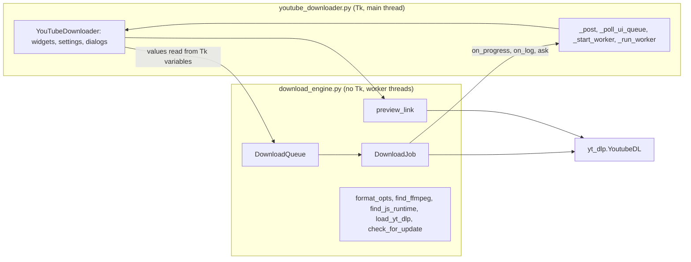
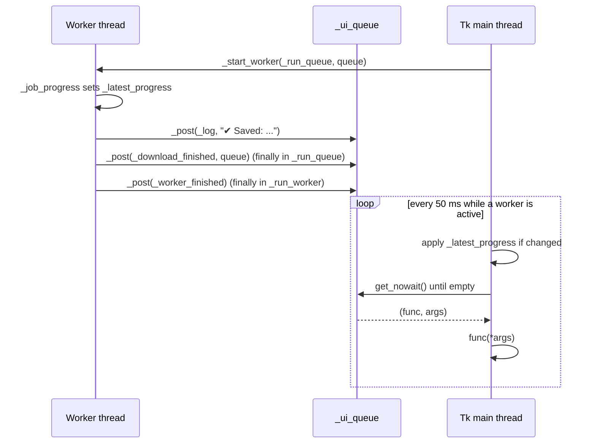
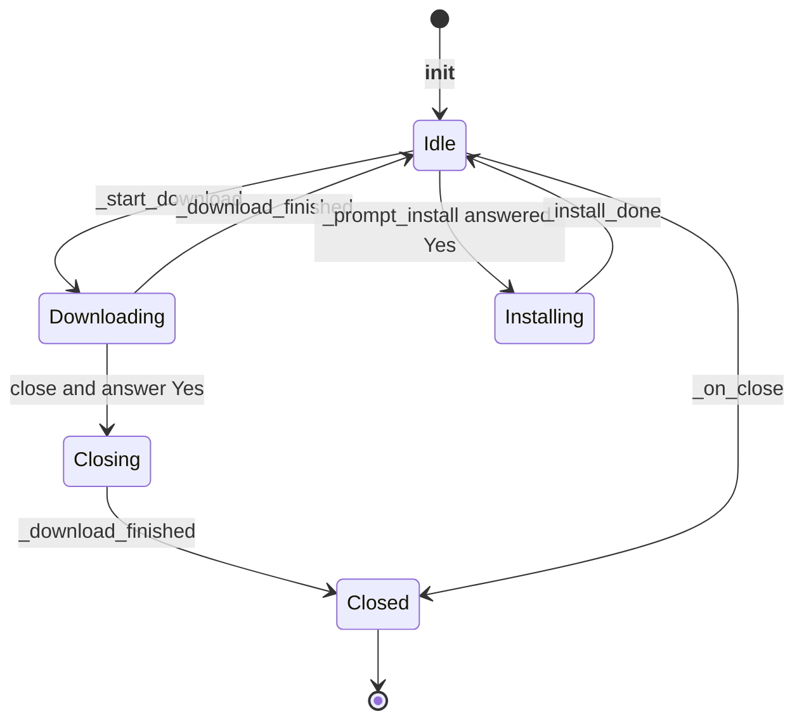

# 3 Architecture and Threading

Relevant source files

- [youtube_downloader.py](https://github.com/lifeupnorth/YouTubeDownloader/blob/b369bd269cac691e2563e27391dbd3702c986e50/youtube_downloader.py)
- [download_engine.py](https://github.com/lifeupnorth/YouTubeDownloader/blob/b369bd269cac691e2563e27391dbd3702c986e50/download_engine.py)

The app is two modules. **`download_engine.py`** does the downloading and knows nothing about Tk, so it can be tested on its own. **`youtube_downloader.py`** is the window: a single class, `YouTubeDownloader`, which subclasses `tk.Tk`. Long-running work (a download, a link preview, the JavaScript-runtime lookup, the update check, or a `pip install`) runs on background threads. Tkinter isn't thread-safe, so those threads never touch widgets or Tk variables: everything they want to show goes through a queue that the Tk main thread drains. This page covers that split, the threading model and the window's lifecycle. For what a download does, see [Download Pipeline](04-download-pipeline.md); for the widgets, see [User Interface](06-user-interface.md).

## The two modules

| Module | Part | Lines | Role |
|---|---|---|---|
| `download_engine.py` | yt-dlp loading and version | 23–109 | Optional `yt_dlp` and Pillow imports, the pin from `requirements.txt`, `missing_yt_dlp_extras`, `load_yt_dlp`, version helpers |
| | Update check | 112–161 | `app_version` (from the .exe's bundled `VERSION` file), `newer_version`, `check_for_update` |
| | Formats, ffmpeg | 164–265 | `VIDEO_MAX_RES`, `format_opts`, `format_eta`, `bundled_ffmpeg`, `find_ffmpeg` (see [Formats and ffmpeg](05-formats-ffmpeg.md)) |
| | JavaScript runtime | 268–302 | `JS_RUNTIMES`, `js_solver_version`, `find_js_runtime` |
| | yt-dlp plumbing | 305–413 | `_YdlLogger`, `_callback_pp_class`, `_current` and `_tracked_popen_class` (tracking ffmpeg runs), `_follow_url_results` |
| | Link preview | 416–503 | `describe_info`, `thumbnail_url`, `fetch_thumbnail`, `preview_link` |
| | Downloading | 506–897 | `DownloadJob` (one link) and `DownloadQueue` (several) |
| `youtube_downloader.py` | Palette, fonts, settings, helpers | 30–173 | Colors, `FORMATS`, `settings_path`/`load_settings`/`save_settings`, `work_area`, `reveal_in_file_manager`, the help texts for ffmpeg and the JavaScript runtime |
| | `YouTubeDownloader` | 176–958 | The window, its state, the worker plumbing, and the download, preview, update and install handlers |
| | Command-line checks | 961–1024 | `self_check` (`--self-check`), see [Getting Started](02-getting-started.md) |
| | Entry point | 1027–1034 | Runs one of the checks, or creates the window and runs `mainloop()` |

The engine reports through plain callbacks and keeps its own results, so the window only has to turn callbacks into queued updates and show a summary. The window reads Tk variables (format, folder, the playlist box) on the main thread and passes their values to the engine.

Sources: [download_engine.py:1-7](https://github.com/lifeupnorth/YouTubeDownloader/blob/b369bd269cac691e2563e27391dbd3702c986e50/download_engine.py#L1-L7), [download_engine.py:23-109](https://github.com/lifeupnorth/YouTubeDownloader/blob/b369bd269cac691e2563e27391dbd3702c986e50/download_engine.py#L23-L109), [download_engine.py:112-161](https://github.com/lifeupnorth/YouTubeDownloader/blob/b369bd269cac691e2563e27391dbd3702c986e50/download_engine.py#L112-L161), [download_engine.py:268-302](https://github.com/lifeupnorth/YouTubeDownloader/blob/b369bd269cac691e2563e27391dbd3702c986e50/download_engine.py#L268-L302), [download_engine.py:305-413](https://github.com/lifeupnorth/YouTubeDownloader/blob/b369bd269cac691e2563e27391dbd3702c986e50/download_engine.py#L305-L413), [download_engine.py:506-897](https://github.com/lifeupnorth/YouTubeDownloader/blob/b369bd269cac691e2563e27391dbd3702c986e50/download_engine.py#L506-L897), [youtube_downloader.py:2-27](https://github.com/lifeupnorth/YouTubeDownloader/blob/b369bd269cac691e2563e27391dbd3702c986e50/youtube_downloader.py#L2-L27), [youtube_downloader.py:176-225](https://github.com/lifeupnorth/YouTubeDownloader/blob/b369bd269cac691e2563e27391dbd3702c986e50/youtube_downloader.py#L176-L225), [youtube_downloader.py:961-1034](https://github.com/lifeupnorth/YouTubeDownloader/blob/b369bd269cac691e2563e27391dbd3702c986e50/youtube_downloader.py#L961-L1034)

## Threads and the UI queue

There are two kinds of threads:

- **The Tk main thread** builds the UI, handles clicks, shows dialogs and applies every UI update.
- **Worker threads** are daemon threads started by `_start_worker`: `_run_queue` for downloads, `_preview_thread` for a preview, `_find_js_runtime_thread` (at startup and after an in-app install), `_update_thread` for the release .exe's update check, or the inner `run()` of `_install_ytdlp` for a pip install.

Every worker runs inside `_run_worker`. If the target raises, it posts `_worker_crashed`, which writes "✘ Unexpected error: …" (the exception's last line) to the log and prints the full traceback when there is a console. Its `finally` always posts `_worker_finished`, after anything the target posted.

Workers reach the main thread in two ways:

1. **Discrete events** go through `_post(func, *args)`, which puts `(func, args)` on `self._ui_queue`, a `queue.Queue`: log lines, "download finished", a preview result, a yes/no question.
2. **Progress** is coalesced: the engine's `on_progress` callback (`_job_progress`) just overwrites `self._latest_progress` with a `(pct, message, color)` tuple. Only the newest value matters, so nothing is queued per progress event.

`_poll_ui_queue` runs on the main thread every 50 ms. It first applies `_latest_progress` if it changed since the last tick (an identity check against `_shown_progress`), then drains the queue. Each callback runs in its own `try`, and errors go to `report_callback_exception`, so one failing callback doesn't drop the rest. The window overrides `report_callback_exception` to write the error to the log as well (the windowed .exe has no stderr for Tk's default report). Progress is applied *before* the queue is drained, so a stale progress value can never overwrite the final state set by `_download_finished`.

`_run_queue` has its own `try`/`finally`: if no JavaScript runtime was found at startup it looks again (one may have been installed since), runs the queue, and always posts `_download_finished`, so the button can't stay stuck on Cancel. If the run crashed, the error goes to the log first and the queue's `outcome` is `None`, which `_download_finished` shows as "✘ The download stopped because of an unexpected error (see the log)."

Sources: [youtube_downloader.py:541-614](https://github.com/lifeupnorth/YouTubeDownloader/blob/b369bd269cac691e2563e27391dbd3702c986e50/youtube_downloader.py#L541-L614), [youtube_downloader.py:692-713](https://github.com/lifeupnorth/YouTubeDownloader/blob/b369bd269cac691e2563e27391dbd3702c986e50/youtube_downloader.py#L692-L713), [youtube_downloader.py:752-762](https://github.com/lifeupnorth/YouTubeDownloader/blob/b369bd269cac691e2563e27391dbd3702c986e50/youtube_downloader.py#L752-L762)

## When polling runs

Polling isn't permanent. `_start_worker` increments `_active_workers` and schedules the first poll only if none is pending (`_after_id is None`). Each tick sets `_after_id = None` and reschedules itself only while a worker is active or the queue still has items. `_run_worker` posts `_worker_finished` for every worker, even one that crashed, so the count can't leak, and polling stops on the tick that handles the last worker's `_worker_finished`. When nothing is running, the app has no timer at all.

Sources: [youtube_downloader.py:547-563](https://github.com/lifeupnorth/YouTubeDownloader/blob/b369bd269cac691e2563e27391dbd3702c986e50/youtube_downloader.py#L547-L563), [youtube_downloader.py:593-614](https://github.com/lifeupnorth/YouTubeDownloader/blob/b369bd269cac691e2563e27391dbd3702c986e50/youtube_downloader.py#L593-L614)

## Asking the user from a worker

A download sometimes needs an answer before it can continue: whether to download a whole playlist (see [Download Pipeline](04-download-pipeline.md)). The engine calls its `ask` callback, which the window wires to `_ask_on_main`. That posts a small `ask()` closure that shows `messagebox.askyesno` on the main thread, stores the answer and sets a `threading.Event`. The worker waits on the event in 0.1 s steps and gives up with `False` if the window starts closing, so it can't hang on a dialog that will never be answered. If the dialog itself fails, `ask()` logs "✘ Couldn't ask about the playlist: …" (the windowed .exe has no stderr, so Tk's own error report would go nowhere), the answer counts as No, and a `finally` still sets the event.

Sources: [youtube_downloader.py:700-701](https://github.com/lifeupnorth/YouTubeDownloader/blob/b369bd269cac691e2563e27391dbd3702c986e50/youtube_downloader.py#L700-L701), [youtube_downloader.py:715-735](https://github.com/lifeupnorth/YouTubeDownloader/blob/b369bd269cac691e2563e27391dbd3702c986e50/youtube_downloader.py#L715-L735)

## Window lifecycle

`__init__` sets up the state (Tk variables plus plain attributes for worker coordination), applies the saved settings, builds the UI, sizes the window (`_fit_window`) and registers `_on_close` for the close button (`WM_DELETE_WINDOW`). Then it runs its startup checks:

- If yt-dlp is missing, it schedules `_prompt_install` 300 ms later.
- If ffmpeg isn't found, it shows a warning in the status line and the log; a `<FocusIn>` binding (`_recheck_ffmpeg`) checks again when the window regains focus.
- If yt-dlp is installed, it starts `_find_js_runtime_thread` on a worker (it runs `<runtime> --version`). `_js_runtime_found` stores the result in `_js_runtime` and logs a hint if no runtime or no yt-dlp-ejs was found.
- If the installed yt-dlp isn't the pinned version, it says so in the log (`_note_yt_dlp_version`).
- `_maybe_check_for_update` starts `_update_thread` only in a release .exe, while "Check for updates at startup" is ticked, and at most once a day (`last_update_check` in the settings, saved by `_update_checked` only when the check reached GitHub); `_update_checked` logs a notice if a newer release is out. `self_check` creates the window with `update_check=False`.

If a download is running, `_on_close` first asks "Cancel it and close the app?". On No nothing changes. On Yes it checks `is_running` again, since the download may have finished while the question was open; if it did, the window just closes. Otherwise it sets `_close_when_stopped`, stops the preview lookup, cancels the queue (unless it's already canceling) and returns; `_download_finished` then calls `_on_close` again once the partial files are removed. Clicking close a second time while that runs (e.g. stuck on a slow network request) closes right away. Otherwise `_on_close` stops the preview lookup (`_preview_cancel`), saves the settings, sets `_closing`, cancels pending timers and destroys the window. `_closing` stops the poll loop and makes `_ask_on_main` return. Worker threads are daemons, so anything still running when the window is destroyed (a pip install, or a download after a forced second close) ends with the process.

Sources: [youtube_downloader.py:177-225](https://github.com/lifeupnorth/YouTubeDownloader/blob/b369bd269cac691e2563e27391dbd3702c986e50/youtube_downloader.py#L177-L225), [youtube_downloader.py:581-591](https://github.com/lifeupnorth/YouTubeDownloader/blob/b369bd269cac691e2563e27391dbd3702c986e50/youtube_downloader.py#L581-L591), [youtube_downloader.py:616-643](https://github.com/lifeupnorth/YouTubeDownloader/blob/b369bd269cac691e2563e27391dbd3702c986e50/youtube_downloader.py#L616-L643), [youtube_downloader.py:752-755](https://github.com/lifeupnorth/YouTubeDownloader/blob/b369bd269cac691e2563e27391dbd3702c986e50/youtube_downloader.py#L752-L755), [youtube_downloader.py:849-858](https://github.com/lifeupnorth/YouTubeDownloader/blob/b369bd269cac691e2563e27391dbd3702c986e50/youtube_downloader.py#L849-L858), [youtube_downloader.py:869-895](https://github.com/lifeupnorth/YouTubeDownloader/blob/b369bd269cac691e2563e27391dbd3702c986e50/youtube_downloader.py#L869-L895)

## Installing yt-dlp at runtime

If yt-dlp is missing, `_prompt_install` asks whether to install it. (The .exe has yt-dlp built in and no pip, so there it only shows an error.) On Yes, `_install_ytdlp` sets `_installing` and runs `python -m pip install <pin>` (`engine.YT_DLP_REQUIREMENT`, e.g. `yt-dlp[default]==2026.8.19` from `requirements.txt` next to the code, or `yt-dlp[default]` without that file) on a worker, capturing pip's output. While it runs, clicking Download only says "Installing yt-dlp, please wait…". If pip fails, the log shows the last five lines of its output. After pip succeeds, the worker calls `engine.load_yt_dlp()`, which imports yt-dlp into the running app, adding the per-user site-packages folder if pip just created it. `_install_done` then updates the header with the version, starts `_find_js_runtime_thread` and looks up the preview of a link already in the box again, which startup skipped without yt-dlp; downloads work without a restart. Only if that import fails does the app ask for a restart.

Sources: [download_engine.py:59-89](https://github.com/lifeupnorth/YouTubeDownloader/blob/b369bd269cac691e2563e27391dbd3702c986e50/download_engine.py#L59-L89), [youtube_downloader.py:656-661](https://github.com/lifeupnorth/YouTubeDownloader/blob/b369bd269cac691e2563e27391dbd3702c986e50/youtube_downloader.py#L656-L661), [youtube_downloader.py:897-958](https://github.com/lifeupnorth/YouTubeDownloader/blob/b369bd269cac691e2563e27391dbd3702c986e50/youtube_downloader.py#L897-L958)

## Shared state

| Attribute | Written by | Read by | Purpose |
|---|---|---|---|
| `_ui_queue` | workers (`_post`) | main (`_poll_ui_queue`) | Discrete UI events |
| `_latest_progress` / `_shown_progress` | worker / main | main | Coalesced progress, change detection |
| `_active_workers`, `_after_id` | main | main | Whether to keep polling |
| `_closing`, `_close_when_stopped` | main (`_on_close`) | main, worker | Shutdown |
| `_queue` | main (`_start_download`) | main, worker | The running `DownloadQueue`; its jobs hold the per-run state (stream counters, files written, counts) |
| `_installing` | main (`_install_ytdlp`, `_install_done`) | main | An in-app install is running; Download then asks the user to wait instead of offering the install again |
| `_js_runtime` | main (`_js_runtime_found`) | main | The `(name, path)` found by the startup lookup, passed to the queue and to previews |
| `_preview_token` | main | main | Drops preview answers for an older link |
| `_preview_cancel` | main | main | Set by main to stop the lookup for an older link, or on close; each worker gets its own `Event` as an argument |
| `DownloadJob._processes`, `_killed_outputs` | worker (`_process_started`), main (`stop_processes` on Cancel) | main, worker (`_remove_partial_files`) | ffmpeg runs of the job and the new files they were creating; both guarded by `DownloadJob._lock` |
| `_current` (engine, `threading.local`) | worker | worker | Which job the thread's ffmpeg runs belong to |
| `is_running` | main | main | Blocks a second concurrent download |

Sources: [youtube_downloader.py:182-206](https://github.com/lifeupnorth/YouTubeDownloader/blob/b369bd269cac691e2563e27391dbd3702c986e50/youtube_downloader.py#L182-L206), [youtube_downloader.py:219-221](https://github.com/lifeupnorth/YouTubeDownloader/blob/b369bd269cac691e2563e27391dbd3702c986e50/youtube_downloader.py#L219-L221), [download_engine.py:356-373](https://github.com/lifeupnorth/YouTubeDownloader/blob/b369bd269cac691e2563e27391dbd3702c986e50/download_engine.py#L356-L373), [download_engine.py:536-566](https://github.com/lifeupnorth/YouTubeDownloader/blob/b369bd269cac691e2563e27391dbd3702c986e50/download_engine.py#L536-L566)
