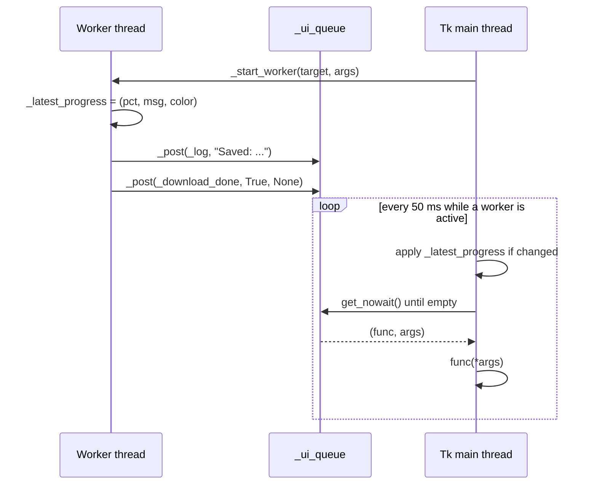
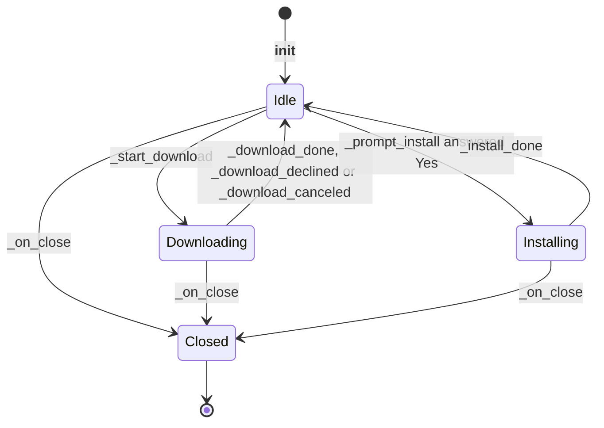

# 3 Architecture and Threading

Relevant source files

- [youtube_downloader.py](https://github.com/lifeupnorth/YouTubeDownloader/blob/bd3fd4242f83ee2cf111812e71b6d2db5aa71bdf/youtube_downloader.py)

The whole app is one module, `youtube_downloader.py`, built around a single class, `YouTubeDownloader`, which subclasses `tk.Tk` and is the main window. Long-running work (a yt-dlp download, or a `pip install yt-dlp`) runs on background threads. Because Tkinter is not thread-safe, those threads never touch widgets or Tk variables. Everything they want to show goes through a queue that the Tk main thread drains. This page covers that threading model and the window's lifecycle. For what a download actually does, see [Download Pipeline](04-download-pipeline.md); for the widgets, see [User Interface](06-user-interface.md).

## Module layout

| Part | Lines | Role |
|---|---|---|
| Optional `yt_dlp` import | 17–22 | Sets `YT_DLP_AVAILABLE` so the app can start, and offer to install yt-dlp, when it's missing |
| Color palette | 25–35 | Dark theme constants (`BG`, `SURFACE`, `ACCENT`, …) |
| Format and ffmpeg helpers | 37–115 | `VIDEO_MAX_RES`, `ffmpeg_help`, `find_ffmpeg`, `format_opts` (see [Formats and ffmpeg](05-formats-ffmpeg.md)) |
| yt-dlp adapters | 118–166 | `_YdlLogger`, `_callback_pp_class`, `_stream_counter_class` |
| `YouTubeDownloader` | 169–695 | Window, state, UI, threading, download and install logic |
| Entry point | 698–701 | Creates the window and runs `mainloop()` |

The two post-processor classes are built by factories decorated with `functools.lru_cache`, which take the base class as an argument. That way the module can be imported without yt-dlp installed, each class is defined only once, and the tests can pass `object` as the base instead of yt-dlp's `PostProcessor`.

Sources: [youtube_downloader.py:17-22](https://github.com/lifeupnorth/YouTubeDownloader/blob/bd3fd4242f83ee2cf111812e71b6d2db5aa71bdf/youtube_downloader.py#L17-L22), [youtube_downloader.py:118-166](https://github.com/lifeupnorth/YouTubeDownloader/blob/bd3fd4242f83ee2cf111812e71b6d2db5aa71bdf/youtube_downloader.py#L118-L166), [youtube_downloader.py:698-701](https://github.com/lifeupnorth/YouTubeDownloader/blob/bd3fd4242f83ee2cf111812e71b6d2db5aa71bdf/youtube_downloader.py#L698-L701)

## Threads and the UI queue

There are two kinds of threads:

- **The Tk main thread** builds the UI, handles clicks, shows dialogs and applies every UI update.
- **Worker threads** are daemon threads started by `_start_worker`: `_download_thread` for a download, or the inner `run()` of `_install_ytdlp` for a pip install.

Workers communicate with the main thread in two ways:

1. **Discrete events** go through `_post(func, *args)`, which puts `(func, args)` on `self._ui_queue`, a `queue.Queue`. Examples are log lines, "download done" and a yes/no question.
2. **Progress** is coalesced: the worker just overwrites `self._latest_progress` with a `(pct, message, color)` tuple. Only the newest value matters, so nothing is queued per progress event.

`_poll_ui_queue` runs on the main thread every 50 ms. It first applies `_latest_progress` if it changed since the last tick (an identity check against `_shown_progress`), then drains the queue. Each callback runs in its own `try`, and errors go to `report_callback_exception`, so one failing callback doesn't drop the rest of the batch. Progress is applied *before* the queue is drained, so a stale progress value can never overwrite the final state set by a "done" callback.

Sources: [youtube_downloader.py:401-434](https://github.com/lifeupnorth/YouTubeDownloader/blob/bd3fd4242f83ee2cf111812e71b6d2db5aa71bdf/youtube_downloader.py#L401-L434), [youtube_downloader.py:443-445](https://github.com/lifeupnorth/YouTubeDownloader/blob/bd3fd4242f83ee2cf111812e71b6d2db5aa71bdf/youtube_downloader.py#L443-L445)

## When polling runs

Polling isn't permanent. `_start_worker` increments `_active_workers` and schedules the first poll only if none is pending (`_after_id is None`). Each tick sets `_after_id = None` and reschedules itself only while a worker is active or the queue still has items. The "done" handlers (`_download_done`, `_download_declined` and `_download_canceled` via `_end_download`, and `_install_done`) call `_worker_finished`, so polling stops on the same tick that handles the final event. When nothing is running, the app has no timer at all.

Sources: [youtube_downloader.py:407-414](https://github.com/lifeupnorth/YouTubeDownloader/blob/bd3fd4242f83ee2cf111812e71b6d2db5aa71bdf/youtube_downloader.py#L407-L414), [youtube_downloader.py:433-434](https://github.com/lifeupnorth/YouTubeDownloader/blob/bd3fd4242f83ee2cf111812e71b6d2db5aa71bdf/youtube_downloader.py#L433-L434), [youtube_downloader.py:607-610](https://github.com/lifeupnorth/YouTubeDownloader/blob/bd3fd4242f83ee2cf111812e71b6d2db5aa71bdf/youtube_downloader.py#L607-L610), [youtube_downloader.py:685-686](https://github.com/lifeupnorth/YouTubeDownloader/blob/bd3fd4242f83ee2cf111812e71b6d2db5aa71bdf/youtube_downloader.py#L685-L686)

## Asking the user from a worker

Sometimes the download thread needs an answer before it can continue. Specifically, it asks whether to download a whole playlist (see [Download Pipeline](04-download-pipeline.md)). `_ask_on_main` posts a small `ask()` closure that shows `messagebox.askyesno` on the main thread, stores the answer and sets a `threading.Event`. The worker waits on the event in 0.1 s steps and gives up with `False` if the window starts closing, so it can't hang forever on a dialog that will never be answered.

Sources: [youtube_downloader.py:521-533](https://github.com/lifeupnorth/YouTubeDownloader/blob/bd3fd4242f83ee2cf111812e71b6d2db5aa71bdf/youtube_downloader.py#L521-L533)

## Window lifecycle

`__init__` sets up all state (Tk variables plus plain attributes for worker coordination), builds the UI, and registers `_on_close` for the window's close button (`WM_DELETE_WINDOW`). It then runs two startup checks:

- If yt-dlp is missing, it schedules `_prompt_install` 300 ms later.
- If ffmpeg isn't found, it shows a warning in the status line and the log. A `<FocusIn>` binding (`_recheck_ffmpeg`) checks again whenever the window regains focus.

If a download is running, `_on_close` first asks "Cancel it and close the app?". On Yes it sets `_close_when_stopped` and cancels the download; the end-of-download handlers (`_download_canceled`, `_download_done`, `_download_declined`) then call `_on_close` again once the partial files are removed. Clicking close a second time while that runs (ffmpeg can't be interrupted) closes right away. Otherwise `_on_close` sets `_closing`, cancels any pending poll and destroys the window. `_closing` stops the poll loop from draining or rescheduling, and makes `_ask_on_main` return. Worker threads are daemons, so anything still running when the window is destroyed (a pip install, or a download after a forced second close) ends with the process. See [Download Pipeline](04-download-pipeline.md) for how Cancel stops a download cleanly.

Sources: [youtube_downloader.py:169-205](https://github.com/lifeupnorth/YouTubeDownloader/blob/bd3fd4242f83ee2cf111812e71b6d2db5aa71bdf/youtube_downloader.py#L169-L205), [youtube_downloader.py:436-441](https://github.com/lifeupnorth/YouTubeDownloader/blob/bd3fd4242f83ee2cf111812e71b6d2db5aa71bdf/youtube_downloader.py#L436-L441), [youtube_downloader.py:646-655](https://github.com/lifeupnorth/YouTubeDownloader/blob/bd3fd4242f83ee2cf111812e71b6d2db5aa71bdf/youtube_downloader.py#L646-L655)

## Installing yt-dlp at runtime

If yt-dlp is missing, `_prompt_install` asks whether to install it. On Yes, `_install_ytdlp` runs `python -m pip install <YT_DLP_REQUIREMENT>` (the pin read from `requirements.txt` next to the script, or plain `yt-dlp` if that file is missing) with `sys.executable` on a worker (output discarded), and `_install_done` reports the result. The module only imports `yt_dlp` once, at startup, so a successful install still requires restarting the app, and the dialog says so.

Sources: [youtube_downloader.py:657-695](https://github.com/lifeupnorth/YouTubeDownloader/blob/bd3fd4242f83ee2cf111812e71b6d2db5aa71bdf/youtube_downloader.py#L657-L695)

## Shared state

| Attribute | Written by | Read by | Purpose |
|---|---|---|---|
| `_ui_queue` | workers (`_post`) | main (`_poll_ui_queue`) | Discrete UI events |
| `_latest_progress` / `_shown_progress` | worker / main | main | Coalesced progress, change detection |
| `_active_workers`, `_after_id` | main | main | Whether to keep polling |
| `_closing` | main (`_on_close`) | main, worker | Shutdown signal |
| `_stream_index`, `_stream_count` | main (reset), worker | worker | Multi-stream progress math |
| `_saved`, `_already`, `_skipped` | main (reset), worker | main (`_download_done`) | Per-run result counts |
| `is_running` | main | main | Blocks a second concurrent download |

Sources: [youtube_downloader.py:178-194](https://github.com/lifeupnorth/YouTubeDownloader/blob/bd3fd4242f83ee2cf111812e71b6d2db5aa71bdf/youtube_downloader.py#L178-L194), [youtube_downloader.py:561-567](https://github.com/lifeupnorth/YouTubeDownloader/blob/bd3fd4242f83ee2cf111812e71b6d2db5aa71bdf/youtube_downloader.py#L561-L567)
