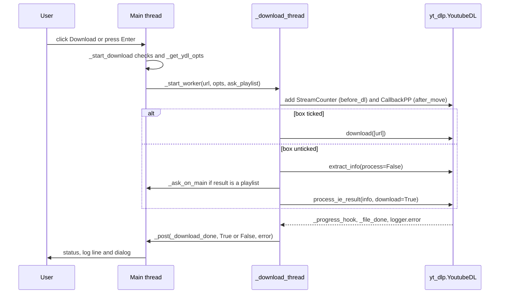
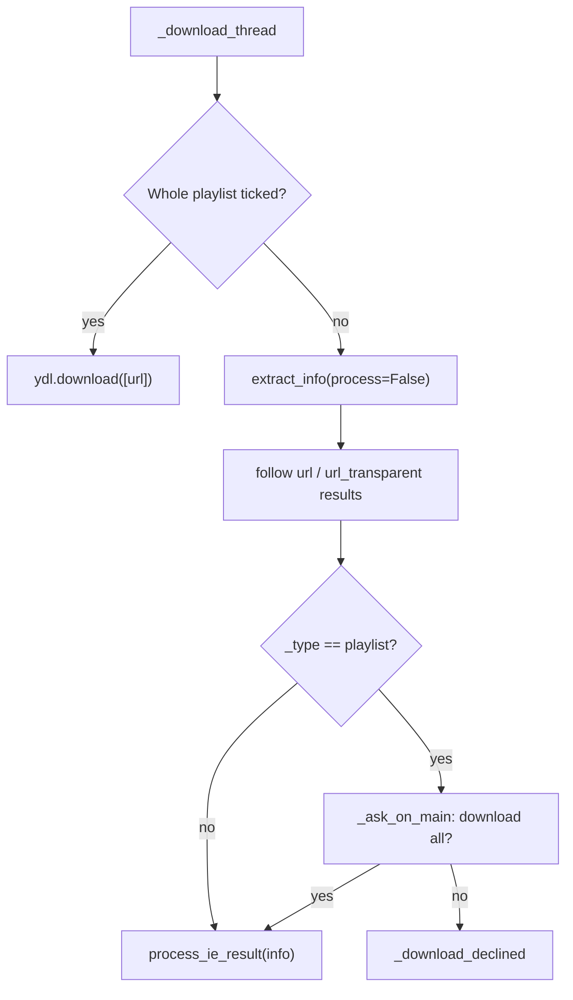

# 4 Download Pipeline

Relevant source files

- [youtube_downloader.py](https://github.com/lifeupnorth/YouTubeDownloader/blob/bd3fd4242f83ee2cf111812e71b6d2db5aa71bdf/youtube_downloader.py)

This page follows one click of **Download** from validation to the final dialog: how the yt-dlp options are built, how playlists are detected and confirmed, how progress and saved files are reported, and how the result is summarized. The threading mechanics it relies on (`_post`, `_latest_progress`, the 50 ms poll) are covered in [Architecture and Threading](03-architecture.md). Format and ffmpeg choices are covered in [Formats and ffmpeg](05-formats-ffmpeg.md).

## End-to-end flow

Sources: [youtube_downloader.py:535-605](https://github.com/lifeupnorth/YouTubeDownloader/blob/bd3fd4242f83ee2cf111812e71b6d2db5aa71bdf/youtube_downloader.py#L535-L605)

## 1. Starting: `_start_download`

`_start_download` is bound to the Download button and to Enter in the URL box. It runs on the main thread and checks, in order:

1. yt-dlp is importable, otherwise it shows the install prompt.
2. ffmpeg can be found (`find_ffmpeg()`, called once per download), otherwise it shows `ffmpeg_help()`.
3. The URL isn't empty or the placeholder text.
4. No download is already running (`is_running`).

It then builds the options with `_get_ydl_opts(url, ffmpeg)`. Tk variables are read here, on the main thread, never on the worker. It disables the button, resets per-run counters, and starts `_download_thread`. The third argument, `ask_playlist`, is `True` when the **Whole playlist** box is unticked.

Sources: [youtube_downloader.py:535-567](https://github.com/lifeupnorth/YouTubeDownloader/blob/bd3fd4242f83ee2cf111812e71b6d2db5aa71bdf/youtube_downloader.py#L535-L567)

## 2. yt-dlp options: `_get_ydl_opts`

| Option | Value | Why |
|---|---|---|
| `outtmpl` | `<folder>/%(playlist_title\|)s/%(playlist_index&{:03d} - \|)s%(title)s.%(ext)s` | Playlist entries go to a folder named after the playlist, with a 3-digit index that keeps same-title videos apart. For a single video both fields are empty and the path collapses to `<folder>/<title>.<ext>`. |
| `progress_hooks` | `[_progress_hook]` | Progress reporting |
| `noplaylist` | `not playlist_var` | Only affects `watch?v=…&list=…` links: unticked means just that video |
| `ignoreerrors` | `"only_download"` | Same as the yt-dlp CLI: skip unavailable playlist entries instead of stopping. Errors go to the logger instead of raising. |
| `logger` | `_YdlLogger(_entry_failed)` | Collects error messages and hides yt-dlp's debug and info output |
| `color` | `never` for stdout and stderr | Keeps ANSI color codes out of error text when the app is started from a terminal |
| `quiet`, `no_warnings` | `True`, `False` | |
| format keys | from `format_opts(fmt)` | See [Formats and ffmpeg](05-formats-ffmpeg.md) |
| `ffmpeg_location` | path from `find_ffmpeg()` | Lets yt-dlp use an ffmpeg that isn't on this process's `PATH` |

Sources: [youtube_downloader.py:449-474](https://github.com/lifeupnorth/YouTubeDownloader/blob/bd3fd4242f83ee2cf111812e71b6d2db5aa71bdf/youtube_downloader.py#L449-L474), [youtube_downloader.py:118-130](https://github.com/lifeupnorth/YouTubeDownloader/blob/bd3fd4242f83ee2cf111812e71b6d2db5aa71bdf/youtube_downloader.py#L118-L130)

## 3. Playlist detection and confirmation

The **Whole playlist** box decides whether the app may download many videos without asking. A playlist is detected from what yt-dlp extracts, not from the URL text, so playlists, channels and channel tabs are all recognized.

- **Box ticked:** `_download_thread` calls `ydl.download([url])` directly, with no probe and no prompt.
- **Box unticked:** `_download_unless_declined` calls `extract_info(url, download=False, process=False)`, follows any `url`/`url_transparent` results to their target, and checks the target's `_type`. If it's `playlist`, it asks *"\<title\>" is a playlist or channel. Download all its videos?* via `_ask_on_main`. Answering No posts `_download_declined` ("Playlist not downloaded."). Yes applies only to this download; the box stays unticked. To avoid extracting twice, it then calls `process_ie_result` on the result it already has. The one exception is `url_transparent`, which is passed through unchanged so yt-dlp can merge its fields.

A `watch?v=…&list=…` link with the box unticked resolves to a `url` result pointing to the single video, so it downloads that video without asking.

Sources: [youtube_downloader.py:569-605](https://github.com/lifeupnorth/YouTubeDownloader/blob/bd3fd4242f83ee2cf111812e71b6d2db5aa71bdf/youtube_downloader.py#L569-L605), [youtube_downloader.py:612-616](https://github.com/lifeupnorth/YouTubeDownloader/blob/bd3fd4242f83ee2cf111812e71b6d2db5aa71bdf/youtube_downloader.py#L612-L616)

## 4. Progress: streams and playlist entries

Formats that merge video and audio download two separate streams, and yt-dlp's progress hook reports each one from 0 to 100%. To show a single bar that only moves forward:

- `StreamCounter`, a `before_dl` post-processor that runs once per video (so once per playlist entry), resets `_stream_index` to 0 and sets `_stream_count` from `len(info["requested_formats"])`. The progress hook's own `info_dict` doesn't include that list.
- `_progress_hook` clamps each stream's percentage to 100, combines the streams as `(stream_index × 100 + pct) / streams`, and scales the result by 0.99. Each `finished` event moves on to the next stream. After the last stream it shows `99, "Processing…"` while ffmpeg merges or converts. Only `_download_done` moves the bar to 100.
- In a playlist, the status starts with `Video {playlist_index}/{n_entries} · `, and the bar restarts at 0 for each video.

Sources: [youtube_downloader.py:147-166](https://github.com/lifeupnorth/YouTubeDownloader/blob/bd3fd4242f83ee2cf111812e71b6d2db5aa71bdf/youtube_downloader.py#L147-L166), [youtube_downloader.py:476-501](https://github.com/lifeupnorth/YouTubeDownloader/blob/bd3fd4242f83ee2cf111812e71b6d2db5aa71bdf/youtube_downloader.py#L476-L501)

## 5. Saved, already downloaded and skipped

The progress hook only sees temporary per-stream files, which are deleted after merging, so it isn't used to report results. Instead:

- `CallbackPP(_file_done)` is registered as an **after_move** post-processor, so it runs once per video with the final path, after conversion and moving. If yt-dlp's `__real_download` flag is set, it logs `✔ Saved: <path>` and increments `_saved`. Otherwise the file already existed: it logs `• Already downloaded: <path>` and increments `_already`.
- `_YdlLogger.error` → `_entry_failed` strips the `ERROR: ` prefix, adds the message to `_skipped` and logs `✘ <message>`. With `ignoreerrors="only_download"`, this is how both unavailable playlist entries and single-video failures surface.

Sources: [youtube_downloader.py:133-144](https://github.com/lifeupnorth/YouTubeDownloader/blob/bd3fd4242f83ee2cf111812e71b6d2db5aa71bdf/youtube_downloader.py#L133-L144), [youtube_downloader.py:503-519](https://github.com/lifeupnorth/YouTubeDownloader/blob/bd3fd4242f83ee2cf111812e71b6d2db5aa71bdf/youtube_downloader.py#L503-L519), [youtube_downloader.py:572-576](https://github.com/lifeupnorth/YouTubeDownloader/blob/bd3fd4242f83ee2cf111812e71b6d2db5aa71bdf/youtube_downloader.py#L572-L576)

## 6. Finishing: `_download_done`

`_download_done(success, error)` runs on the main thread. It re-enables the button via `_end_download` and picks one of four outcomes:

| Situation | Result |
|---|---|
| Errors were logged and nothing was saved or already present | Failure. The first logged error becomes the message, and it isn't logged twice. |
| More than one file, or any skipped entries | `Done: N saved[, M already downloaded][, K skipped]`. Shown in the warning color if anything was skipped, otherwise success color. |
| One file, no errors | "Download complete!" |
| An exception escaped yt-dlp (`success=False`) | "✘ Error: …" and a "Download Failed" dialog |

Sources: [youtube_downloader.py:607-644](https://github.com/lifeupnorth/YouTubeDownloader/blob/bd3fd4242f83ee2cf111812e71b6d2db5aa71bdf/youtube_downloader.py#L607-L644)

## Limitations

- There's no Cancel. A long playlist can only be stopped by closing the window, which ends the daemon worker mid-file.
- Only one download at a time (`is_running`).
- The output folder comes from the **Save To** field and defaults to `~/Downloads`; the app doesn't create or validate it beforehand.

Sources: [youtube_downloader.py:179](https://github.com/lifeupnorth/YouTubeDownloader/blob/bd3fd4242f83ee2cf111812e71b6d2db5aa71bdf/youtube_downloader.py#L179), [youtube_downloader.py:407-411](https://github.com/lifeupnorth/YouTubeDownloader/blob/bd3fd4242f83ee2cf111812e71b6d2db5aa71bdf/youtube_downloader.py#L407-L411), [youtube_downloader.py:550-552](https://github.com/lifeupnorth/YouTubeDownloader/blob/bd3fd4242f83ee2cf111812e71b6d2db5aa71bdf/youtube_downloader.py#L550-L552)
