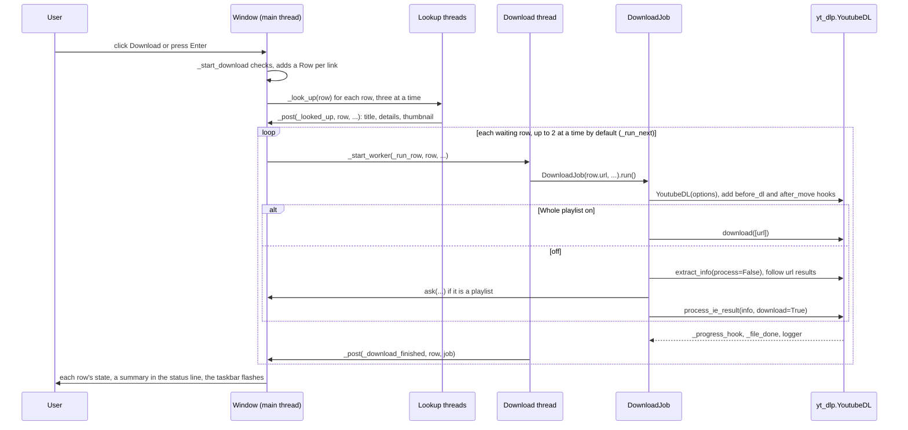
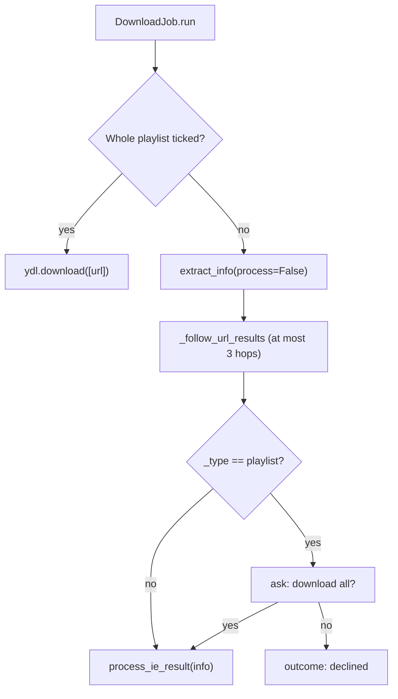

# 4 Download Pipeline

Relevant source files

- [download_engine.py](https://github.com/lifeupnorth/YouTubeDownloader/blob/b00d4d39f0bbdb66f9610548ccf49a57481e4f08/download_engine.py)
- [youtube_downloader.py](https://github.com/lifeupnorth/YouTubeDownloader/blob/b00d4d39f0bbdb66f9610548ccf49a57481e4f08/youtube_downloader.py)

This page follows one click of **Download** from validation to the final summary: how links become rows in the Downloads list that download a few at a time, how the yt-dlp options are built, how playlists are confirmed, how progress and saved files are reported, how Cancel works, and how the result is shown. Everything between adding the rows and showing the result is in `download_engine.py` and runs without Qt. The threading it relies on (`_post`, `Row.latest`, the progress timer) is in [Architecture and Threading](03-architecture.md); format and ffmpeg choices are in [Formats and ffmpeg](05-formats-ffmpeg.md).

## End-to-end flow

Sources: [youtube_downloader.py:1549-1607](https://github.com/lifeupnorth/YouTubeDownloader/blob/b00d4d39f0bbdb66f9610548ccf49a57481e4f08/youtube_downloader.py#L1549-L1607), [youtube_downloader.py:1662-1674](https://github.com/lifeupnorth/YouTubeDownloader/blob/b00d4d39f0bbdb66f9610548ccf49a57481e4f08/youtube_downloader.py#L1662-L1674), [youtube_downloader.py:1696-1714](https://github.com/lifeupnorth/YouTubeDownloader/blob/b00d4d39f0bbdb66f9610548ccf49a57481e4f08/youtube_downloader.py#L1696-L1714), [youtube_downloader.py:1740-1764](https://github.com/lifeupnorth/YouTubeDownloader/blob/b00d4d39f0bbdb66f9610548ccf49a57481e4f08/youtube_downloader.py#L1740-L1764), [download_engine.py:724-789](https://github.com/lifeupnorth/YouTubeDownloader/blob/b00d4d39f0bbdb66f9610548ccf49a57481e4f08/download_engine.py#L724-L789), [youtube_downloader.py:1786-1844](https://github.com/lifeupnorth/YouTubeDownloader/blob/b00d4d39f0bbdb66f9610548ccf49a57481e4f08/youtube_downloader.py#L1786-L1844)

## 1. Starting: `_start_download`

`_start_download` runs on the main thread (Download button or Enter in the URL box) and checks, in order:

1. yt-dlp is available (`engine.YT_DLP_AVAILABLE`), otherwise it shows the install prompt (or, while the in-app install runs, asks the user to wait).
2. ffmpeg can be found (`engine.find_ffmpeg()`, once per click), otherwise it shows `ffmpeg_help()`. The path found is kept in `_ffmpeg` and given to each download.
3. At least one link was entered (`split_links`: separated by spaces, `https://` added where it's missing, repeats dropped), otherwise "No URL". Words that aren't links are left out, and the log says which.
4. **Save to** is a full path, otherwise "Choose a folder" (a relative one would save next to wherever the app was started).

There's no check for a running download: new links wait their turn. It then saves the settings and reads the format (`_chosen_format`), the folder and **Whole playlist** here, on the main thread. For each link it adds a `Row` with those values to the list, unless the same link with the same format is already in the list and not finished (waiting, downloading or paused), and starts the row's lookup (see [User Interface](06-user-interface.md#looking-links-up)). It clears the URL box and calls `_run_next`; if every link was already in the list, the status line says so instead (the box is cleared either way).

Sources: [youtube_downloader.py:233-251](https://github.com/lifeupnorth/YouTubeDownloader/blob/b00d4d39f0bbdb66f9610548ccf49a57481e4f08/youtube_downloader.py#L233-L251), [youtube_downloader.py:1549-1575](https://github.com/lifeupnorth/YouTubeDownloader/blob/b00d4d39f0bbdb66f9610548ccf49a57481e4f08/youtube_downloader.py#L1549-L1575), [youtube_downloader.py:1577-1607](https://github.com/lifeupnorth/YouTubeDownloader/blob/b00d4d39f0bbdb66f9610548ccf49a57481e4f08/youtube_downloader.py#L1577-L1607)

## 2. Several links: the Downloads list

The window does the queueing: a `DownloadJob` downloads one link, and the window runs up to `_parallel` jobs at a time (the "at a time" drop-down: 1, 2 or 3; 2 by default), each on its own thread (see [Architecture and Threading](03-architecture.md#several-downloads-at-once)). `_run_next` does nothing while the window is closing. Otherwise, while fewer than `_parallel` rows are downloading (`_running`), it takes the first row, in list order, that's waiting or still being looked up (a paused row isn't, nor one whose link and folder are those of a download running now: `_clashes`), marks it Downloading with "Starting…", logs `▶ <url>`, starts the progress timer and runs `_run_row` on a worker. The status line then says "Downloading 2 of 3…" for one download (counting the rows not finished or paused), or "Downloading 2 links, 1 waiting…" for several (`_show_running`). If no JavaScript runtime was known yet, `_run_row` looks one up with `engine.find_js_runtime()` (it may have been installed since startup). It creates one `DownloadJob` for the row, with the row's link, format, folder and **Whole playlist** setting, the ffmpeg found, the row's own cancel and pause events, and the partial files an earlier pause kept. When it ends, `_download_finished` shows the result in the row and calls `_run_next` again, so a link that fails, or whose playlist isn't confirmed, doesn't stop the others. A `_run_row` that raises (a bug, not a download problem) fails only its row. When no row is left waiting, `_queue_finished` sums up (section 8). Links can be added at any time, also while others download.

Sources: [youtube_downloader.py:159-161](https://github.com/lifeupnorth/YouTubeDownloader/blob/b00d4d39f0bbdb66f9610548ccf49a57481e4f08/youtube_downloader.py#L159-L161), [youtube_downloader.py:1398-1402](https://github.com/lifeupnorth/YouTubeDownloader/blob/b00d4d39f0bbdb66f9610548ccf49a57481e4f08/youtube_downloader.py#L1398-L1402), [youtube_downloader.py:1696-1738](https://github.com/lifeupnorth/YouTubeDownloader/blob/b00d4d39f0bbdb66f9610548ccf49a57481e4f08/youtube_downloader.py#L1696-L1738), [youtube_downloader.py:1740-1764](https://github.com/lifeupnorth/YouTubeDownloader/blob/b00d4d39f0bbdb66f9610548ccf49a57481e4f08/youtube_downloader.py#L1740-L1764), [youtube_downloader.py:1786-1833](https://github.com/lifeupnorth/YouTubeDownloader/blob/b00d4d39f0bbdb66f9610548ccf49a57481e4f08/youtube_downloader.py#L1786-L1833)

## 3. yt-dlp options: `DownloadJob.options`

| Option | Value | Why |
|---|---|---|
| `outtmpl` | `<folder>/%(playlist_title\|)s/%(playlist_index&{:03d} - \|)s%(title)s.%(ext)s` | Playlist entries go to a folder named after the playlist, with a 3-digit index that keeps same-title videos apart. For a single video both fields are empty and the path collapses to `<folder>/<title>.<ext>`. A `%` in the folder's name is doubled, so yt-dlp doesn't read it as a field. |
| `progress_hooks` | `[_progress_hook]` | Progress reporting |
| `noplaylist` | `not whole_playlist` | Only affects `watch?v=…&list=…` links: off means just that video |
| `quiet`, `no_warnings` | `True`, `False` | Nothing goes to the console; warnings still reach the logger |
| `ignoreerrors` | `"only_download"` | Like the yt-dlp CLI: skip unavailable playlist entries instead of stopping |
| `logger` | `_YdlLogger(_entry_failed, _entry_warning, _check_stop)` | Errors are logged with ✘ and counted as skipped; warnings are logged with ⚠ (except the missing-JavaScript-runtime warning, which the window shows once at startup). Debug and info messages aren't logged, but each one runs the cancel and pause check (section 7). |
| `color` | `never` for stdout and stderr | Keeps ANSI color codes out of error text when started from a terminal |
| format keys | from `format_opts(fmt)`: `format`, `postprocessors`, `final_ext`, and for video `format_sort` and `merge_output_format` | See [Formats and ffmpeg](05-formats-ffmpeg.md). `final_ext` is the extension after conversion; it lets yt-dlp see that a converted file is already there (section 6). |
| `ffmpeg_location` | the path `find_ffmpeg()` found | Works even when ffmpeg isn't on this process's `PATH` |
| `js_runtimes` | `{name: {"path": path}}` from `find_js_runtime()` | yt-dlp needs a JavaScript runtime for YouTube, or some formats are missing. The bundled deno in the .exe, else the first new enough deno, node or bun on `PATH`. Left out when none was found, so yt-dlp uses its own default. |

Sources: [download_engine.py:180-221](https://github.com/lifeupnorth/YouTubeDownloader/blob/b00d4d39f0bbdb66f9610548ccf49a57481e4f08/download_engine.py#L180-L221), [download_engine.py:275-276](https://github.com/lifeupnorth/YouTubeDownloader/blob/b00d4d39f0bbdb66f9610548ccf49a57481e4f08/download_engine.py#L275-L276), [download_engine.py:306-313](https://github.com/lifeupnorth/YouTubeDownloader/blob/b00d4d39f0bbdb66f9610548ccf49a57481e4f08/download_engine.py#L306-L313), [download_engine.py:321-348](https://github.com/lifeupnorth/YouTubeDownloader/blob/b00d4d39f0bbdb66f9610548ccf49a57481e4f08/download_engine.py#L321-L348), [download_engine.py:695-722](https://github.com/lifeupnorth/YouTubeDownloader/blob/b00d4d39f0bbdb66f9610548ccf49a57481e4f08/download_engine.py#L695-L722), [download_engine.py:853-856](https://github.com/lifeupnorth/YouTubeDownloader/blob/b00d4d39f0bbdb66f9610548ccf49a57481e4f08/download_engine.py#L853-L856)

## 4. Playlist detection and confirmation

The **Whole playlist** box decides whether the app may download many videos without asking. A playlist is detected from what yt-dlp extracts, not from the URL text, so playlists, channels and channel tabs are all recognized.

- **Box ticked:** `run` calls `ydl.download([url])` directly, with no probe and no question.
- **Box unticked:** `_download_unless_declined` calls `extract_info(url, download=False, process=False)`, then `_follow_url_results` follows any `url`/`url_transparent` results to their target (at most 3 hops, so a link that keeps redirecting can't loop), and it checks the target's `_type`. If it's `playlist`, it asks *"\<title\>" is a playlist or channel. Download all its videos?* through the `ask` callback. No makes the job's outcome `"declined"`. To avoid extracting twice, it then calls `process_ie_result` on the result it already has (except for `url_transparent`, which is passed through so yt-dlp can merge its fields). If extraction returned nothing, yt-dlp has already logged the error and nothing is processed; with nothing saved, the job ends as failed.

A `watch?v=…&list=…` link with the box unticked resolves to a `url` result pointing to the single video, so it downloads that video without asking.

Sources: [download_engine.py:431-439](https://github.com/lifeupnorth/YouTubeDownloader/blob/b00d4d39f0bbdb66f9610548ccf49a57481e4f08/download_engine.py#L431-L439), [download_engine.py:735-740](https://github.com/lifeupnorth/YouTubeDownloader/blob/b00d4d39f0bbdb66f9610548ccf49a57481e4f08/download_engine.py#L735-L740), [download_engine.py:774-789](https://github.com/lifeupnorth/YouTubeDownloader/blob/b00d4d39f0bbdb66f9610548ccf49a57481e4f08/download_engine.py#L774-L789)

## 5. Progress: streams and playlist entries

Formats that merge video and audio download two streams, and yt-dlp reports each from 0 to 100%. To show one bar that only moves forward:

- `_video_starting`, a `before_dl` post-processor that runs once per video, resets the stream index and sets the stream count from `len(info["requested_formats"])` (the progress hook's own `info_dict` doesn't include that list). It also checks for a cancel and starts a new list of the video's files (section 7).
- `_progress_hook` clamps each stream's percentage to 100, combines the streams as `(stream_index × 100 + pct) / streams` (the index capped at the last stream), and scales the result by 0.99. Each call hands `on_progress` an `engine.Progress`. After the last stream it reports 99 with `processing` set while ffmpeg merges or converts, which shows the row as Processing…; the row's bar only reaches 100% once `_download_finished` marks it Completed.
- A `Progress` carries the speed (bytes a second) and time left (seconds), 0 when yt-dlp doesn't know them, and in a playlist `video` and `videos` (`playlist_index`, `n_entries`). The window words it (`progress_text`): time left as m:ss (h:mm:ss past an hour, `format_eta`), and no percentage, since the row's bar shows it, so a row reads e.g. "Video 2/5 · 3.4 MB/s · ETA 0:07".

Sources: [download_engine.py:224-228](https://github.com/lifeupnorth/YouTubeDownloader/blob/b00d4d39f0bbdb66f9610548ccf49a57481e4f08/download_engine.py#L224-L228), [download_engine.py:791-827](https://github.com/lifeupnorth/YouTubeDownloader/blob/b00d4d39f0bbdb66f9610548ccf49a57481e4f08/download_engine.py#L791-L827), [youtube_downloader.py:371-379](https://github.com/lifeupnorth/YouTubeDownloader/blob/b00d4d39f0bbdb66f9610548ccf49a57481e4f08/youtube_downloader.py#L371-L379), [youtube_downloader.py:1770-1784](https://github.com/lifeupnorth/YouTubeDownloader/blob/b00d4d39f0bbdb66f9610548ccf49a57481e4f08/youtube_downloader.py#L1770-L1784)

## 6. Saved, already downloaded and skipped

The progress hook only sees temporary per-stream files, which are deleted after merging, so it isn't used to report results. Instead:

- `_file_done` runs as an **after_move** post-processor, once per video with the final path. If yt-dlp's `__real_download` flag is set, or the video used up a stream an earlier, paused job kept (an MP3 converted from that job's finished `.webm`, which yt-dlp reports as not downloaded), it logs `✔ Saved: <path>` and counts it as saved; otherwise the file already existed, and it logs `• Already downloaded: <path>`. Because the options include `final_ext`, this also works for converted files: a second MP3 download of the same video finds the MP3 instead of downloading and converting again.
- `_YdlLogger.error` → `_entry_failed` strips the `ERROR: ` prefix, adds the message to `skipped` and logs `✘ <message>`. yt-dlp also sends its "Deprecated Feature" notices to `error`; the logger drops those. After a cancel, `_entry_failed` ignores errors (such as the stopped ffmpeg's).

Sources: [download_engine.py:336-342](https://github.com/lifeupnorth/YouTubeDownloader/blob/b00d4d39f0bbdb66f9610548ccf49a57481e4f08/download_engine.py#L336-L342), [download_engine.py:729-734](https://github.com/lifeupnorth/YouTubeDownloader/blob/b00d4d39f0bbdb66f9610548ccf49a57481e4f08/download_engine.py#L729-L734), [download_engine.py:829-851](https://github.com/lifeupnorth/YouTubeDownloader/blob/b00d4d39f0bbdb66f9610548ccf49a57481e4f08/download_engine.py#L829-L851)

## 7. Canceling

Each row that isn't finished has a Cancel icon (`_cancel_row`). It sets the row's `cancel_event`, which is also its job's cancel event. A row that's still waiting is just marked Canceled; `_run_next` skips it, and its lookup stops. For the running row, it also calls `row.job.stop_processes()`, which stops the job's ffmpeg, and the row shows "Canceling…" until the job ends. A job checks the event in `_check_stop` (which also stops it for a pause) and raises yt-dlp's `DownloadCancelled`, which stops yt-dlp even with `ignoreerrors` set. It checks at every progress update, before each video starts, and at each of yt-dlp's status messages (the `check` that `_YdlLogger.debug` and `info` run), so a download stops almost at once, a playlist stops between two videos, and reading a big channel's pages stops at the next page. Canceling one row doesn't affect the others: the next waiting row starts as usual.

A running ffmpeg conversion or merge is stopped too. `run` calls `_track_processes`, which swaps the `Popen` that yt-dlp's ffmpeg post-processors and external downloaders use for `_tracked_popen_class`. Each process it starts reports itself to the job running on that thread (`_current.job`, via `_process_started`), together with the file it is about to create: `_new_ffmpeg_output` takes the last argument, `file:<path>`, but only for ffmpeg writing a file that isn't on disk yet (not ffprobe, not a run that only reads a file). `stop_processes` notes those files and kills the processes; one that starts just after a cancel is stopped at once. yt-dlp treats the killed ffmpeg as a failed post-processing step and only logs it, so `run` checks for a cancel after a normal return as well, and the job still ends as "canceled".

yt-dlp leaves the unfinished video's `.part` file behind, plus any of its streams that finished but weren't merged. The progress hook records the files this run writes for the current video, and after a cancel `_remove_partial_files` deletes them, the files the stopped ffmpeg was creating, the files a paused run kept (see below), and their `.ytdl` and `-Frag*` files (`remove_partial_files`). Files that were already on disk never get a "downloading" event and are never an ffmpeg's new output, so they're never removed, and `_file_done` clears the list once a video is complete, so finished videos are kept.

Sources: [youtube_downloader.py:1900-1918](https://github.com/lifeupnorth/YouTubeDownloader/blob/b00d4d39f0bbdb66f9610548ccf49a57481e4f08/youtube_downloader.py#L1900-L1918), [download_engine.py:367-428](https://github.com/lifeupnorth/YouTubeDownloader/blob/b00d4d39f0bbdb66f9610548ccf49a57481e4f08/download_engine.py#L367-L428), [download_engine.py:585-602](https://github.com/lifeupnorth/YouTubeDownloader/blob/b00d4d39f0bbdb66f9610548ccf49a57481e4f08/download_engine.py#L585-L602), [download_engine.py:650-681](https://github.com/lifeupnorth/YouTubeDownloader/blob/b00d4d39f0bbdb66f9610548ccf49a57481e4f08/download_engine.py#L650-L681), [download_engine.py:741-752](https://github.com/lifeupnorth/YouTubeDownloader/blob/b00d4d39f0bbdb66f9610548ccf49a57481e4f08/download_engine.py#L741-L752), [download_engine.py:765-772](https://github.com/lifeupnorth/YouTubeDownloader/blob/b00d4d39f0bbdb66f9610548ccf49a57481e4f08/download_engine.py#L765-L772), [download_engine.py:800-806](https://github.com/lifeupnorth/YouTubeDownloader/blob/b00d4d39f0bbdb66f9610548ccf49a57481e4f08/download_engine.py#L800-L806), [download_engine.py:858-866](https://github.com/lifeupnorth/YouTubeDownloader/blob/b00d4d39f0bbdb66f9610548ccf49a57481e4f08/download_engine.py#L858-L866)

### Pausing and resuming

Pause (`_pause_row`, the icon or Space) sets the row's `pause_event`, which is also its job's pause event, and stops the job's ffmpeg (`stop_processes`; together what `DownloadJob.pause` does); the row shows "Pausing…" until the job ends. A waiting row is just marked Paused, and `_run_next` passes it by. The job stops exactly as for a cancel (`_check_stop`), but then `_keep_partial_files` removes only the output of an ffmpeg it stopped and keeps the rest: the `.part` file, fragments and `.ytdl` file, and streams that finished but weren't merged. A stopped ffmpeg's output is never continued, and an MP3 or M4A conversion writes to the final file name, which a resumed download would take for a finished file (`final_ext`). The job's outcome is `"paused"`, its summary "Download paused." (with "(2 saved)" in a playlist), and `job.partial_files` lists what it kept, which the row keeps as `partial_files`. The row shows Paused (amber) with its bar where it stopped.

Resume (`_resume_row`) gives the row a new `pause_event`, puts it back to waiting and calls `_run_next`. The new job gets the row's `partial_files`, and yt-dlp does the resuming: with `continuedl` (its default) it continues a `.part` file from its size, a stream file that's already there counts as downloaded (its progress hook gets `finished` at once, so the bar picks up where it was), and in a playlist the videos already saved are skipped as already downloaded. A stopped merge or conversion runs again. A stream that finished before the pause gets no `downloading` event now, so the job only knows it's this video's from the earlier list (`_earlier_files`): a cancel after a resume removes those files too. Once a video is really downloaded (`__real_download`), the earlier list is dropped, since the paused video is the first one a resumed run downloads and its final file may be one of them. Cancel on a paused row (nothing is running) removes its `partial_files` right away on the main thread and logs "✘ Download canceled (2 partial files removed)."

A playlist question cut short by Pause or Cancel isn't a No: the job ends paused or canceled, and the question comes again on Resume.

Link lookups stop the same way: `preview_link` gives its `_YdlLogger` a `check` that raises `DownloadCancelled` once the row's cancel event is set (its Cancel was clicked, or the window is closing), and it stops the thumbnail download between chunks.

Sources: [youtube_downloader.py:1920-1943](https://github.com/lifeupnorth/YouTubeDownloader/blob/b00d4d39f0bbdb66f9610548ccf49a57481e4f08/youtube_downloader.py#L1920-L1943), [youtube_downloader.py:1846-1859](https://github.com/lifeupnorth/YouTubeDownloader/blob/b00d4d39f0bbdb66f9610548ccf49a57481e4f08/youtube_downloader.py#L1846-L1859), [download_engine.py:640-642](https://github.com/lifeupnorth/YouTubeDownloader/blob/b00d4d39f0bbdb66f9610548ccf49a57481e4f08/download_engine.py#L640-L642), [download_engine.py:735-740](https://github.com/lifeupnorth/YouTubeDownloader/blob/b00d4d39f0bbdb66f9610548ccf49a57481e4f08/download_engine.py#L735-L740), [download_engine.py:753-756](https://github.com/lifeupnorth/YouTubeDownloader/blob/b00d4d39f0bbdb66f9610548ccf49a57481e4f08/download_engine.py#L753-L756), [download_engine.py:831-844](https://github.com/lifeupnorth/YouTubeDownloader/blob/b00d4d39f0bbdb66f9610548ccf49a57481e4f08/download_engine.py#L831-L844), [download_engine.py:868-876](https://github.com/lifeupnorth/YouTubeDownloader/blob/b00d4d39f0bbdb66f9610548ccf49a57481e4f08/download_engine.py#L868-L876), [download_engine.py:519-559](https://github.com/lifeupnorth/YouTubeDownloader/blob/b00d4d39f0bbdb66f9610548ccf49a57481e4f08/download_engine.py#L519-L559)

## 8. Finishing: the summary

Each job ends with an outcome (`done`, `failed`, `declined`, `canceled` or `paused`), counts and a `summary()`. A job where nothing was saved but entries failed (e.g. a single private video) counts as `failed`, with the reason already in the log. Before it runs, or if it crashed, the outcome is `None`.

| Situation | Summary |
|---|---|
| One video, no problems | `Download complete!` |
| Nothing saved and nothing skipped (e.g. an empty playlist) | `Nothing to download: the link has no videos.` |
| Several videos or problems | `Done: 3 saved, 1 already downloaded, 2 skipped` ("N saved" always, the others only when they apply) |
| Failed | `Error: <reason>` |
| Playlist declined | `Playlist not downloaded.` |
| Canceled | `Download canceled (1 saved, 2 partial files removed).` |
| Paused | `Download paused (1 saved).` |

`_download_finished` turns the job's result into the row's state, and remembers `job.last_file` in the row, which shows the Show in folder icon:

| Outcome | Row | Log |
|---|---|---|
| `done` | Completed. If the summary isn't `Download complete!` (a playlist, say), it replaces the row's details line | `✔ Done!`, or `✔ 
` |
| `done`, but nothing to download (e.g. an empty playlist) | Nothing found (amber), with the summary under the progress bar | `• Nothing to download: the link has no videos.` |
| `failed` | Failed, with `job.error` under the progress bar | `✘ 
`, unless the reason is already there (`error_logged`) |
| `declined` | Not downloaded | `✘ Playlist not downloaded.` |
| `canceled` | Canceled | `✘ Download canceled (…)` |
| `paused` | Paused, with the bar where it stopped and its kept files in `partial_files` | `• Download paused.` |
| `None` (`_run_row` crashed, or never ran) | Failed, with "An unexpected error (see the log)", or Canceled or Paused if the row was | The error, from `_worker_crashed` |

When no row is left waiting, `_queue_finished` sums up the finished rows still in the list, and the paused ones, except those restored from an earlier run, in the status line (`queue_summary`), and flashes the taskbar button (`QApplication.alert`) if the window isn't in front. There's no dialog for success or failure. The summary counts each outcome, in the order completed, failed, canceled, not downloaded, empty, paused, leaving out those with none:

| Finished rows | Status line |
|---|---|
| All Completed | `✔ All downloads complete.` (green) |
| Some Completed, none Failed | e.g. `✔ Done: 2 completed, 1 canceled, 1 not downloaded.` or `✔ Done: 2 completed, 1 paused.` (green) |
| Some Completed, some Failed | e.g. `✔ Done: 2 completed, 1 failed.` (orange) |
| Some Failed, none Completed | e.g. `✘ Nothing downloaded: 1 failed, 1 canceled.` (red) |
| Only Canceled, Not downloaded, Nothing found or Paused | e.g. `Nothing downloaded: 1 canceled.` (gray) |

Sources: [download_engine.py:578-582](https://github.com/lifeupnorth/YouTubeDownloader/blob/b00d4d39f0bbdb66f9610548ccf49a57481e4f08/download_engine.py#L578-L582), [download_engine.py:757-763](https://github.com/lifeupnorth/YouTubeDownloader/blob/b00d4d39f0bbdb66f9610548ccf49a57481e4f08/download_engine.py#L757-L763), [download_engine.py:878-897](https://github.com/lifeupnorth/YouTubeDownloader/blob/b00d4d39f0bbdb66f9610548ccf49a57481e4f08/download_engine.py#L878-L897), [youtube_downloader.py:489-506](https://github.com/lifeupnorth/YouTubeDownloader/blob/b00d4d39f0bbdb66f9610548ccf49a57481e4f08/youtube_downloader.py#L489-L506), [youtube_downloader.py:1786-1833](https://github.com/lifeupnorth/YouTubeDownloader/blob/b00d4d39f0bbdb66f9610548ccf49a57481e4f08/youtube_downloader.py#L1786-L1833), [youtube_downloader.py:1835-1844](https://github.com/lifeupnorth/YouTubeDownloader/blob/b00d4d39f0bbdb66f9610548ccf49a57481e4f08/youtube_downloader.py#L1835-L1844)

## Limitations

- At most three downloads run at a time (`PARALLEL_CHOICES`), and up to three lookups alongside them. The same link into the same folder never downloads twice at once; two different links whose videos have the same title, into the same folder, could still write the same file.
- Closing the window during a download asks first; Yes pauses the downloads and the waiting rows, and the window closes once every download has stopped (the lookups are canceled then); the next run lists them as Paused. Closing again while it stops, or a crash, leaves its partial files without the list of them (the row comes back Paused all the same, and Resume continues them, but Cancel can't remove them). If that happens during an MP3 or M4A conversion, the half-converted file stays, and a resumed download takes it for a finished one.
- yt-dlp extracts a resumed download's formats again, and after a restart YouTube may offer other ones; if yt-dlp then picks another format, it downloads it from the start and the earlier partial file stays.
- An ffmpeg that is a `.bat`/`.cmd` wrapper runs under `cmd.exe /C`, so Cancel stops only `cmd.exe`.
- A row's output folder is what **Save to** said when the link was added (default `~/Downloads`); yt-dlp creates missing folders.
- The Downloads list is saved, up to 200 rows (see [User Interface](06-user-interface.md#kept-between-runs)). A row that was waiting or downloading when the app closed comes back Paused; it doesn't start again by itself.

Sources: [youtube_downloader.py:159-161](https://github.com/lifeupnorth/YouTubeDownloader/blob/b00d4d39f0bbdb66f9610548ccf49a57481e4f08/youtube_downloader.py#L159-L161), [youtube_downloader.py:1114](https://github.com/lifeupnorth/YouTubeDownloader/blob/b00d4d39f0bbdb66f9610548ccf49a57481e4f08/youtube_downloader.py#L1114), [youtube_downloader.py:1716-1719](https://github.com/lifeupnorth/YouTubeDownloader/blob/b00d4d39f0bbdb66f9610548ccf49a57481e4f08/youtube_downloader.py#L1716-L1719), [youtube_downloader.py:1980-2011](https://github.com/lifeupnorth/YouTubeDownloader/blob/b00d4d39f0bbdb66f9610548ccf49a57481e4f08/youtube_downloader.py#L1980-L2011), [youtube_downloader.py:209-210](https://github.com/lifeupnorth/YouTubeDownloader/blob/b00d4d39f0bbdb66f9610548ccf49a57481e4f08/youtube_downloader.py#L209-L210), [youtube_downloader.py:447-486](https://github.com/lifeupnorth/YouTubeDownloader/blob/b00d4d39f0bbdb66f9610548ccf49a57481e4f08/youtube_downloader.py#L447-L486), [download_engine.py:658-672](https://github.com/lifeupnorth/YouTubeDownloader/blob/b00d4d39f0bbdb66f9610548ccf49a57481e4f08/download_engine.py#L658-L672)
