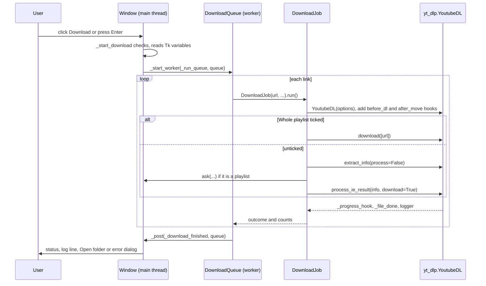

# 4 Download Pipeline

Relevant source files

- [download_engine.py](https://github.com/lifeupnorth/YouTubeDownloader/blob/fed021846b04c093d045f0ec3de2b53d5ea42060/download_engine.py)
- [youtube_downloader.py](https://github.com/lifeupnorth/YouTubeDownloader/blob/fed021846b04c093d045f0ec3de2b53d5ea42060/youtube_downloader.py)

This page follows one click of **Download** from validation to the final summary: how links become a queue of jobs, how the yt-dlp options are built, how playlists are confirmed, how progress and saved files are reported, how Cancel works, and how the result is summarized. All of it except the first and last steps is in `download_engine.py` and runs without Tk. The threading it relies on (`_post`, `_latest_progress`, the 50 ms poll) is in [Architecture and Threading](03-architecture.md); format and ffmpeg choices are in [Formats and ffmpeg](05-formats-ffmpeg.md).

## End-to-end flow

Sources: [youtube_downloader.py:522-573](https://github.com/lifeupnorth/YouTubeDownloader/blob/fed021846b04c093d045f0ec3de2b53d5ea42060/youtube_downloader.py#L522-L573), [download_engine.py:356-383](https://github.com/lifeupnorth/YouTubeDownloader/blob/fed021846b04c093d045f0ec3de2b53d5ea42060/download_engine.py#L356-L383), [download_engine.py:530-547](https://github.com/lifeupnorth/YouTubeDownloader/blob/fed021846b04c093d045f0ec3de2b53d5ea42060/download_engine.py#L530-L547), [youtube_downloader.py:605-627](https://github.com/lifeupnorth/YouTubeDownloader/blob/fed021846b04c093d045f0ec3de2b53d5ea42060/youtube_downloader.py#L605-L627)

## 1. Starting: `_start_download`

`_start_download` runs on the main thread (Download button or Enter in the URL box) and checks, in order:

1. yt-dlp is available (`engine.YT_DLP_AVAILABLE`), otherwise it shows the install prompt.
2. ffmpeg can be found (`engine.find_ffmpeg()`, once per download), otherwise it shows `ffmpeg_help()`.
3. At least one link was entered (`_urls()`: one per line or space-separated, repeats dropped, the placeholder ignored).
4. No download is already running (`is_running`).

It then creates an `engine.DownloadQueue` with the links and the values of the format, folder and **Whole playlist** controls (read here, on the main thread), saves the settings, turns the button into **Cancel**, and starts `_run_queue` on a worker.

Sources: [youtube_downloader.py:404-415](https://github.com/lifeupnorth/YouTubeDownloader/blob/fed021846b04c093d045f0ec3de2b53d5ea42060/youtube_downloader.py#L404-L415), [youtube_downloader.py:522-557](https://github.com/lifeupnorth/YouTubeDownloader/blob/fed021846b04c093d045f0ec3de2b53d5ea42060/youtube_downloader.py#L522-L557)

## 2. Several links: `DownloadQueue`

`DownloadQueue.run` creates one `DownloadJob` per link and runs them in order, all sharing one cancel event. With several links it logs `▶ Link 2/3: <url>` before each one and prefixes progress messages with `Link 2/3 · `. A link that fails, or whose playlist isn't confirmed, doesn't stop the others; a failure is logged as it happens. One link is just a queue of one, and gives exactly the job's own result.

Sources: [download_engine.py:506-547](https://github.com/lifeupnorth/YouTubeDownloader/blob/fed021846b04c093d045f0ec3de2b53d5ea42060/download_engine.py#L506-L547)

## 3. yt-dlp options: `DownloadJob.options`

| Option | Value | Why |
|---|---|---|
| `outtmpl` | `<folder>/%(playlist_title\|)s/%(playlist_index&{:03d} - \|)s%(title)s.%(ext)s` | Playlist entries go to a folder named after the playlist, with a 3-digit index that keeps same-title videos apart. For a single video both fields are empty and the path collapses to `<folder>/<title>.<ext>`. |
| `progress_hooks` | `[_progress_hook]` | Progress reporting |
| `noplaylist` | `not whole_playlist` | Only affects `watch?v=…&list=…` links: unticked means just that video |
| `ignoreerrors` | `"only_download"` | Like the yt-dlp CLI: skip unavailable playlist entries instead of stopping |
| `logger` | `_YdlLogger(_entry_failed, _entry_warning)` | Errors are logged with ✘ and counted as skipped; warnings are logged with ⚠; debug output is dropped |
| `color` | `never` for stdout and stderr | Keeps ANSI color codes out of error text when started from a terminal |
| format keys | from `format_opts(fmt)` | See [Formats and ffmpeg](05-formats-ffmpeg.md) |
| `ffmpeg_location` | the path `find_ffmpeg()` found | Works even when ffmpeg isn't on this process's `PATH` |

Sources: [download_engine.py:174-194](https://github.com/lifeupnorth/YouTubeDownloader/blob/fed021846b04c093d045f0ec3de2b53d5ea42060/download_engine.py#L174-L194), [download_engine.py:333-354](https://github.com/lifeupnorth/YouTubeDownloader/blob/fed021846b04c093d045f0ec3de2b53d5ea42060/download_engine.py#L333-L354)

## 4. Playlist detection and confirmation

The **Whole playlist** box decides whether the app may download many videos without asking. A playlist is detected from what yt-dlp extracts, not from the URL text, so playlists, channels and channel tabs are all recognized.

- **Box ticked:** `run` calls `ydl.download([url])` directly, with no probe and no question.
- **Box unticked:** `_download_unless_declined` calls `extract_info(url, download=False, process=False)`, follows any `url`/`url_transparent` results to their target, and checks the target's `_type`. If it's `playlist`, it asks *"\<title\>" is a playlist or channel. Download all its videos?* through the `ask` callback. No makes the job's outcome `"declined"`. To avoid extracting twice, it then calls `process_ie_result` on the result it already has (except for `url_transparent`, which is passed through so yt-dlp can merge its fields).

A `watch?v=…&list=…` link with the box unticked resolves to a `url` result pointing to the single video, so it downloads that video without asking.

Sources: [download_engine.py:356-369](https://github.com/lifeupnorth/YouTubeDownloader/blob/fed021846b04c093d045f0ec3de2b53d5ea42060/download_engine.py#L356-L369), [download_engine.py:393-409](https://github.com/lifeupnorth/YouTubeDownloader/blob/fed021846b04c093d045f0ec3de2b53d5ea42060/download_engine.py#L393-L409)

## 5. Progress: streams and playlist entries

Formats that merge video and audio download two streams, and yt-dlp reports each from 0 to 100%. To show one bar that only moves forward:

- `_video_starting`, a `before_dl` post-processor that runs once per video, resets the stream index and sets the stream count from `len(info["requested_formats"])` (the progress hook's own `info_dict` doesn't include that list).
- `_progress_hook` clamps each stream's percentage to 100, combines the streams as `(stream_index × 100 + pct) / streams`, and scales the result by 0.99. After the last stream it reports `99, "Processing…"` while ffmpeg merges or converts; only the window's `_download_finished` moves the bar to 100.
- The message shows speed and time left as m:ss (`format_eta`), and in a playlist starts with `Video {playlist_index}/{n_entries} · `.

Sources: [download_engine.py:136-140](https://github.com/lifeupnorth/YouTubeDownloader/blob/fed021846b04c093d045f0ec3de2b53d5ea42060/download_engine.py#L136-L140), [download_engine.py:197-210](https://github.com/lifeupnorth/YouTubeDownloader/blob/fed021846b04c093d045f0ec3de2b53d5ea42060/download_engine.py#L197-L210), [download_engine.py:414-447](https://github.com/lifeupnorth/YouTubeDownloader/blob/fed021846b04c093d045f0ec3de2b53d5ea42060/download_engine.py#L414-L447)

## 6. Saved, already downloaded and skipped

The progress hook only sees temporary per-stream files, which are deleted after merging, so it isn't used to report results. Instead:

- `_file_done` runs as an **after_move** post-processor, once per video with the final path. If yt-dlp's `__real_download` flag is set it logs `✔ Saved: <path>` and counts it as saved; otherwise the file already existed, and it logs `• Already downloaded: <path>`.
- `_YdlLogger.error` → `_entry_failed` strips the `ERROR: ` prefix, adds the message to `skipped` and logs `✘ <message>`. yt-dlp also sends its "Deprecated Feature" notices to `error`; the logger drops those.

Sources: [download_engine.py:183-189](https://github.com/lifeupnorth/YouTubeDownloader/blob/fed021846b04c093d045f0ec3de2b53d5ea42060/download_engine.py#L183-L189), [download_engine.py:451-468](https://github.com/lifeupnorth/YouTubeDownloader/blob/fed021846b04c093d045f0ec3de2b53d5ea42060/download_engine.py#L451-L468)

## 7. Canceling

While a download runs, the Download button is **✖ Cancel** (`_cancel_download`). Clicking it calls `queue.cancel()`, which sets the event all jobs share; the window shows "Canceling…" and disables the button. A job checks the event in `_check_canceled` and raises yt-dlp's `DownloadCancelled`, which stops yt-dlp even with `ignoreerrors` set. It checks at every progress update and before each video starts, so a download stops almost at once and a playlist stops between two videos. The queue doesn't start any further links.

yt-dlp leaves the unfinished video's `.part` file behind, plus any of its streams that finished but weren't merged. The progress hook records the files this run writes for the current video, and after a cancel `_remove_partial_files` deletes them along with their `.ytdl` and `-Frag*` files. Files that were already on disk never get a "downloading" event, so they're never recorded, and `_file_done` clears the list once a video is complete, so finished videos are kept. ffmpeg can't be interrupted, so a click during the final merge lets that video finish first.

Sources: [download_engine.py:370-376](https://github.com/lifeupnorth/YouTubeDownloader/blob/fed021846b04c093d045f0ec3de2b53d5ea42060/download_engine.py#L370-L376), [download_engine.py:387-389](https://github.com/lifeupnorth/YouTubeDownloader/blob/fed021846b04c093d045f0ec3de2b53d5ea42060/download_engine.py#L387-L389), [download_engine.py:420-426](https://github.com/lifeupnorth/YouTubeDownloader/blob/fed021846b04c093d045f0ec3de2b53d5ea42060/download_engine.py#L420-L426), [download_engine.py:470-482](https://github.com/lifeupnorth/YouTubeDownloader/blob/fed021846b04c093d045f0ec3de2b53d5ea42060/download_engine.py#L470-L482), [youtube_downloader.py:592-597](https://github.com/lifeupnorth/YouTubeDownloader/blob/fed021846b04c093d045f0ec3de2b53d5ea42060/youtube_downloader.py#L592-L597)

## 8. Finishing: the summary

Each job ends with an outcome (`done`, `failed`, `declined` or `canceled`), counts and a `summary()`. A job where nothing was saved but entries failed (e.g. a single private video) counts as `failed`, with the reason already in the log. The queue combines its jobs: one link gives exactly the job's result; with several, the outcome is `done` if any link worked, and the summary adds everything up. Skipped entries of a link that failed outright count as one failed link, not also as skipped.

| Situation | Summary |
|---|---|
| One video, no problems | `Download complete!` |
| Several videos or problems | `Done: 3 saved, 1 already downloaded, 2 skipped, 1 link failed, 1 playlist not downloaded` (only the parts that apply) |
| Nothing worked (several links) | `Nothing downloaded: 2 links failed` |
| Failed (one link) | `Error: <reason>` |
| Playlist declined (one link) | `Playlist not downloaded.` |
| Canceled | `Download canceled (1 saved, 2 partial files removed).` |

`_download_finished` shows the summary in the status line and the log. Success is green, or orange if anything was skipped, failed or declined (`had_problems`). Only a failed outcome gets an error dialog; after a download that saved something, the **Open folder** button appears.

Sources: [download_engine.py:377-383](https://github.com/lifeupnorth/YouTubeDownloader/blob/fed021846b04c093d045f0ec3de2b53d5ea42060/download_engine.py#L377-L383), [download_engine.py:484-503](https://github.com/lifeupnorth/YouTubeDownloader/blob/fed021846b04c093d045f0ec3de2b53d5ea42060/download_engine.py#L484-L503), [download_engine.py:549-630](https://github.com/lifeupnorth/YouTubeDownloader/blob/fed021846b04c093d045f0ec3de2b53d5ea42060/download_engine.py#L549-L630), [youtube_downloader.py:605-633](https://github.com/lifeupnorth/YouTubeDownloader/blob/fed021846b04c093d045f0ec3de2b53d5ea42060/youtube_downloader.py#L605-L633)

## Limitations

- Only one download (queue) runs at a time (`is_running`).
- Closing the window during a download asks first, then cancels cleanly. A forced second close, or a crash, leaves the partial file.
- The output folder comes from **Save To** and defaults to `~/Downloads`; yt-dlp creates missing folders.

Sources: [youtube_downloader.py:492-506](https://github.com/lifeupnorth/YouTubeDownloader/blob/fed021846b04c093d045f0ec3de2b53d5ea42060/youtube_downloader.py#L492-L506), [youtube_downloader.py:538-540](https://github.com/lifeupnorth/YouTubeDownloader/blob/fed021846b04c093d045f0ec3de2b53d5ea42060/youtube_downloader.py#L538-L540)
