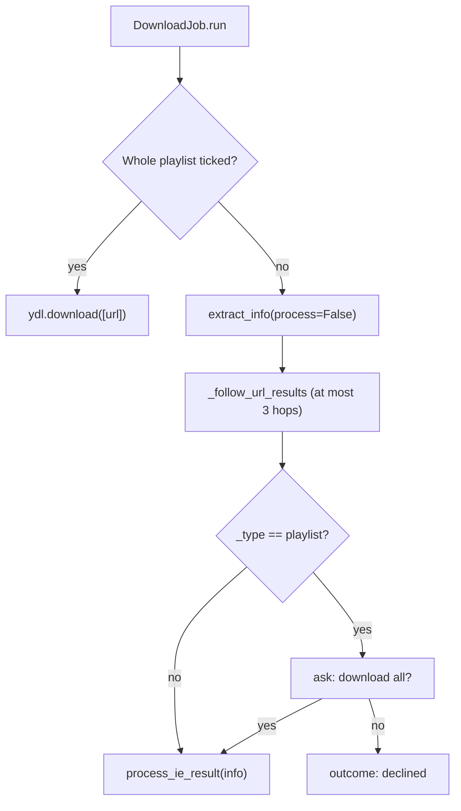

# 4 Download Pipeline

Relevant source files

- [download_engine.py](https://github.com/lifeupnorth/YouTubeDownloader/blob/b369bd269cac691e2563e27391dbd3702c986e50/download_engine.py)
- [youtube_downloader.py](https://github.com/lifeupnorth/YouTubeDownloader/blob/b369bd269cac691e2563e27391dbd3702c986e50/youtube_downloader.py)

This page follows one click of **Download** from validation to the final summary: how links become a queue of jobs, how the yt-dlp options are built, how playlists are confirmed, how progress and saved files are reported, how Cancel works, and how the result is summarized. All of it except the first and last steps is in `download_engine.py` and runs without Tk. The threading it relies on (`_post`, `_latest_progress`, the 50 ms poll) is in [Architecture and Threading](03-architecture.md); format and ffmpeg choices are in [Formats and ffmpeg](05-formats-ffmpeg.md).

## End-to-end flow

Sources: [youtube_downloader.py:651-713](https://github.com/lifeupnorth/YouTubeDownloader/blob/b369bd269cac691e2563e27391dbd3702c986e50/youtube_downloader.py#L651-L713), [download_engine.py:599-633](https://github.com/lifeupnorth/YouTubeDownloader/blob/b369bd269cac691e2563e27391dbd3702c986e50/download_engine.py#L599-L633), [download_engine.py:788-809](https://github.com/lifeupnorth/YouTubeDownloader/blob/b369bd269cac691e2563e27391dbd3702c986e50/download_engine.py#L788-L809), [youtube_downloader.py:752-780](https://github.com/lifeupnorth/YouTubeDownloader/blob/b369bd269cac691e2563e27391dbd3702c986e50/youtube_downloader.py#L752-L780)

## 1. Starting: `_start_download`

`_start_download` runs on the main thread (Download button or Enter in the URL box) and checks, in order:

1. No download is already running (`is_running`), otherwise it says so in a "Busy" message.
2. yt-dlp is available (`engine.YT_DLP_AVAILABLE`), otherwise it shows the install prompt (or, while the in-app install runs, asks the user to wait).
3. ffmpeg can be found (`engine.find_ffmpeg()`, once per download), otherwise it shows `ffmpeg_help()`.
4. At least one link was entered (`_urls()`: one per line or space-separated, repeats dropped, the placeholder ignored).

It then creates an `engine.DownloadQueue` with the links, the values of the format, folder and **Whole playlist** controls (read here, on the main thread), and the JavaScript runtime found at startup, saves the settings, turns the button into **Cancel**, and starts `_run_queue` on a worker. If no runtime was known yet, `_run_queue` looks one up there with `engine.find_js_runtime()` (it may have been installed since startup) before calling `run()`.

Sources: [youtube_downloader.py:483-489](https://github.com/lifeupnorth/YouTubeDownloader/blob/b369bd269cac691e2563e27391dbd3702c986e50/youtube_downloader.py#L483-L489), [youtube_downloader.py:651-713](https://github.com/lifeupnorth/YouTubeDownloader/blob/b369bd269cac691e2563e27391dbd3702c986e50/youtube_downloader.py#L651-L713)

## 2. Several links: `DownloadQueue`

`DownloadQueue.run` creates one `DownloadJob` per link and runs them in order, all sharing one cancel event. With several links it logs `▶ Link 2/3: <url>` before each one and prefixes progress messages with `Link 2/3 · `. A link that fails, or whose playlist isn't confirmed, doesn't stop the others; with several links a failure is logged as it happens. A job that raises (a bug, not a download problem) becomes a failed link with the error `Unexpected error: <type>: <message>`, and the queue goes on. One link is just a queue of one, and gives exactly the job's own result.

Sources: [download_engine.py:762-809](https://github.com/lifeupnorth/YouTubeDownloader/blob/b369bd269cac691e2563e27391dbd3702c986e50/download_engine.py#L762-L809)

## 3. yt-dlp options: `DownloadJob.options`

| Option | Value | Why |
|---|---|---|
| `outtmpl` | `<folder>/%(playlist_title\|)s/%(playlist_index&{:03d} - \|)s%(title)s.%(ext)s` | Playlist entries go to a folder named after the playlist, with a 3-digit index that keeps same-title videos apart. For a single video both fields are empty and the path collapses to `<folder>/<title>.<ext>`. A `%` in the folder's name is doubled, so yt-dlp doesn't read it as a field. |
| `progress_hooks` | `[_progress_hook]` | Progress reporting |
| `noplaylist` | `not whole_playlist` | Only affects `watch?v=…&list=…` links: unticked means just that video |
| `quiet`, `no_warnings` | `True`, `False` | Nothing goes to the console; warnings still reach the logger |
| `ignoreerrors` | `"only_download"` | Like the yt-dlp CLI: skip unavailable playlist entries instead of stopping |
| `logger` | `_YdlLogger(_entry_failed, _entry_warning, _check_canceled)` | Errors are logged with ✘ and counted as skipped; warnings are logged with ⚠ (except the missing-JavaScript-runtime warning, which the window shows once at startup). Debug and info messages aren't logged, but each one runs the cancel check (section 7). |
| `color` | `never` for stdout and stderr | Keeps ANSI color codes out of error text when started from a terminal |
| format keys | from `format_opts(fmt)`: `format`, `postprocessors`, `final_ext`, and for video `format_sort` and `merge_output_format` | See [Formats and ffmpeg](05-formats-ffmpeg.md). `final_ext` is the extension after conversion; it lets yt-dlp see that a converted file is already there (section 6). |
| `ffmpeg_location` | the path `find_ffmpeg()` found | Works even when ffmpeg isn't on this process's `PATH` |
| `js_runtimes` | `{name: {"path": path}}` from `find_js_runtime()` | yt-dlp needs a JavaScript runtime for YouTube, or some formats are missing. The bundled deno in the .exe, else the first new enough deno, node or bun on `PATH`. Left out when none was found, so yt-dlp uses its own default. |

Sources: [download_engine.py:171-210](https://github.com/lifeupnorth/YouTubeDownloader/blob/b369bd269cac691e2563e27391dbd3702c986e50/download_engine.py#L171-L210), [download_engine.py:295-302](https://github.com/lifeupnorth/YouTubeDownloader/blob/b369bd269cac691e2563e27391dbd3702c986e50/download_engine.py#L295-L302), [download_engine.py:310-337](https://github.com/lifeupnorth/YouTubeDownloader/blob/b369bd269cac691e2563e27391dbd3702c986e50/download_engine.py#L310-L337), [download_engine.py:572-597](https://github.com/lifeupnorth/YouTubeDownloader/blob/b369bd269cac691e2563e27391dbd3702c986e50/download_engine.py#L572-L597), [download_engine.py:718-721](https://github.com/lifeupnorth/YouTubeDownloader/blob/b369bd269cac691e2563e27391dbd3702c986e50/download_engine.py#L718-L721)

## 4. Playlist detection and confirmation

The **Whole playlist** box decides whether the app may download many videos without asking. A playlist is detected from what yt-dlp extracts, not from the URL text, so playlists, channels and channel tabs are all recognized.

- **Box ticked:** `run` calls `ydl.download([url])` directly, with no probe and no question.
- **Box unticked:** `_download_unless_declined` calls `extract_info(url, download=False, process=False)`, then `_follow_url_results` follows any `url`/`url_transparent` results to their target (at most 3 hops, so a link that keeps redirecting can't loop), and it checks the target's `_type`. If it's `playlist`, it asks *"\<title\>" is a playlist or channel. Download all its videos?* through the `ask` callback. No makes the job's outcome `"declined"`. To avoid extracting twice, it then calls `process_ie_result` on the result it already has (except for `url_transparent`, which is passed through so yt-dlp can merge its fields). If extraction returned nothing, yt-dlp has already logged the error and nothing is processed; with nothing saved, the job ends as failed.

A `watch?v=…&list=…` link with the box unticked resolves to a `url` result pointing to the single video, so it downloads that video without asking.

Sources: [download_engine.py:405-413](https://github.com/lifeupnorth/YouTubeDownloader/blob/b369bd269cac691e2563e27391dbd3702c986e50/download_engine.py#L405-L413), [download_engine.py:610-614](https://github.com/lifeupnorth/YouTubeDownloader/blob/b369bd269cac691e2563e27391dbd3702c986e50/download_engine.py#L610-L614), [download_engine.py:643-658](https://github.com/lifeupnorth/YouTubeDownloader/blob/b369bd269cac691e2563e27391dbd3702c986e50/download_engine.py#L643-L658)

## 5. Progress: streams and playlist entries

Formats that merge video and audio download two streams, and yt-dlp reports each from 0 to 100%. To show one bar that only moves forward:

- `_video_starting`, a `before_dl` post-processor that runs once per video, resets the stream index and sets the stream count from `len(info["requested_formats"])` (the progress hook's own `info_dict` doesn't include that list). It also checks for a cancel and starts a new list of the video's files (section 7).
- `_progress_hook` clamps each stream's percentage to 100, combines the streams as `(stream_index × 100 + pct) / streams` (the index capped at the last stream), and scales the result by 0.99. After the last stream it reports `99, "Processing…"` while ffmpeg merges or converts; only the window's `_download_finished` moves the bar to 100.
- The message shows speed and time left as m:ss (h:mm:ss past an hour, `format_eta`), and in a playlist starts with `Video {playlist_index}/{n_entries} · `.

Sources: [download_engine.py:213-217](https://github.com/lifeupnorth/YouTubeDownloader/blob/b369bd269cac691e2563e27391dbd3702c986e50/download_engine.py#L213-L217), [download_engine.py:660-696](https://github.com/lifeupnorth/YouTubeDownloader/blob/b369bd269cac691e2563e27391dbd3702c986e50/download_engine.py#L660-L696)

## 6. Saved, already downloaded and skipped

The progress hook only sees temporary per-stream files, which are deleted after merging, so it isn't used to report results. Instead:

- `_file_done` runs as an **after_move** post-processor, once per video with the final path. If yt-dlp's `__real_download` flag is set it logs `✔ Saved: <path>` and counts it as saved; otherwise the file already existed, and it logs `• Already downloaded: <path>`. Because the options include `final_ext`, this also works for converted files: a second MP3 download of the same video finds the MP3 instead of downloading and converting again.
- `_YdlLogger.error` → `_entry_failed` strips the `ERROR: ` prefix, adds the message to `skipped` and logs `✘ <message>`. yt-dlp also sends its "Deprecated Feature" notices to `error`; the logger drops those. After a cancel, `_entry_failed` ignores errors (such as the stopped ffmpeg's).

Sources: [download_engine.py:325-331](https://github.com/lifeupnorth/YouTubeDownloader/blob/b369bd269cac691e2563e27391dbd3702c986e50/download_engine.py#L325-L331), [download_engine.py:698-716](https://github.com/lifeupnorth/YouTubeDownloader/blob/b369bd269cac691e2563e27391dbd3702c986e50/download_engine.py#L698-L716)

## 7. Canceling

While a download runs, the Download button is **✖ Cancel** (`_cancel_download`). Clicking it calls `queue.cancel()`, which sets the event all jobs share and stops the running job's ffmpeg; the window shows "Canceling…" and disables the button. A job checks the event in `_check_canceled` and raises yt-dlp's `DownloadCancelled`, which stops yt-dlp even with `ignoreerrors` set. It checks at every progress update, before each video starts, and at each of yt-dlp's status messages (the `check` that `_YdlLogger.debug` and `info` run), so a download stops almost at once, a playlist stops between two videos, and reading a big channel's pages stops at the next page. The queue doesn't start any further links.

A running ffmpeg conversion or merge is stopped too. `run` calls `_track_processes`, which swaps the `Popen` that yt-dlp's ffmpeg post-processors and external downloaders use for `_tracked_popen_class`. Each process it starts reports itself to the job running on that thread (`_current.job`, via `_process_started`), together with the file it is about to create: `_new_ffmpeg_output` takes the last argument, `file:<path>`, but only for ffmpeg writing a file that isn't on disk yet (not ffprobe, not a run that only reads a file). `stop_processes` notes those files and kills the processes; one that starts just after a cancel is stopped at once. yt-dlp treats the killed ffmpeg as a failed post-processing step and only logs it, so `run` checks for a cancel after a normal return as well, and the job still ends as "canceled".

yt-dlp leaves the unfinished video's `.part` file behind, plus any of its streams that finished but weren't merged. The progress hook records the files this run writes for the current video, and after a cancel `_remove_partial_files` deletes them, the files the stopped ffmpeg was creating, and their `.ytdl` and `-Frag*` files. Files that were already on disk never get a "downloading" event and are never an ffmpeg's new output, so they're never removed, and `_file_done` clears the list once a video is complete, so finished videos are kept.

Link previews stop the same way: `preview_link` gives its `_YdlLogger` a `check` that raises `DownloadCancelled` once the preview's cancel event is set (a newer link was typed, or the window is closing), and it stops the thumbnail download between chunks.

Sources: [download_engine.py:356-403](https://github.com/lifeupnorth/YouTubeDownloader/blob/b369bd269cac691e2563e27391dbd3702c986e50/download_engine.py#L356-L403), [download_engine.py:447-503](https://github.com/lifeupnorth/YouTubeDownloader/blob/b369bd269cac691e2563e27391dbd3702c986e50/download_engine.py#L447-L503), [download_engine.py:543-566](https://github.com/lifeupnorth/YouTubeDownloader/blob/b369bd269cac691e2563e27391dbd3702c986e50/download_engine.py#L543-L566), [download_engine.py:599-641](https://github.com/lifeupnorth/YouTubeDownloader/blob/b369bd269cac691e2563e27391dbd3702c986e50/download_engine.py#L599-L641), [download_engine.py:669-674](https://github.com/lifeupnorth/YouTubeDownloader/blob/b369bd269cac691e2563e27391dbd3702c986e50/download_engine.py#L669-L674), [download_engine.py:723-738](https://github.com/lifeupnorth/YouTubeDownloader/blob/b369bd269cac691e2563e27391dbd3702c986e50/download_engine.py#L723-L738), [download_engine.py:779-782](https://github.com/lifeupnorth/YouTubeDownloader/blob/b369bd269cac691e2563e27391dbd3702c986e50/download_engine.py#L779-L782), [youtube_downloader.py:737-745](https://github.com/lifeupnorth/YouTubeDownloader/blob/b369bd269cac691e2563e27391dbd3702c986e50/youtube_downloader.py#L737-L745)

## 8. Finishing: the summary

Each job ends with an outcome (`done`, `failed`, `declined` or `canceled`), counts and a `summary()`. A job where nothing was saved but entries failed (e.g. a single private video) counts as `failed`, with the reason already in the log. The queue combines its jobs: one link gives exactly the job's result; with several, the outcome is `done` if any link worked, `declined` if every link was a declined playlist, and `failed` otherwise, and the summary adds everything up. Skipped entries of a link that failed outright count as one failed link, not also as skipped. The queue's outcome is `canceled` only if the cancel stopped something (a link was still running or waiting); a cancel clicked just as the last link finished leaves that link's result. Before any link ran, the outcome is `None`.

| Situation | Summary |
|---|---|
| One video, no problems | `Download complete!` |
| Nothing saved and nothing skipped (e.g. an empty playlist) | `Nothing to download: the link has no videos.` (shown as a problem) |
| Several videos or problems | `Done: 3 saved, 1 already downloaded, 2 skipped, 1 link failed, 1 playlist not downloaded` (only the parts that apply) |
| Nothing worked (several links) | `Nothing downloaded: 2 links failed` |
| Failed (one link) | `Error: <reason>` |
| Playlist declined (one link) | `Playlist not downloaded.` |
| Canceled | `Download canceled (1 saved, 2 partial files removed).` |

`_download_finished` shows the summary in the status line and the log. Success is green, or orange if anything was skipped, failed or declined (`had_problems`). Only a failed outcome gets an error dialog. After any other outcome, the **Open folder** button appears if a file was saved or found already there. If `run` itself crashed, `_run_queue` has logged the error and the outcome is `None`; the status line then says the download stopped because of an unexpected error.

Sources: [download_engine.py:619-633](https://github.com/lifeupnorth/YouTubeDownloader/blob/b369bd269cac691e2563e27391dbd3702c986e50/download_engine.py#L619-L633), [download_engine.py:740-759](https://github.com/lifeupnorth/YouTubeDownloader/blob/b369bd269cac691e2563e27391dbd3702c986e50/download_engine.py#L740-L759), [download_engine.py:811-897](https://github.com/lifeupnorth/YouTubeDownloader/blob/b369bd269cac691e2563e27391dbd3702c986e50/download_engine.py#L811-L897), [youtube_downloader.py:705-713](https://github.com/lifeupnorth/YouTubeDownloader/blob/b369bd269cac691e2563e27391dbd3702c986e50/youtube_downloader.py#L705-L713), [youtube_downloader.py:752-786](https://github.com/lifeupnorth/YouTubeDownloader/blob/b369bd269cac691e2563e27391dbd3702c986e50/youtube_downloader.py#L752-L786)

## Limitations

- Only one download (queue) runs at a time (`is_running`).
- Closing the window during a download asks first; Yes cancels it (and any preview lookup), and the window closes once the download has stopped and its partial files are removed. Closing again while it stops, or a crash, leaves the partial file.
- An ffmpeg that is a `.bat`/`.cmd` wrapper runs under `cmd.exe /C`, so Cancel stops only `cmd.exe`.
- The output folder comes from **Save To** and defaults to `~/Downloads`; yt-dlp creates missing folders.

Sources: [youtube_downloader.py:183](https://github.com/lifeupnorth/YouTubeDownloader/blob/b369bd269cac691e2563e27391dbd3702c986e50/youtube_downloader.py#L183), [youtube_downloader.py:616-643](https://github.com/lifeupnorth/YouTubeDownloader/blob/b369bd269cac691e2563e27391dbd3702c986e50/youtube_downloader.py#L616-L643), [download_engine.py:554-560](https://github.com/lifeupnorth/YouTubeDownloader/blob/b369bd269cac691e2563e27391dbd3702c986e50/download_engine.py#L554-L560)
