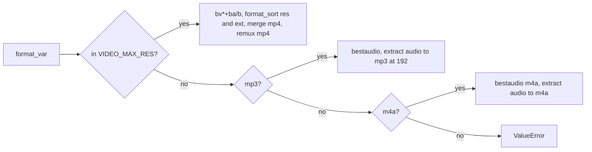

# 5 Formats and ffmpeg

Relevant source files

- [download_engine.py](https://github.com/lifeupnorth/YouTubeDownloader/blob/b369bd269cac691e2563e27391dbd3702c986e50/download_engine.py)
- [youtube_downloader.py](https://github.com/lifeupnorth/YouTubeDownloader/blob/b369bd269cac691e2563e27391dbd3702c986e50/youtube_downloader.py)
- [tests/test_engine.py](https://github.com/lifeupnorth/YouTubeDownloader/blob/b369bd269cac691e2563e27391dbd3702c986e50/tests/test_engine.py)
- [packaging/build_exe.py](https://github.com/lifeupnorth/YouTubeDownloader/blob/b369bd269cac691e2563e27391dbd3702c986e50/packaging/build_exe.py)

How each **Format** choice turns into yt-dlp options, and how the app finds ffmpeg, which every choice needs. Both are plain functions in `download_engine.py`, tested without a window; the help text shown when ffmpeg is missing is in `youtube_downloader.py`. For how the options are used during a download, see [Download Pipeline](04-download-pipeline.md).

## Format choices: `format_opts`

The radio buttons (`FORMATS` in the window) store a value in `format_var`. When a download starts, the value goes to the `DownloadQueue`, which passes it to each `DownloadJob`, and `format_opts(fmt)` turns it into yt-dlp options that `DownloadJob.options` merges in.

| Radio button | Value | `format` | `final_ext` | Other options |
|---|---|---|---|---|
| Best MP4 (Video+Audio) | `mp4_best` | `bv*+ba/b` | `mp4` | `format_sort: ["ext:mp4:m4a"]`, `merge_output_format: mp4`, `FFmpegVideoRemuxer → mp4` |
| 1080p MP4 | `1080p` | `bv*+ba/b` | `mp4` | `format_sort: ["res:1080", "ext:mp4:m4a"]`, merge to and remux as mp4 |
| 720p MP4 | `720p` | `bv*+ba/b` | `mp4` | `res:720`, as above |
| 480p MP4 | `480p` | `bv*+ba/b` | `mp4` | `res:480`, as above |
| Audio Only (MP3) | `mp3` | `bestaudio/best` | `mp3` | `FFmpegExtractAudio`, codec `mp3`, quality `192` |
| Audio Only (M4A) | `m4a` | `bestaudio[ext=m4a]/bestaudio/best` | `m4a` | `FFmpegExtractAudio`, codec `m4a` |

`final_ext` is the extension after conversion. yt-dlp needs it to recognize a converted file that's already there (an MP3 made from a WebM), so a second run says "Already downloaded" instead of downloading and converting again.

Any other value raises `ValueError`.

Sources: [download_engine.py:164-210](https://github.com/lifeupnorth/YouTubeDownloader/blob/b369bd269cac691e2563e27391dbd3702c986e50/download_engine.py#L164-L210), [download_engine.py:592-593](https://github.com/lifeupnorth/YouTubeDownloader/blob/b369bd269cac691e2563e27391dbd3702c986e50/download_engine.py#L592-L593), [youtube_downloader.py:51-59](https://github.com/lifeupnorth/YouTubeDownloader/blob/b369bd269cac691e2563e27391dbd3702c986e50/youtube_downloader.py#L51-L59), [youtube_downloader.py:675-680](https://github.com/lifeupnorth/YouTubeDownloader/blob/b369bd269cac691e2563e27391dbd3702c986e50/youtube_downloader.py#L675-L680)

### Why sort instead of filter

The video choices use yt-dlp's *format sorting* rather than hard filters such as `[height<=1080]`. With `res:N`, yt-dlp prefers the best format at or below N and, if there's none, the closest one above; a hard filter would fail with "Requested format is not available". `ext:mp4:m4a` breaks ties in favor of MP4 video and M4A audio. For **Best MP4**, which has no `res` limit, that preference comes first, which keeps the original "MP4 first" behavior.

`res:N` compares the **shorter side** of the video, the way YouTube's quality labels do, not its height. So for a vertical 1080×1920 Short, "480p" picks 480×854. That's why the constant is named `VIDEO_MAX_RES`.

The single-file fallback (`/b`) isn't always MP4, so every video choice also adds an `FFmpegVideoRemuxer` post-processor targeting `mp4`. The key `preferedformat` is yt-dlp's own spelling.

Sources: [download_engine.py:166-190](https://github.com/lifeupnorth/YouTubeDownloader/blob/b369bd269cac691e2563e27391dbd3702c986e50/download_engine.py#L166-L190), [tests/test_engine.py:85-134](https://github.com/lifeupnorth/YouTubeDownloader/blob/b369bd269cac691e2563e27391dbd3702c986e50/tests/test_engine.py#L85-L134)

## Finding ffmpeg: `find_ffmpeg`

`find_ffmpeg()` looks in up to three places and returns the first ffmpeg it finds:

1. In the one-file .exe only (`sys.frozen`): `bundled_ffmpeg()`, the `ffmpeg.exe` that `packaging/build_exe.py` packs in, from PyInstaller's unpack folder `sys._MEIPASS`. From source this step is skipped.
2. `shutil.which("ffmpeg")` on the process's `PATH`.
3. On Windows only, if that fails: `shutil.which` against `_registry_path()`, which reads the *saved* `Path` from the registry, machine-wide (`HKLM\…\Session Manager\Environment`) first and then the user's (`HKCU\Environment`), the order Windows uses, with `%VARS%` expanded.

Steps 2 and 3 are `_which()`, which `find_js_runtime()` also uses for deno, node and bun. The third step matters because installers such as winget, Chocolatey or Scoop update the saved `Path`, but a running process keeps its old copy; without it, the user would have to restart the app after installing ffmpeg. `winreg` is imported inside `_registry_path()`, so the module still imports on macOS and Linux. The path that's found becomes yt-dlp's `ffmpeg_location`.

Sources: [download_engine.py:220-265](https://github.com/lifeupnorth/YouTubeDownloader/blob/b369bd269cac691e2563e27391dbd3702c986e50/download_engine.py#L220-L265), [download_engine.py:593](https://github.com/lifeupnorth/YouTubeDownloader/blob/b369bd269cac691e2563e27391dbd3702c986e50/download_engine.py#L593), [packaging/build_exe.py:126-130](https://github.com/lifeupnorth/YouTubeDownloader/blob/b369bd269cac691e2563e27391dbd3702c986e50/packaging/build_exe.py#L126-L130), [tests/test_engine.py:197-229](https://github.com/lifeupnorth/YouTubeDownloader/blob/b369bd269cac691e2563e27391dbd3702c986e50/tests/test_engine.py#L197-L229)

## When ffmpeg is missing

| When | What happens |
|---|---|
| Startup | The status line shows `FFMPEG_MISSING_STATUS` ("ffmpeg not found, see the log below") and the log shows `ffmpeg_help(startup=True)`. There's no modal dialog, so it can't stack with the yt-dlp install prompt. |
| Window regains focus | `_recheck_ffmpeg` (on the root's `<FocusIn>`, ignoring child widgets) checks again while ffmpeg is missing. Once found, it logs `✔ ffmpeg found: <path>` and resets the status to "Ready" if the warning is still showing. |
| Download clicked | `_start_download` shows an error dialog with `ffmpeg_help()` and doesn't start. |

In the .exe the bundled ffmpeg is found first, so this normally only comes up when running from source. `ffmpeg_help` takes the install command from `_ffmpeg_install_hint()`, which picks it from `sys.platform`: `winget install ffmpeg` on Windows, `brew install ffmpeg` on macOS, otherwise e.g. `sudo apt install ffmpeg`. Its last sentence differs for startup and for a Download click.

Sources: [youtube_downloader.py:49](https://github.com/lifeupnorth/YouTubeDownloader/blob/b369bd269cac691e2563e27391dbd3702c986e50/youtube_downloader.py#L49), [youtube_downloader.py:142-147](https://github.com/lifeupnorth/YouTubeDownloader/blob/b369bd269cac691e2563e27391dbd3702c986e50/youtube_downloader.py#L142-L147), [youtube_downloader.py:168-173](https://github.com/lifeupnorth/YouTubeDownloader/blob/b369bd269cac691e2563e27391dbd3702c986e50/youtube_downloader.py#L168-L173), [youtube_downloader.py:215-218](https://github.com/lifeupnorth/YouTubeDownloader/blob/b369bd269cac691e2563e27391dbd3702c986e50/youtube_downloader.py#L215-L218), [youtube_downloader.py:225](https://github.com/lifeupnorth/YouTubeDownloader/blob/b369bd269cac691e2563e27391dbd3702c986e50/youtube_downloader.py#L225), [youtube_downloader.py:663-667](https://github.com/lifeupnorth/YouTubeDownloader/blob/b369bd269cac691e2563e27391dbd3702c986e50/youtube_downloader.py#L663-L667), [youtube_downloader.py:849-858](https://github.com/lifeupnorth/YouTubeDownloader/blob/b369bd269cac691e2563e27391dbd3702c986e50/youtube_downloader.py#L849-L858)
