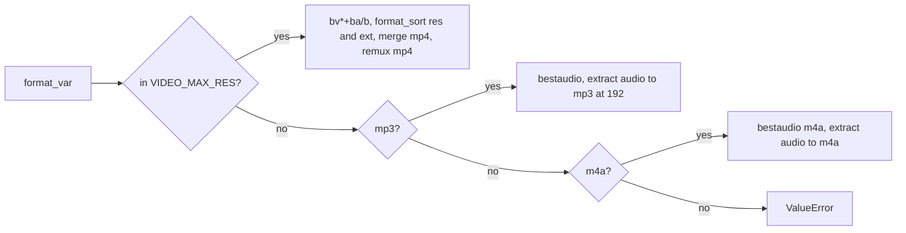

# 5 Formats and ffmpeg

Relevant source files

- [youtube_downloader.py](https://github.com/lifeupnorth/YouTubeDownloader/blob/bd3fd4242f83ee2cf111812e71b6d2db5aa71bdf/youtube_downloader.py)
- [tests/test_formats.py](https://github.com/lifeupnorth/YouTubeDownloader/blob/bd3fd4242f83ee2cf111812e71b6d2db5aa71bdf/tests/test_formats.py)

This page explains how each **Format** choice turns into yt-dlp options, and how the app finds ffmpeg, which every choice needs. Both live in module-level functions above the `YouTubeDownloader` class, so they can be tested without a window. For how these options are used during a download, see [Download Pipeline](04-download-pipeline.md).

## Format choices: `format_opts`

The radio buttons store a value in `format_var`. `format_opts(fmt)` maps it to yt-dlp options, and `_get_ydl_opts` merges them in.

| Radio button | Value | `format` | Other options |
|---|---|---|---|
| Best MP4 (Video+Audio) | `mp4_best` | `bv*+ba/b` | `format_sort: ["ext:mp4:m4a"]`, `merge_output_format: mp4`, `FFmpegVideoRemuxer → mp4` |
| 1080p MP4 | `1080p` | `bv*+ba/b` | `format_sort: ["res:1080", "ext:mp4:m4a"]`, merge to and remux as mp4 |
| 720p MP4 | `720p` | `bv*+ba/b` | `res:720`, as above |
| 480p MP4 | `480p` | `bv*+ba/b` | `res:480`, as above |
| Audio Only (MP3) | `mp3` | `bestaudio/best` | `FFmpegExtractAudio`, codec `mp3`, quality `192` |
| Audio Only (M4A) | `m4a` | `bestaudio[ext=m4a]/bestaudio/best` | `FFmpegExtractAudio`, codec `m4a` |

Any other value raises `ValueError`.

Sources: [youtube_downloader.py:84-115](https://github.com/lifeupnorth/YouTubeDownloader/blob/bd3fd4242f83ee2cf111812e71b6d2db5aa71bdf/youtube_downloader.py#L84-L115), [youtube_downloader.py:267-283](https://github.com/lifeupnorth/YouTubeDownloader/blob/bd3fd4242f83ee2cf111812e71b6d2db5aa71bdf/youtube_downloader.py#L267-L283)

### Why sort instead of filter

The video choices use yt-dlp's *format sorting* rather than hard filters such as `[height<=1080]`. With `res:N`, yt-dlp prefers the best format at or below N, and if none exists, it takes the closest one above. A hard filter would fail with "Requested format is not available". `ext:mp4:m4a` breaks ties in favor of MP4 video and M4A audio. For **Best MP4**, which has no `res` limit, that preference comes first, which keeps the original "MP4 first" behavior.

`res:N` compares the **shorter side** of the video, the way YouTube's quality labels do, not its height. So for a vertical 1080×1920 Short, "480p" picks 480×854. That's why the constant is named `VIDEO_MAX_RES`.

The single-file fallback (`/b`) isn't always MP4, so every video choice also adds an `FFmpegVideoRemuxer` post-processor targeting `mp4`. The key `preferedformat` is yt-dlp's own spelling.

Sources: [youtube_downloader.py:37-39](https://github.com/lifeupnorth/YouTubeDownloader/blob/bd3fd4242f83ee2cf111812e71b6d2db5aa71bdf/youtube_downloader.py#L37-L39), [youtube_downloader.py:86-97](https://github.com/lifeupnorth/YouTubeDownloader/blob/bd3fd4242f83ee2cf111812e71b6d2db5aa71bdf/youtube_downloader.py#L86-L97), [tests/test_formats.py:73-117](https://github.com/lifeupnorth/YouTubeDownloader/blob/bd3fd4242f83ee2cf111812e71b6d2db5aa71bdf/tests/test_formats.py#L73-L117)

## Finding ffmpeg: `find_ffmpeg`

Every choice needs ffmpeg: to merge video and audio, to remux, or to convert audio. `find_ffmpeg()` looks for it in two places:

1. `shutil.which("ffmpeg")` on the process's `PATH`.
2. On Windows only, if that fails: `shutil.which` against `_registry_path()`. That function reads the *saved* `Path` from the registry, machine-wide (`HKLM\…\Session Manager\Environment`) first and then the user's (`HKCU\Environment`), the same order Windows uses, with `%VARS%` expanded.

The second step matters because installers such as winget, Chocolatey or Scoop update the saved `Path`, but a process that's already running keeps its old copy. Without it, the user would have to restart the app after installing ffmpeg. `winreg` is imported inside the function, so the module still imports on macOS and Linux.

The path that's found is passed to yt-dlp as `ffmpeg_location`.

Sources: [youtube_downloader.py:60-81](https://github.com/lifeupnorth/YouTubeDownloader/blob/bd3fd4242f83ee2cf111812e71b6d2db5aa71bdf/youtube_downloader.py#L60-L81), [youtube_downloader.py:472](https://github.com/lifeupnorth/YouTubeDownloader/blob/bd3fd4242f83ee2cf111812e71b6d2db5aa71bdf/youtube_downloader.py#L472)

## When ffmpeg is missing

| When | What happens |
|---|---|
| Startup | The status line shows `FFMPEG_MISSING_STATUS` ("ffmpeg not found, see the log below"), and the log shows `ffmpeg_help(startup=True)`. There's no modal dialog, so it can't stack with the yt-dlp install prompt. |
| Window regains focus | `_recheck_ffmpeg` (bound to the root's `<FocusIn>`, ignoring child widgets) checks again while ffmpeg is still missing. Once found, it logs `✔ ffmpeg found: <path>` and resets the status to "Ready" if the warning is still showing. |
| Download clicked | `_start_download` shows an error dialog with `ffmpeg_help()` and doesn't start. |

`ffmpeg_help` picks the install command from `sys.platform`: `winget install ffmpeg` on Windows, `brew install ffmpeg` on macOS, otherwise e.g. `sudo apt install ffmpeg`. The closing sentence differs for startup and for a Download click.

Sources: [youtube_downloader.py:41-57](https://github.com/lifeupnorth/YouTubeDownloader/blob/bd3fd4242f83ee2cf111812e71b6d2db5aa71bdf/youtube_downloader.py#L41-L57), [youtube_downloader.py:201-205](https://github.com/lifeupnorth/YouTubeDownloader/blob/bd3fd4242f83ee2cf111812e71b6d2db5aa71bdf/youtube_downloader.py#L201-L205), [youtube_downloader.py:539-543](https://github.com/lifeupnorth/YouTubeDownloader/blob/bd3fd4242f83ee2cf111812e71b6d2db5aa71bdf/youtube_downloader.py#L539-L543), [youtube_downloader.py:646-655](https://github.com/lifeupnorth/YouTubeDownloader/blob/bd3fd4242f83ee2cf111812e71b6d2db5aa71bdf/youtube_downloader.py#L646-L655)
