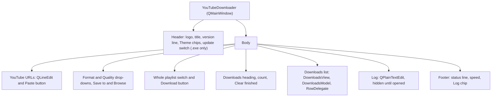

# 6 User Interface

Relevant source files

- [youtube_downloader.py](https://github.com/lifeupnorth/YouTubeDownloader/blob/b369bd269cac691e2563e27391dbd3702c986e50/youtube_downloader.py)
- [download_engine.py](https://github.com/lifeupnorth/YouTubeDownloader/blob/b369bd269cac691e2563e27391dbd3702c986e50/download_engine.py)

The window is a Qt `QMainWindow` (PySide6), built once by `_build_ui` to look like YouTube: a URL box like its search box, pill buttons and chips, drop-downs, and a list of downloads with thumbnails and thin red progress bars, in YouTube's light or dark colors (see [Themes](#themes)). This page lists the widgets, what each is connected to, how the Downloads list works, how links are looked up, and how status and log messages reach the screen. For what a row's download does, see [Download Pipeline](04-download-pipeline.md).

## Layout

`application()` creates the process's one `QApplication`, with Qt's Fusion style (so the style sheet looks the same on every system) and, on Windows, Segoe UI at 10 pt; elsewhere the system font. The log uses Consolas on Windows and the system's monospace font elsewhere.

The central widget is a vertical layout: the header, a 1 px divider, and the body. In the body only the Downloads list grows and shrinks with the window. Sizes are given at 96 DPI (`SEARCH` 40 px for the URL box, `PILL` 36, `PRIMARY` 44 for Download, `CHIP` 30, `ROW_HEIGHT` 92) and Qt scales them and the fonts for the screen, so the app has no DPI code of its own. What the app draws itself (the logo, the Download icon) is drawn at the screen's device pixel ratio, and thumbnails are requested at it (`_thumb_pixels`), so they stay sharp on a high-DPI screen. `_fit_window` opens the window at 1060×780, or smaller to fit the screen's available area (less 40 px for the title bar), centers it, and sets a minimum size of 820×600, or the screen's size if that's smaller.

Sources: [youtube_downloader.py:30-44](https://github.com/lifeupnorth/YouTubeDownloader/blob/b369bd269cac691e2563e27391dbd3702c986e50/youtube_downloader.py#L30-L44), [youtube_downloader.py:99-118](https://github.com/lifeupnorth/YouTubeDownloader/blob/b369bd269cac691e2563e27391dbd3702c986e50/youtube_downloader.py#L99-L118), [youtube_downloader.py:229-419](https://github.com/lifeupnorth/YouTubeDownloader/blob/b369bd269cac691e2563e27391dbd3702c986e50/youtube_downloader.py#L229-L419), [youtube_downloader.py:440-458](https://github.com/lifeupnorth/YouTubeDownloader/blob/b369bd269cac691e2563e27391dbd3702c986e50/youtube_downloader.py#L440-L458)

## Widgets and bindings

| Widget | Connected to | Behavior |
|---|---|---|
| Logo | `logo_pixmap` | A white play triangle on a red rounded rectangle, drawn with `QPainter`; also the window's icon |
| Header label (`powered_lbl`) | `_powered_by_text` | "Powered by yt-dlp 2026.08.19", or "(not installed)"; a release .exe puts its own version first ("v1.0.3 · …"); updated after an in-app install |
| Theme chips (`theme_chips`) | `_choose_theme` | Checkable buttons in a `QButtonGroup`, so one is checked at a time: System, Light or Dark (`THEME_MODES`). `_choose_theme` repaints the window and saves the choice as `theme`. See [Themes](#themes) |
| Check for updates at startup (`update_switch`) | `_update_switch_toggled` | A `QCheckBox` drawn as a switch, only in a release .exe (`engine.app_version()`); on by default, saved as `check_updates` when clicked. While on, startup checks GitHub for a newer release at most once a day and says so in the log |
| URL box (`url`, a `QLineEdit`) | `returnPressed` → `_start_download`, `textChanged` → `_one_line` | One line, styled like YouTube's search box, with a dimmed placeholder ("Paste one or more links: …"). Several links go in separated by spaces; pasted line breaks become spaces (`_one_line`). Enter downloads. When Download is clicked, `split_links` picks out the links |
| Paste button | `_paste_url` | Joined to the URL box's right end. Adds the clipboard's links to those in the box, without repeats, leaving out words that aren't links (`split_links`); a clipboard without a link only changes the status ("The clipboard has no link to paste.") |
| Format drop-down (`format`) | `currentIndexChanged` | MP4 video, MP3 audio or M4A audio (`FORMATS`). The audio formats disable Quality |
| Quality drop-down (`quality`) | | Best quality, 2160p (4K), 1440p, 1080p, 720p or 480p (`QUALITIES`). `_chosen_format` turns Format and Quality into the engine's value: the quality's (`mp4_best`, `1080p`, …) for video, the format's (`mp3`, `m4a`) for audio. `_set_format` does the reverse for the saved value |
| Save to (`path`, a `QLineEdit`) | | Defaults to `~/Downloads`, or the last folder used; a saved folder that's missing (an unplugged drive) is kept in the settings and noted in the log. Download refuses an empty or relative path |
| Browse | `_browse_folder` | `QFileDialog.getExistingDirectory`, starting at the current folder |
| Whole playlist (`whole_playlist`) | | A switch, off by default and never remembered. Read for each link when it's added to the list |
| Download (`dl_btn`) | `_start_download` | Red, with a download arrow drawn by `download_icon` (a "⬇" character comes out as a color emoji on Windows). Adds the links to the list. It stays a Download button while downloads run, so more links can be added at any time |
| Count (`count_lbl`) | the model's `rowsInserted`, `rowsRemoved` and `dataChanged` → `_update_counts` | "3 · 1 completed" next to the Downloads heading; empty while the list is |
| At a time (`parallel`) | `_parallel_changed` | A drop-down beside Clear finished: "1 at a time", "2 at a time" (the default) or "3 at a time" (`PARALLEL_CHOICES`), saved as `parallel_downloads`. More starts waiting rows at once; fewer lets those running finish |
| Clear finished | `_clear_finished` | Removes every finished row (Completed, Failed, Canceled, Not downloaded, Nothing found) from the list and the saved list; the files stay |
| Downloads list (`view`) | `RowDelegate.action` → `_row_action` | See [The Downloads list](#the-downloads-list) |
| Log (`log_box`) | `_log` | A read-only `QPlainTextEdit`, 130 px high, hidden until the Log chip is checked |
| Status line (`status_lbl`) | `_set_status` | Text and color; wraps |
| Speed (`speed_lbl`) | `_update_counts` | "⚡ 3.4 MB/s": the running rows' speeds, from their messages, added up |
| Log chip (`log_btn`) | `toggled` → `log_box.setVisible` | Shows or hides the log. `_log(msg, show=True)` checks it |

Sources: [youtube_downloader.py:121-134](https://github.com/lifeupnorth/YouTubeDownloader/blob/b369bd269cac691e2563e27391dbd3702c986e50/youtube_downloader.py#L121-L134), [youtube_downloader.py:229-419](https://github.com/lifeupnorth/YouTubeDownloader/blob/b369bd269cac691e2563e27391dbd3702c986e50/youtube_downloader.py#L229-L419), [youtube_downloader.py:421-438](https://github.com/lifeupnorth/YouTubeDownloader/blob/b369bd269cac691e2563e27391dbd3702c986e50/youtube_downloader.py#L421-L438), [youtube_downloader.py:462-539](https://github.com/lifeupnorth/YouTubeDownloader/blob/b369bd269cac691e2563e27391dbd3702c986e50/youtube_downloader.py#L462-L539), [youtube_downloader.py:782-797](https://github.com/lifeupnorth/YouTubeDownloader/blob/b369bd269cac691e2563e27391dbd3702c986e50/youtube_downloader.py#L782-L797), [youtube_downloader.py:862-879](https://github.com/lifeupnorth/YouTubeDownloader/blob/b369bd269cac691e2563e27391dbd3702c986e50/youtube_downloader.py#L862-L879)

## The Downloads list

Each link is a `Row` (a dataclass). The link, format, folder and Whole playlist setting are fixed when it's added; the rest fills in as it's looked up and downloaded: `title`, `details`, `thumb`, `state`, `pct`, `message` (speed and time left, or why it failed), `file` (the last file it saved or found already there), `log` (its own log lines), `cancel_event`, `job` and `latest`. Only the main thread changes a row, except `latest` (the download thread's newest progress) and `job`.

It's a Qt model and view. `DownloadsModel` (a `QAbstractTableModel`) holds the rows; `add`, `changed` and `remove` tell the view what changed. `DownloadsView` (a `QTableView`) shows them without a grid, selects one row at a time (the one the keys act on; see below), scrolls by pixel, and while there are no rows draws a hint in their place: "Paste a link and click Download. Your downloads show up here." `RowDelegate` draws the Video, Progress and action cells itself and handles clicks on the icons; the Format, Quality and Status cells are text from the model. The row under the mouse gets the `surface` color, and a divider line runs under each row.

| Column | Shows |
|---|---|
| Video | Takes the width that's left. A 128×72 thumbnail (`THUMB_SIZE`) with rounded corners, cropped to fill (`cover`), or until there is one an empty box with a play triangle. Beside it the title in bold (the link until the lookup finds the title), and under it, dimmer, the details: length and channel, "Playlist · 12 videos" and the channel, "Looking up…", "Couldn't load a preview for this link.", or after a playlist download how it went ("Done: 3 saved, 1 skipped"). Its tooltip is the link |
| Format | MP4, MP3 or M4A (`Row.format_label`) |
| Quality | Best quality, 2160p (4K), 1440p, 1080p, 720p or 480p, or "—" for audio (`Row.quality_label`) |
| Progress | A 4 px bar: red (`accent`) while it downloads or is paused partway, green (`success`) when done, and empty, with no percentage, in every other state (`bar_percent`; a canceled row's partial file is gone, so its bar doesn't keep the progress it had). The percentage beside it while it downloads, processes, is paused partway or is done. Under it the message: "Starting…", speed and time left (with "Video 2/5" in a playlist), "Canceling…", "Pausing…", or in the error color why it failed |
| Status | The state's label in its color (below). Its tooltip is the last 8 log lines for this link |
| (actions) | The icons below |

A row's `state` is one of `STATES`, each with the Status column's text and a theme role for its color:

| State | Status column | Color role |
|---|---|---|
| `waiting` | Waiting | `text_dim` |
| `looking` | Looking up… | `text_dim` |
| `downloading` | Downloading | `blue` |
| `processing` | Processing… | `blue` |
| `paused` | Paused | `warning` |
| `done` | Completed | `success` |
| `failed` | Failed | `error` |
| `canceled` | Canceled | `text_dim` |
| `declined` | Not downloaded | `text_dim` |
| `empty` | Nothing found | `warning` |

`ACTIVE` is `downloading` and `processing`; `FINISHED` is `done`, `failed`, `canceled`, `declined` and `empty`. `paused` is neither: a paused row keeps its partial files, so it can't be removed or cleared until it's resumed or canceled. A row is `processing` while the engine's progress message says "Processing…" (ffmpeg merging or converting). For how each download outcome becomes a state, see [Download Pipeline](04-download-pipeline.md#8-finishing-the-summary).

The action icons are drawn by `draw_icon` in the theme's colors, with a round background under the mouse and a tooltip naming them and their key (e.g. "Cancel (Esc)"). `row_actions(row)` decides which a row has; `ROW_ACTIONS` holds their names and keys:

| Icon | Key | Shown | Does |
|---|---|---|---|
| Two bars, "Pause" | Space | While the row waits or downloads (not while it's pausing) | `_pause_row`: a waiting row is just marked Paused; the running one shows "Pausing…", stops like a cancel, and keeps its partial files (see [Download Pipeline](04-download-pipeline.md#pausing-and-resuming)) |
| Play triangle, "Resume" | Space | While the row is paused | `_resume_row`: back to waiting; its download continues the partial files |
| ✕ "Cancel" | Esc | While the row isn't finished | `_cancel_row`: a waiting row is just marked Canceled; the running one shows "Canceling…" and stops at yt-dlp's next status or progress update, and its partial files are removed, also those a pause kept (see [Download Pipeline](04-download-pipeline.md#7-canceling)) |
| Folder, "Show in folder" | Enter (or a double-click on the row) | Once the row has a file | `_open_folder` → `reveal_in_file_manager`: Explorer with the file selected, Finder with it revealed, or the Linux file manager on its folder |
| Trash can, "Remove from the list (the file stays)" | Delete (Backspace too: the Mac's Delete key) | Once the row is finished | Removes the row from the list; it turns red under the mouse. It never deletes files |

`RowDelegate.editorEvent` finds the icon under the mouse when it moves or is released, and on a release emits `action(row, name)`; `_row_action` runs it. Remove only acts on finished rows, so a running row can't be taken out of the list.

The same actions work from the keyboard. The list takes the focus (Tab reaches it, and a click selects a row), the arrow keys move between rows, and `DownloadsView.keyPressEvent` runs the selected row's action for Space, Esc, Enter or Delete (`ACTION_KEYS`: a key's actions, of which a row has at most one, since Space is both Pause and Resume; with Ctrl, Alt or Shift held they do nothing). Tabbing into the list selects its first row, so the keys always have one to act on; Tab itself leaves the list (`setTabKeyNavigation(False)`). The selected row is filled with the `button` color while the list has the focus, and like a row under the mouse otherwise. A right-click opens a menu (`row_menu`) with all the actions and their keys, the ones the row doesn't have grayed out, and a double-click on a row (not on its icons) shows its file. Each of these emits the view's own `action(row, name)`, which `_row_action` runs like a click on an icon.

### Kept between runs

The list is saved in `downloads.json`, next to the settings file (`history_path`), and comes back when the app starts (`_load_history`): the newest 200 rows (`HISTORY_LIMIT`), in their order. For each row it keeps what the list shows (`row_entry`): the link, format, folder, Whole playlist setting, title, details, state, progress, message and file, a paused row's `partial_files`, and the thumbnail as a small JPEG (`thumb_jpeg`, a few KB, base64 in the JSON). Each save writes the model's rows, so a removed row, or the rows Clear finished removes, leave the saved list too. It's saved a second after the list last changed (`_history_changed` restarts the single-shot `_history_timer`), so a burst of changes, such as many lookups finishing at once, is one write, and right away when the window closes.

Thumbnails are cached rather than looked up again: a restored row shows its thumbnail at once, also offline, and the app doesn't contact YouTube for links nobody entered in this run (see the README's privacy policy). The lookup's worker already has the Pillow image, so it encodes it there (`engine.encode_thumbnail`), and `restored_row` decodes it with Pillow too (`engine.decode_thumbnail`), so it doesn't depend on Qt's JPEG plugin being bundled. Without Pillow there are no thumbnails to keep.

`restored_row` checks each entry and leaves out one it can't use (no link, an unknown format, no folder); a damaged thumbnail only leaves its row without one. Restored rows are marked `restored`: they aren't looked up again, they don't download until they're resumed, and the status line's summary doesn't count them until then. A paused row comes back Paused, with its progress and partial files, so Resume continues it. Closing during a download pauses it and the waiting rows, so that's how they come back; a row that was still waiting or downloading (after a crash) comes back Paused too, with "Stopped when the app closed" (`INTERRUPTED`): a download starting again by itself would be a surprise, and Resume continues its `.part` files all the same.

## Drag and drop

The window takes drops (`setAcceptDrops`); the URL and folder boxes don't (`setAcceptDrops(False)`), so a drop on them does the same as anywhere else. `dropped(mime)` reads what's dragged: the `http`/`https` links among its URLs (or, without any, the links in its text, through `split_links`), and the first local folder. Anything else is refused.

While something is dragged over the window, `dragEnterEvent` shows an overlay (`drop_overlay`, a `QLabel` with a dashed blue border over the whole window, letting the mouse through) saying what a drop will do: "Drop to download 2 links" and how ("as MP4 video, 2160p (4K)"), "into <folder>" if a folder comes with them, or "Drop to save to <folder>". `dragLeaveEvent` and `dropEvent` hide it.

`dropEvent` makes a dropped folder the Save to folder (saved at once if no links came with it). Dropped links go through the same checks and the same `_add_links` as Download (`_can_download`: yt-dlp and ffmpeg; then the folder), so they download right away with the chosen format and quality. The URL box is left as it is.

## Looking links up

As soon as Download adds a row, `_start_download` starts `_look_up` for it on a worker, with the thumbnail size in device pixels (`_thumb_pixels`, read on the main thread, since workers mustn't touch widgets) and the JavaScript runtime found at startup. A semaphore (`_lookup_slots`) lets three lookups run at a time; the others wait their turn. A lookup whose row was canceled meanwhile, or that gets its turn while the window closes, does nothing. Otherwise it posts `_looked_up(row, None)`, which shows the row as "Looking up…" if it's still waiting, and calls `engine.preview_link`. That asks yt-dlp for the link's details without downloading (`process=False`, following `url` results, not paging through playlist entries), formats them with `describe_info`, and fetches the smallest thumbnail at least as wide as asked (`thumbnail_url(info, max(160, width))`), shrunk to fit (`fetch_thumbnail`). The thumbnail needs Pillow; without it rows show titles only. The worker turns the Pillow image into a `QImage` (`to_qimage`; a `QPixmap` may only be made on the main thread) and into the small JPEG the saved list keeps (`engine.encode_thumbnail`), and `_looked_up` sets the row's title, details and thumbnail.

A row's lookup and its download are independent: the download can start before the lookup is done, and the title then appears while it runs. The row's `cancel_event` stops both. A canceled lookup stops at yt-dlp's next status message (the `check` of `_YdlLogger` raises yt-dlp's `DownloadCancelled`) or the thumbnail's next 64 KB chunk, `preview_link` returns `None`, and nothing is posted. Closing the window sets every row's event.

Sources: [download_engine.py:416-503](https://github.com/lifeupnorth/YouTubeDownloader/blob/b369bd269cac691e2563e27391dbd3702c986e50/download_engine.py#L416-L503), [youtube_downloader.py:799-847](https://github.com/lifeupnorth/YouTubeDownloader/blob/b369bd269cac691e2563e27391dbd3702c986e50/youtube_downloader.py#L799-L847), [youtube_downloader.py:945-949](https://github.com/lifeupnorth/YouTubeDownloader/blob/b369bd269cac691e2563e27391dbd3702c986e50/youtube_downloader.py#L945-L949)

## Status, log and colors

Two helpers write to the screen, and both must run on the main thread:

- `_set_status(msg, color)` sets the status line's text and color. `color` is a theme role, kept in `_status_role` so a theme change can repaint it (`_paint_status`).
- `_log(msg, show=False)` appends a line to `log_box` and scrolls to it. `show=True` also opens the log by checking the Log chip. That's for things the user should read: ffmpeg or the JavaScript runtime missing, a saved folder that isn't available, an update notice, a failed install, an unexpected error. Download lines (`▶ <link>`, `✔ Saved: …`, `⚠` warnings, `✘` errors) are added without opening it. The lines a row's `DownloadJob` reports also go into that row's own `log`, which the Status cell's tooltip shows.

Worker threads reach them only through `_post` (see [Architecture and Threading](03-architecture.md)). Unexpected errors, in a worker or in a call on the main thread, also end up in the log as "✘ Unexpected error: …". The status color shows the state:

| Constant (role) | Dark | Light | Used for |
|---|---|---|---|
| `TEXT_DIM` | `#aaaaaa` | `#606060` | Idle ("Ready", "Those links are already in the list.", "Nothing downloaded: 1 canceled.") |
| `WARNING` | `#f59e0b` | `#b45309` | In progress ("Downloading…", "Downloading 2 of 3…" with several links, or "Downloading 2 links, 1 waiting…" while several download at once), ffmpeg missing, an install running, a clipboard without a link, canceling before closing, "✔ Done: 2 completed, 1 failed." |
| `SUCCESS` | `#2ba640` | `#107c41` | "✔ All downloads complete.", "✔ Done: 2 completed, 1 canceled.", yt-dlp installed |
| `ERROR` | `#ff4e45` | `#cc0000` | "✘ Nothing downloaded: 1 failed.", a failed install |

When the last waiting row has finished, `_queue_finished` sets one of those summaries, counted over the finished rows still in the list (not those restored from an earlier run), and calls `QApplication.alert`, which flashes the taskbar button if the window isn't in front.

## Themes

`THEMES` holds YouTube's colors twice, `"dark"` and `"light"`, under the same role names: `bg`, `surface` (the log, the row under the mouse, an empty thumbnail), `field` and `field_border` (text boxes and drop-downs), `blue` (the border of the box being typed in, a switch that's on, a downloading row's status), `button` and `button_hover` (gray buttons and chips), `chip_on` and `chip_on_text` (the checked chip, inverted), `accent`, `accent_hover` and `accent_text` (the red of Download, the progress bars and the logo), `divider`, `scroll` (scroll bars, a switch that's off), `text`, `text_dim`, `disabled` and the status colors above.

`apply_theme` does four things:

1. It tells Qt the scheme the user chose (`QStyleHints.setColorScheme`: `Light`, `Dark`, or `Unknown` for System, which hands the choice back to the system). On Windows this also makes Qt draw a matching dark or light title bar.
2. It picks the theme to show (`_theme_name`): the one chosen, or for System what Qt reports (`styleHints().colorScheme()`): light if that's `Light`, otherwise dark, the app's original look, also when the system doesn't say.
3. It writes the small SVG images the style sheet needs in that theme's colors (the drop-down arrow, and the switch on and off; `write_svgs`) into a temporary folder, builds the style sheet from the roles (`style_sheet`) and sets it on the window.
4. It repaints the status line and the list; `DownloadsModel` and `RowDelegate` take their colors from `model.colors`.

The style sheet styles widgets by type and by object name: `url` and `search` (the URL box and Paste, joined like YouTube's search box), `primary` (Download), `chip` (the Theme and Log chips), `dim`, `heading`, `title`, `divider` and `log`. A pill's corner radius is half its height, since Qt draws square corners when the radius is more.

`theme_mode` is `"system"` (the default), `"light"` or `"dark"`, chosen with the Theme chips and saved in the settings as `theme` (any other saved value is ignored). For System, the window connects to Qt's `colorSchemeChanged` signal and repaints when the system switches between light and dark; there's no timer.

The switches and arrows are SVG images, which Qt reads with its SVG image plugin. That plugin needs `Qt6Svg.dll`, which Windows only finds once it's loaded, so `youtube_downloader.py` imports `PySide6.QtSvg`, which also makes PyInstaller bundle it. The self-check reports whether Qt can read SVG (`svg_images`), and `build_exe.py --check` fails without it.

Sources: [youtube_downloader.py:30-40](https://github.com/lifeupnorth/YouTubeDownloader/blob/b369bd269cac691e2563e27391dbd3702c986e50/youtube_downloader.py#L30-L40), [youtube_downloader.py:531-539](https://github.com/lifeupnorth/YouTubeDownloader/blob/b369bd269cac691e2563e27391dbd3702c986e50/youtube_downloader.py#L531-L539), [youtube_downloader.py:565-579](https://github.com/lifeupnorth/YouTubeDownloader/blob/b369bd269cac691e2563e27391dbd3702c986e50/youtube_downloader.py#L565-L579), [youtube_downloader.py:752-780](https://github.com/lifeupnorth/YouTubeDownloader/blob/b369bd269cac691e2563e27391dbd3702c986e50/youtube_downloader.py#L752-L780)

## Dialogs

All dialogs are `QMessageBox`'s static functions (`question`, `critical`, `warning`, `information`), shown on the main thread. `_start_download` checks, in order: yt-dlp missing, ffmpeg missing, no link ("No URL"), and an empty or relative Save to folder ("Choose a folder"). There's no check for a download already running: links added meanwhile wait their turn in the list.

| Dialog | When |
|---|---|
| "yt-dlp not found" (yes/no) | From source: startup without yt-dlp, or Download clicked without it (while an install runs, the status line says to wait instead) |
| "yt-dlp not found" (error) | The same, in the .exe, which has no pip: "This copy of the app is missing yt-dlp" |
| "ffmpeg not found" (error) | Download clicked without ffmpeg |
| "No URL" (warning) | No link in the URL box |
| "Choose a folder" (warning) | Save to is empty or not a full path |
| "Playlist" (yes/no) | Whole playlist was off for a link that turns out to be a playlist or channel; asked when that row's download starts, one question at a time |
| "Folder not found" (error) / "Couldn't open the folder" (error) | Show in folder clicked after the folder was removed / the file manager couldn't be started |
| "Download in progress" (yes/no) | Closing the window during a download: "Pause it and close the app?" ("2 downloads are still running… Pause them…" for several) |
| "Installed" (info) | Only if yt-dlp was installed but couldn't be loaded without a restart |

A download that fails gets no dialog, and neither does success: the row shows the result, and the status line sums up once the list has nothing left to download.

Sources: [youtube_downloader.py:616-643](https://github.com/lifeupnorth/YouTubeDownloader/blob/b369bd269cac691e2563e27391dbd3702c986e50/youtube_downloader.py#L616-L643), [youtube_downloader.py:651-672](https://github.com/lifeupnorth/YouTubeDownloader/blob/b369bd269cac691e2563e27391dbd3702c986e50/youtube_downloader.py#L651-L672), [youtube_downloader.py:715-735](https://github.com/lifeupnorth/YouTubeDownloader/blob/b369bd269cac691e2563e27391dbd3702c986e50/youtube_downloader.py#L715-L735), [youtube_downloader.py:752-780](https://github.com/lifeupnorth/YouTubeDownloader/blob/b369bd269cac691e2563e27391dbd3702c986e50/youtube_downloader.py#L752-L780), [youtube_downloader.py:788-797](https://github.com/lifeupnorth/YouTubeDownloader/blob/b369bd269cac691e2563e27391dbd3702c986e50/youtube_downloader.py#L788-L797), [youtube_downloader.py:897-958](https://github.com/lifeupnorth/YouTubeDownloader/blob/b369bd269cac691e2563e27391dbd3702c986e50/youtube_downloader.py#L897-L958)
