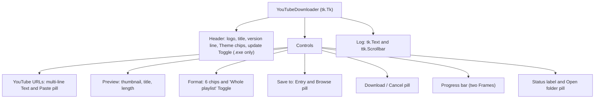

# 6 User Interface

Relevant source files

- [youtube_downloader.py](https://github.com/lifeupnorth/YouTubeDownloader/blob/b369bd269cac691e2563e27391dbd3702c986e50/youtube_downloader.py)
- [download_engine.py](https://github.com/lifeupnorth/YouTubeDownloader/blob/b369bd269cac691e2563e27391dbd3702c986e50/download_engine.py)

The window is plain Tkinter (and a ttk scroll bar), built once by `_build_ui` to look like YouTube: rounded buttons and chips, text boxes like its search box, a thin red progress bar, in YouTube's light or dark colors (see [Themes](#themes)). This page lists the widgets, what each is bound to, how the link preview works, and how status and log messages reach the screen. For what the Download button sets off, see [Download Pipeline](04-download-pipeline.md).

## Layout

The root window has four grid rows: a header, a 1 px divider, the controls and the log. Only the log row grows and shrinks with the window (`rowconfigure(3, weight=1)`). The URL box and the log are `Text` widgets with `width=1`, so they fill their row and the window's width comes from the other controls rather than from Tk's default of 80 characters. `_fit_window` opens the window 680 px wide, or wider if the controls need it (e.g. with Windows display scaling), and as tall as its contents need. It caps both at the screen's work area without the taskbar (`work_area`), leaving `TITLE_BAR` (40 px) for the title bar and frame, centers the window there, and sets a minimum size that keeps every control, the status line and a couple of log lines visible. Text uses Segoe UI on Windows (Helvetica would fall back to Arial there) and Helvetica elsewhere; the log uses Consolas or Courier.

On Windows the app declares itself DPI aware before the window opens (`enable_dpi_awareness`, "system aware"), so on a scaled display (e.g. 150%) Windows doesn't draw it at 96 DPI and stretch it, which blurs the text. Fonts are in points, so Tk sizes them for the real DPI by itself; the layout's pixel sizes (padding, borders, the thumbnail box, wrap widths, the progress bar's height, the window's 680/580 px widths) are multiplied by `scale` (the screen's DPI / 96) once, after the window is built (`_scale_layout`, `_px`), and the preview asks the engine for a thumbnail of the scaled size. Pills and toggles scale their own sizes when they draw themselves, so `_scale_layout` only scales their grid padding. Below 1.05 the scale counts as 1, since Tk reports e.g. 96.08 DPI for 96.

Sources: [youtube_downloader.py:30-44](https://github.com/lifeupnorth/YouTubeDownloader/blob/b369bd269cac691e2563e27391dbd3702c986e50/youtube_downloader.py#L30-L44), [youtube_downloader.py:99-118](https://github.com/lifeupnorth/YouTubeDownloader/blob/b369bd269cac691e2563e27391dbd3702c986e50/youtube_downloader.py#L99-L118), [youtube_downloader.py:229-419](https://github.com/lifeupnorth/YouTubeDownloader/blob/b369bd269cac691e2563e27391dbd3702c986e50/youtube_downloader.py#L229-L419), [youtube_downloader.py:440-458](https://github.com/lifeupnorth/YouTubeDownloader/blob/b369bd269cac691e2563e27391dbd3702c986e50/youtube_downloader.py#L440-L458)

## Widgets and bindings

| Widget | Bound to | Behavior |
|---|---|---|
| Header label (`powered_lbl`) | `_powered_by_text` | "Powered by yt-dlp 2026.08.19", or "(not installed)"; a release .exe puts its own version first ("v1.0.3 · …"); updated after an in-app install |
| Theme chips (`theme_chips`) | `theme_var` | System, Light or Dark (`THEME_MODES`); `_choose_theme` repaints the window and saves the choice as `theme`. See [Themes](#themes) |
| Check for updates at startup `Toggle` | `update_check_var` | Only in a release .exe (`engine.app_version()`); on by default, saved as `check_updates` when clicked. While on, startup checks GitHub for a newer release at most once a day and says so in the log |
| URL `Text` (`url_entry`) | `<FocusIn>`, `<FocusOut>`, `<KeyRelease>`, `<Return>`, `<Shift-Return>`, `<Tab>`, `<Shift-Tab>` | One link per line; grows from 1 to 4 lines (`_fit_url_box`). Shows a dimmed placeholder (tracked by `_placeholder_shown`) until focused. Enter starts a download, Shift+Enter adds a line, Tab moves to the next widget and Shift+Tab to the previous one. `_urls()` returns the links in order without repeats; `_url()` the first one. |
| Paste `Pill` | `_paste_url` | Adds the clipboard's links to those in the box (or replaces the placeholder), one per line and without repeats, leaving out words that aren't links (`split_links`); a clipboard without a link only changes the status |
| Preview (`preview_img`, `preview_lbl`) | `preview_text` | Thumbnail (160×90, rounded; an empty rounded box until there is one), then the title in bold (`preview_title`, the first line) and under it, dimmer, the length or playlist size with the channel (`preview_details`), for the first link; "+ 2 more links" when there are several. Hints such as "Loading preview…" show dimmed in the title's place |
| Format chips ×6 (`format_chips`) | `format_var` | From `FORMATS`, in two rows: "Video (MP4)" (Best quality, 1080p, 720p, 480p) and "Audio only" (MP3, M4A). The selected chip is inverted (`_select_format_chip`, on every change of `format_var`) |
| Whole playlist `Toggle` | `playlist_var` | Right of the Format heading, off by default and never remembered; changing it refreshes the preview |
| Save to `Entry` | `download_path` | Defaults to `~/Downloads`, or the last folder used; a saved folder that's missing (an unplugged drive) is kept in the settings and noted in the log. Download refuses an empty or relative path |
| Browse `Pill` | `_browse_folder` | `filedialog.askdirectory`, starting at the current folder |
| Download `Pill` (`dl_btn`) | `_start_download` | Red and as wide as the window (`stretch=True`). Becomes **✖ Cancel** (`_cancel_download`) while a download runs, then "Canceling…" (disabled, gray) until it stops |
| Progress bar (`progress`) | `progress_var` | A 4 px `Frame` in the trough color with a red `Frame` placed in it at `relwidth` = progress / 100 (ttk's progress bar can't be made this thin) |
| Status `Label` (`status_lbl`) | `status_var` | Text and color set by `_set_status`; wraps at its current width |
| Open folder `Pill` (`open_btn`) | `_open_folder` | Hidden until a download saves a file; shows that file in Explorer, Finder or the Linux file manager (`reveal_in_file_manager`) |
| Log `Text` (`log_box`) | `_log` | Read-only; temporarily enabled to append a line and scroll to it |

Sources: [youtube_downloader.py:121-134](https://github.com/lifeupnorth/YouTubeDownloader/blob/b369bd269cac691e2563e27391dbd3702c986e50/youtube_downloader.py#L121-L134), [youtube_downloader.py:229-419](https://github.com/lifeupnorth/YouTubeDownloader/blob/b369bd269cac691e2563e27391dbd3702c986e50/youtube_downloader.py#L229-L419), [youtube_downloader.py:421-438](https://github.com/lifeupnorth/YouTubeDownloader/blob/b369bd269cac691e2563e27391dbd3702c986e50/youtube_downloader.py#L421-L438), [youtube_downloader.py:462-539](https://github.com/lifeupnorth/YouTubeDownloader/blob/b369bd269cac691e2563e27391dbd3702c986e50/youtube_downloader.py#L462-L539), [youtube_downloader.py:782-797](https://github.com/lifeupnorth/YouTubeDownloader/blob/b369bd269cac691e2563e27391dbd3702c986e50/youtube_downloader.py#L782-L797), [youtube_downloader.py:862-879](https://github.com/lifeupnorth/YouTubeDownloader/blob/b369bd269cac691e2563e27391dbd3702c986e50/youtube_downloader.py#L862-L879)

## The link preview

Typing (after a 600 ms pause), pasting, leaving the URL box, or changing **Whole playlist** schedules `_start_preview`. It skips the lookup if neither the links nor the box changed (`_preview_key`). Otherwise it bumps `_preview_token` and starts `_preview_thread` on a worker, which calls `engine.preview_link` with the JavaScript runtime found at startup. That asks yt-dlp for the first link's details without downloading (`process=False`, following `url` results, not paging through playlist entries), formats them with `describe_info`, and fetches a small thumbnail with `fetch_thumbnail`. The thumbnail needs Pillow; without it the preview is text only. `_preview_done` ignores answers whose token is older than the current one, so typing quickly can't show the wrong video. Each lookup also gets its own `threading.Event` (`_preview_cancel`); starting a newer one, or closing the window, sets the old one. `preview_link` then stops at yt-dlp's next status message (the `check` of `_YdlLogger` raises yt-dlp's `DownloadCancelled`) or the thumbnail's next 64 KB chunk and returns `None`, and `_preview_thread` returns without posting a result. After an in-app install of yt-dlp, `_install_done` clears `_preview_key` so a link already in the box gets its preview.

Sources: [download_engine.py:416-503](https://github.com/lifeupnorth/YouTubeDownloader/blob/b369bd269cac691e2563e27391dbd3702c986e50/download_engine.py#L416-L503), [youtube_downloader.py:799-847](https://github.com/lifeupnorth/YouTubeDownloader/blob/b369bd269cac691e2563e27391dbd3702c986e50/youtube_downloader.py#L799-L847), [youtube_downloader.py:945-949](https://github.com/lifeupnorth/YouTubeDownloader/blob/b369bd269cac691e2563e27391dbd3702c986e50/youtube_downloader.py#L945-L949)

## Status, log and colors

Two helpers write to the screen, and both must run on the main thread:

- `_set_status(msg, color)` sets `status_var` and the label's text color. `color` is a theme role, kept in `_status_role` so a theme change can repaint it.
- `_log(msg)` appends a line to `log_box`.

Worker threads reach them only through `_post` or the coalesced `_latest_progress` (see [Architecture and Threading](03-architecture.md)). Unexpected errors, in a worker or in a Tk callback, also end up in the log as "✘ Unexpected error: …". The status color shows the state:

| Constant (role) | Dark | Light | Used for |
|---|---|---|---|
| `TEXT_DIM` | `#aaaaaa` | `#606060` | Idle ("Ready", "Playlist not downloaded.", "Download canceled …") |
| `WARNING` | `#f59e0b` | `#b45309` | In progress, ffmpeg missing, an install still running, a finished run where something was skipped, failed or declined |
| `SUCCESS` | `#2ba640` | `#107c41` | Download complete, yt-dlp installed |
| `ERROR` | `#ff4e45` | `#cc0000` | Errors (a failed download, a download that crashed, a failed install) |

## Themes

`THEMES` holds YouTube's colors twice, `"dark"` and `"light"`, under the same role names: `bg`, `surface` (the log, an empty thumbnail), `field` and `field_border` (text boxes), `blue` (the border of the text box being typed in, a switch that's on), `button` and `button_hover` (gray pills and chips), `chip_on` and `chip_on_text` (the selected chip, inverted), `accent` (the red of Download, the progress bar and the logo), `divider`, `scroll`, `text`, `text_dim`, `disabled` and the status colors above. Widgets are given roles, not colors: `_paint(widget, bg="bg", fg="text")` colors a widget and records it in `_painted`, and `_apply_theme` picks the theme, then repaints everything recorded, the pills and toggles, the text boxes' borders (`_paint_field`), the placeholder, the status line and the preview, restyles the ttk scroll bar, and on Windows 10 and 11 makes the title bar dark or light to match (`set_title_bar_theme`, `DWMWA_USE_IMMERSIVE_DARK_MODE`).

`theme_var` is `"system"` (the default), `"light"` or `"dark"`, chosen with the Theme chips and saved in the settings as `theme` (any other saved value is ignored). For `"system"`, `_theme_name` asks `system_theme`: on Windows the registry's `AppsUseLightTheme`, on macOS Tk's `::tk::unsupported::MacWindowStyle isdark`, elsewhere GNOME's `color-scheme` (`gsettings`). If it can't tell, the app is dark, its original look. On Windows and macOS, where asking is cheap, `_watch_system_theme` asks again every 2 seconds and repaints when the system switches; on Linux it's asked at startup and when System is chosen. `destroy` cancels that timer.

`Pill` is a `tk.Label` that acts like a `tk.Button`: `command`, `invoke()`, a `"disabled"` state, Space or Enter once Tab reaches it, and a click that counts only if the mouse is released over it. Its text sits on a rounded shape that Pillow draws at 4× and shrinks (`pill_image`, `SMOOTH`), so the edges are smooth, which Tk's own drawing isn't; the images are cached by size and color in `_photo`. Kinds (`PILL_KINDS`): `"primary"` (red: Download), `"secondary"` (gray: Paste, Browse, Open folder, the chips) and, for a selected chip, inverted. `Toggle` is a `Pill` that draws an on/off switch (`switch_image`) before its label and flips a `BooleanVar`. Without Pillow, pills are plain rectangles, toggles show ☑ or ☐, and the thumbnail box is a gray frame.

Sources: [youtube_downloader.py:30-40](https://github.com/lifeupnorth/YouTubeDownloader/blob/b369bd269cac691e2563e27391dbd3702c986e50/youtube_downloader.py#L30-L40), [youtube_downloader.py:531-539](https://github.com/lifeupnorth/YouTubeDownloader/blob/b369bd269cac691e2563e27391dbd3702c986e50/youtube_downloader.py#L531-L539), [youtube_downloader.py:565-579](https://github.com/lifeupnorth/YouTubeDownloader/blob/b369bd269cac691e2563e27391dbd3702c986e50/youtube_downloader.py#L565-L579), [youtube_downloader.py:752-780](https://github.com/lifeupnorth/YouTubeDownloader/blob/b369bd269cac691e2563e27391dbd3702c986e50/youtube_downloader.py#L752-L780)

## Dialogs

`_start_download` checks, in order: a download already running ("Busy"), yt-dlp missing, ffmpeg missing, no link ("No URL").

| Dialog | When |
|---|---|
| "Busy" (info) | Download clicked while a download is running |
| "yt-dlp not found" (yes/no) | From source: startup without yt-dlp, or Download clicked without it (while an install runs, the status line says to wait instead) |
| "yt-dlp not found" (error) | The same, in the .exe, which has no pip: "This copy of the app is missing yt-dlp" |
| "ffmpeg not found" (error) | Download clicked without ffmpeg |
| "No URL" (warning) | No link entered |
| "Playlist" (yes/no) | Whole playlist unticked and a link turns out to be a playlist or channel |
| "Download Failed" (error) | Nothing could be downloaded; success has no pop-up, just the status line and Open folder |
| "Folder not found" (error) / "Couldn't open the folder" (error) | Open folder clicked after the folder was removed / the file manager couldn't be started |
| "Download in progress" (yes/no) | Closing the window during a download |
| "Installed" (info) | Only if yt-dlp was installed but couldn't be loaded without a restart |

Sources: [youtube_downloader.py:616-643](https://github.com/lifeupnorth/YouTubeDownloader/blob/b369bd269cac691e2563e27391dbd3702c986e50/youtube_downloader.py#L616-L643), [youtube_downloader.py:651-672](https://github.com/lifeupnorth/YouTubeDownloader/blob/b369bd269cac691e2563e27391dbd3702c986e50/youtube_downloader.py#L651-L672), [youtube_downloader.py:715-735](https://github.com/lifeupnorth/YouTubeDownloader/blob/b369bd269cac691e2563e27391dbd3702c986e50/youtube_downloader.py#L715-L735), [youtube_downloader.py:752-780](https://github.com/lifeupnorth/YouTubeDownloader/blob/b369bd269cac691e2563e27391dbd3702c986e50/youtube_downloader.py#L752-L780), [youtube_downloader.py:788-797](https://github.com/lifeupnorth/YouTubeDownloader/blob/b369bd269cac691e2563e27391dbd3702c986e50/youtube_downloader.py#L788-L797), [youtube_downloader.py:897-958](https://github.com/lifeupnorth/YouTubeDownloader/blob/b369bd269cac691e2563e27391dbd3702c986e50/youtube_downloader.py#L897-L958)
