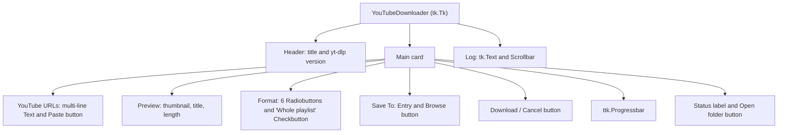

# 6 User Interface

Relevant source files

- [youtube_downloader.py](https://github.com/lifeupnorth/YouTubeDownloader/blob/fed021846b04c093d045f0ec3de2b53d5ea42060/youtube_downloader.py)
- [download_engine.py](https://github.com/lifeupnorth/YouTubeDownloader/blob/fed021846b04c093d045f0ec3de2b53d5ea42060/download_engine.py)

The window is plain Tkinter plus a ttk progress bar, built once by `_build_ui` with a dark, YouTube-like palette. This page lists the widgets, what each is bound to, how the link preview works, and how status and log messages reach the screen. For what the Download button sets off, see [Download Pipeline](04-download-pipeline.md).

## Layout

The root window has three grid rows: a header, the main card and the log. Only the log row grows and shrinks with the window (`rowconfigure(2, weight=1)`). `_fit_window` opens the window 680 px wide and as tall as its contents need (capped at the screen height), and sets a minimum size that keeps every control, the status line and a couple of log lines visible. Text uses Segoe UI on Windows (Helvetica would fall back to Arial there) and Helvetica elsewhere; the log uses Consolas or Courier.

Sources: [youtube_downloader.py:28-44](https://github.com/lifeupnorth/YouTubeDownloader/blob/fed021846b04c093d045f0ec3de2b53d5ea42060/youtube_downloader.py#L28-L44), [youtube_downloader.py:172-352](https://github.com/lifeupnorth/YouTubeDownloader/blob/fed021846b04c093d045f0ec3de2b53d5ea42060/youtube_downloader.py#L172-L352), [youtube_downloader.py:368-379](https://github.com/lifeupnorth/YouTubeDownloader/blob/fed021846b04c093d045f0ec3de2b53d5ea42060/youtube_downloader.py#L368-L379)

## Widgets and bindings

| Widget | Bound to | Behavior |
|---|---|---|
| Header label (`powered_lbl`) | `_powered_by_text` | "Powered by yt-dlp 2026.08.19", or "(not installed)"; updated after an in-app install |
| URL `Text` (`url_entry`) | `<FocusIn>`, `<FocusOut>`, `<KeyRelease>`, `<Return>`, `<Shift-Return>`, `<Tab>` | One link per line; grows from 1 to 4 lines (`_fit_url_box`). Shows a dimmed placeholder (tracked by `_placeholder_shown`) until focused. Enter starts a download, Shift+Enter adds a line, Tab moves to the next widget. `_urls()` returns the links in order without repeats; `_url()` the first one. |
| Paste `Button` | `_paste_url` | Replaces the box (or placeholder) with the clipboard's links, one per line; an empty clipboard is ignored |
| Preview (`preview_img`, `preview_lbl`) | `preview_text` | Thumbnail, title, and length or playlist size with the channel, for the first link; "+ 2 more links" when there are several |
| Format `Radiobutton` ×6 | `format_var` | From `FORMATS`, laid out with `divmod(i, 3)` in columns 0–1 |
| Whole playlist `Checkbutton` | `playlist_var` | In column 2 of the format grid, off by default and never remembered; changing it refreshes the preview |
| Save To `Entry` | `download_path` | Defaults to `~/Downloads`, or the last folder used |
| Browse `Button` | `_browse_folder` | `filedialog.askdirectory`, starting at the current folder |
| Download `Button` (`dl_btn`) | `_start_download` | Becomes **✖ Cancel** (`_cancel_download`) while a download runs, then "Canceling…" (disabled) until it stops |
| `ttk.Progressbar` | `progress_var` | `Red.Horizontal.TProgressbar` style on the `clam` theme |
| Status `Label` (`status_lbl`) | `status_var` | Text and color set by `_set_status`; wraps at its current width |
| Open folder `Button` (`open_btn`) | `_open_folder` | Hidden until a download saves a file; shows that file in Explorer, Finder or the Linux file manager (`reveal_in_file_manager`) |
| Log `Text` (`log_box`) | `_log` | Read-only; temporarily enabled to append a line and scroll to it |

Sources: [youtube_downloader.py:95-108](https://github.com/lifeupnorth/YouTubeDownloader/blob/fed021846b04c093d045f0ec3de2b53d5ea42060/youtube_downloader.py#L95-L108), [youtube_downloader.py:175-333](https://github.com/lifeupnorth/YouTubeDownloader/blob/fed021846b04c093d045f0ec3de2b53d5ea42060/youtube_downloader.py#L175-L333), [youtube_downloader.py:384-445](https://github.com/lifeupnorth/YouTubeDownloader/blob/fed021846b04c093d045f0ec3de2b53d5ea42060/youtube_downloader.py#L384-L445), [youtube_downloader.py:631-644](https://github.com/lifeupnorth/YouTubeDownloader/blob/fed021846b04c093d045f0ec3de2b53d5ea42060/youtube_downloader.py#L631-L644), [youtube_downloader.py:702-705](https://github.com/lifeupnorth/YouTubeDownloader/blob/fed021846b04c093d045f0ec3de2b53d5ea42060/youtube_downloader.py#L702-L705)

## The link preview

Typing (after a 600 ms pause), pasting, leaving the URL box, or changing **Whole playlist** schedules `_start_preview`. It skips the lookup if neither the links nor the box changed (`_preview_key`). Otherwise it bumps `_preview_token` and starts `_preview_thread` on a worker, which calls `engine.preview_link`. That asks yt-dlp for the first link's details without downloading (`process=False`, following `url` results, not paging through playlist entries), formats them with `describe_info`, and fetches a small thumbnail with `fetch_thumbnail`. The thumbnail needs Pillow; without it the preview is text only. `_preview_done` ignores answers whose token is older than the current one, so typing quickly can't show the wrong video. Each lookup also gets its own `threading.Event` (`_preview_cancel`); starting a newer one, or closing the window, sets the old one. `preview_link` then stops at yt-dlp's next status message (the `check` of `_YdlLogger`) or the thumbnail's next 64 KB chunk and returns `None`, and `_preview_thread` only reports that the worker finished.

Sources: [download_engine.py:224-290](https://github.com/lifeupnorth/YouTubeDownloader/blob/fed021846b04c093d045f0ec3de2b53d5ea42060/download_engine.py#L224-L290), [youtube_downloader.py:646-687](https://github.com/lifeupnorth/YouTubeDownloader/blob/fed021846b04c093d045f0ec3de2b53d5ea42060/youtube_downloader.py#L646-L687)

## Status, log and colors

Two helpers write to the screen, and both must run on the main thread:

- `_set_status(msg, color)` sets `status_var` and the label's text color.
- `_log(msg)` appends a line to `log_box`.

Worker threads reach them only through `_post` or the coalesced `_latest_progress` (see [Architecture and Threading](03-architecture.md)). The status color shows the state:

| Constant | Hex | Used for |
|---|---|---|
| `TEXT_DIM` | `#aaaaaa` | Idle ("Ready", "Playlist not downloaded.", "Download canceled …") |
| `WARNING` | `#f59e0b` | In progress, ffmpeg missing, a finished run where something was skipped, failed or declined |
| `SUCCESS` | `#22c55e` | Download complete, yt-dlp installed |
| `ACCENT` | `#ff0000` | Errors; also the Download button and progress bar |

Sources: [youtube_downloader.py:28-38](https://github.com/lifeupnorth/YouTubeDownloader/blob/fed021846b04c093d045f0ec3de2b53d5ea42060/youtube_downloader.py#L28-L38), [youtube_downloader.py:447-455](https://github.com/lifeupnorth/YouTubeDownloader/blob/fed021846b04c093d045f0ec3de2b53d5ea42060/youtube_downloader.py#L447-L455), [youtube_downloader.py:605-627](https://github.com/lifeupnorth/YouTubeDownloader/blob/fed021846b04c093d045f0ec3de2b53d5ea42060/youtube_downloader.py#L605-L627)

## Dialogs

| Dialog | When |
|---|---|
| "yt-dlp not found" (yes/no) | Startup without yt-dlp, or Download clicked without it |
| "ffmpeg not found" (error) | Download clicked without ffmpeg |
| "No URL" (warning) / "Busy" (info) | No link entered / a download already running |
| "Playlist" (yes/no) | Whole playlist unticked and a link turns out to be a playlist or channel |
| "Download Failed" (error) | Nothing could be downloaded; success has no pop-up, just the status line and Open folder |
| "Download in progress" (yes/no) | Closing the window during a download |
| "Installed" (info) | Only if yt-dlp was installed but couldn't be loaded without a restart |

Sources: [youtube_downloader.py:492-514](https://github.com/lifeupnorth/YouTubeDownloader/blob/fed021846b04c093d045f0ec3de2b53d5ea42060/youtube_downloader.py#L492-L514), [youtube_downloader.py:522-540](https://github.com/lifeupnorth/YouTubeDownloader/blob/fed021846b04c093d045f0ec3de2b53d5ea42060/youtube_downloader.py#L522-L540), [youtube_downloader.py:576-587](https://github.com/lifeupnorth/YouTubeDownloader/blob/fed021846b04c093d045f0ec3de2b53d5ea42060/youtube_downloader.py#L576-L587), [youtube_downloader.py:605-627](https://github.com/lifeupnorth/YouTubeDownloader/blob/fed021846b04c093d045f0ec3de2b53d5ea42060/youtube_downloader.py#L605-L627), [youtube_downloader.py:715-758](https://github.com/lifeupnorth/YouTubeDownloader/blob/fed021846b04c093d045f0ec3de2b53d5ea42060/youtube_downloader.py#L715-L758)
