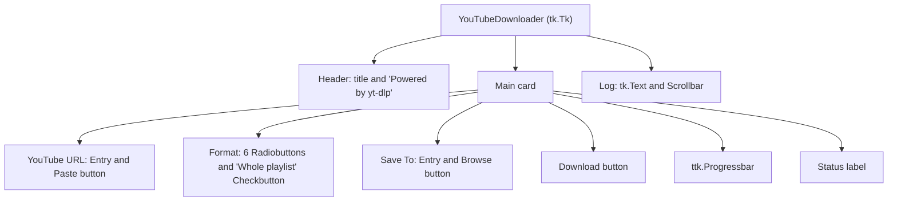

# 6 User Interface

Relevant source files

- [youtube_downloader.py](https://github.com/lifeupnorth/YouTubeDownloader/blob/bd3fd4242f83ee2cf111812e71b6d2db5aa71bdf/youtube_downloader.py)

The window is plain Tkinter with one ttk widget (the progress bar). It's built once by `_build_ui` with a dark, YouTube-like palette. This page lists the widgets, what each one is bound to, and how status and log messages reach the screen. For the logic behind the Download button, see [Download Pipeline](04-download-pipeline.md).

## Layout

The root window has three grid rows: a header, the main card and the log. Only the log row grows and shrinks with the window (`rowconfigure(2, weight=1)`). `_fit_window` opens the window 680 px wide and as tall as its contents need (capped at the screen height), and sets a minimum size that keeps every control, the status line and a couple of log lines visible. Text uses Segoe UI on Windows (Helvetica would fall back to Arial there) and Helvetica elsewhere; the log uses Consolas or Courier.

Sources: [youtube_downloader.py:169-176](https://github.com/lifeupnorth/YouTubeDownloader/blob/bd3fd4242f83ee2cf111812e71b6d2db5aa71bdf/youtube_downloader.py#L169-L176), [youtube_downloader.py:209-360](https://github.com/lifeupnorth/YouTubeDownloader/blob/bd3fd4242f83ee2cf111812e71b6d2db5aa71bdf/youtube_downloader.py#L209-L360)

## Widgets and bindings

| Widget | Bound to | Behavior |
|---|---|---|
| URL `Entry` (`url_entry`) | `<FocusIn>`, `<FocusOut>`, `<KeyRelease>`, `<Return>` | Shows a dimmed placeholder URL (tracked by `_placeholder_shown`) that's cleared on focus and restored when the box is left empty; `_url()` never returns it. Typing (after a pause) or leaving the box updates the preview. Enter starts a download. |
| Preview (`preview_img`, `preview_lbl`) | `preview_text` | Thumbnail, title, and length or playlist size with the channel. `_start_preview` looks the link up on a worker (`_preview_thread`, `process=False` so playlists aren't paged through) and drops answers for an older link (`_preview_token`). Thumbnails need Pillow. |
| Paste `Button` | `_paste_url` | Replaces the URL (or placeholder) with the trimmed clipboard text; an empty clipboard is ignored |
| Format `Radiobutton` ×6 | `format_var` | Laid out with `divmod(i, 3)`, which fills columns 0–1 |
| Whole playlist `Checkbutton` | `playlist_var` | In the free column 2 of the format grid, off by default |
| Save To `Entry` | `download_path` | Defaults to `~/Downloads` |
| Browse `Button` | `_browse_folder` | `filedialog.askdirectory`, starting at the current folder |
| Download `Button` (`dl_btn`) | `_start_download` | Becomes **✖ Cancel** (`_cancel_download`) while a download runs, then "Canceling…" (disabled) until it stops |
| `ttk.Progressbar` | `progress_var` | Custom `Red.Horizontal.TProgressbar` style on the `clam` theme |
| Status `Label` (`status_lbl`) | `status_var` | Text and color set by `_set_status` |
| Open folder `Button` (`open_btn`) | `_open_folder` | Hidden until a download saves a file; shows that file in the file manager |
| Log `Text` (`log_box`) | `_log` | Read-only; temporarily enabled to append a line and scroll to it |

Sources: [youtube_downloader.py:231-341](https://github.com/lifeupnorth/YouTubeDownloader/blob/bd3fd4242f83ee2cf111812e71b6d2db5aa71bdf/youtube_downloader.py#L231-L341), [youtube_downloader.py:364-389](https://github.com/lifeupnorth/YouTubeDownloader/blob/bd3fd4242f83ee2cf111812e71b6d2db5aa71bdf/youtube_downloader.py#L364-L389)

## Status, log and colors

Two helpers write to the screen, and both must run on the main thread:

- `_set_status(msg, color)` sets `status_var` and the label's text color. The label wraps long messages at its current width, which follows the window.
- `_log(msg)` appends a line to `log_box`.

Worker threads reach them only through `_post` or the coalesced `_latest_progress` (see [Architecture and Threading](03-architecture.md)). The status color tells the user what state the app is in:

| Constant | Hex | Used for |
|---|---|---|
| `TEXT_DIM` | `#aaaaaa` | Idle ("Ready", "Playlist not downloaded.", "Download canceled …") |
| `WARNING` | `#f59e0b` | In progress, ffmpeg missing, a finished run that had skipped entries |
| `SUCCESS` | `#22c55e` | Download complete, yt-dlp installed |
| `ACCENT` | `#ff0000` | Errors; also the Download button and progress bar |

Sources: [youtube_downloader.py:25-35](https://github.com/lifeupnorth/YouTubeDownloader/blob/bd3fd4242f83ee2cf111812e71b6d2db5aa71bdf/youtube_downloader.py#L25-L35), [youtube_downloader.py:391-399](https://github.com/lifeupnorth/YouTubeDownloader/blob/bd3fd4242f83ee2cf111812e71b6d2db5aa71bdf/youtube_downloader.py#L391-L399), [youtube_downloader.py:618-644](https://github.com/lifeupnorth/YouTubeDownloader/blob/bd3fd4242f83ee2cf111812e71b6d2db5aa71bdf/youtube_downloader.py#L618-L644)

## Dialogs

| Dialog | When |
|---|---|
| "yt-dlp not found" (yes/no) | Startup without yt-dlp, or Download clicked without it |
| "ffmpeg not found" (error) | Download clicked without ffmpeg |
| "No URL" (warning) / "Busy" (info) | Empty URL / a download already running |
| "Playlist" (yes/no) | Box unticked and the link turns out to be a playlist or channel |
| "Download Failed" (error) | A download failed (success has no pop-up; see the Open folder button) |
| "Download in progress" (yes/no) | Closing the window during a download |
| "Installed" (info) | After a successful pip install |

Sources: [youtube_downloader.py:535-552](https://github.com/lifeupnorth/YouTubeDownloader/blob/bd3fd4242f83ee2cf111812e71b6d2db5aa71bdf/youtube_downloader.py#L535-L552), [youtube_downloader.py:598-603](https://github.com/lifeupnorth/YouTubeDownloader/blob/bd3fd4242f83ee2cf111812e71b6d2db5aa71bdf/youtube_downloader.py#L598-L603), [youtube_downloader.py:659-692](https://github.com/lifeupnorth/YouTubeDownloader/blob/bd3fd4242f83ee2cf111812e71b6d2db5aa71bdf/youtube_downloader.py#L659-L692)
